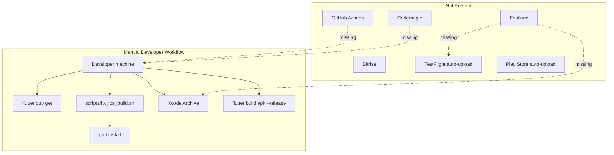

# Flutter Build & CI/CD Audit

**Project:** CasaZero (`d:\Sajid\casazero`)  
**Date:** July 10, 2026  
**Toolchain:** Flutter 3.41.7 · Dart 3.11.5 · AGP 8.9.1 · Gradle 8.12 · Kotlin 2.1.0  
**Scope:** Android/iOS release configs, signing, obfuscation, flavors, versioning, store artifacts, CI/CD platforms  
**Constraint:** Analysis only — no source modifications

---

## Executive Summary

CasaZero has **no automated release pipeline**. Builds are **manual, developer-machine dependent**, with a single helper script (`scripts/fix_ios_build.sh`) for iOS CocoaPods sync. There is **no** GitHub Actions, Codemagic, Fastlane, or Bitrise configuration in the repository.

**Android is not store-ready:** release builds sign with the **debug keystore**, use placeholder `com.example.casazero`, and have **no R8/ProGuard, resource shrinking, or Dart obfuscation**. **AAB production builds are not documented or automated.**

**iOS is partially configured** for manual distribution: development team `2CKF37TSD9`, bundle ID `com.attoexa.casazero`, Archive scheme on Release — but **missing push entitlements**, **malformed Info.plist**, **no ExportOptions.plist**, and **no TestFlight automation**.

| Report | Score |
|--------|-------|
| Android Release Readiness | **22 / 100** |
| iOS Release Readiness | **48 / 100** |
| CI/CD Automation | **5 / 100** |
| **Deployment Score (overall)** | **32 / 100** |

---

## Part A — Release Readiness Report

### A.1 Android

#### Signing

| Item | Status | Evidence |
|------|--------|----------|
| Release keystore | 🔴 **Missing** | No `key.properties`, no `*.jks` / `*.keystore` in repo (correctly gitignored) |
| Release `signingConfig` | 🔴 **Uses debug** | `android/app/build.gradle.kts` L37–39: `signingConfig = signingConfigs.getByName("debug")` |
| `key.properties` template | ⚪ Missing | Not documented in repo |
| Play App Signing | ⚪ Unknown | No upload key configuration |
| `.gitignore` keystore rules | ✅ Present | `android/.gitignore` excludes `key.properties`, `**/*.keystore`, `**/*.jks` |

**Verdict:** Cannot submit to Google Play. Release APK/AAB would be signed with debug credentials.

#### ProGuard / R8

| Item | Status | Evidence |
|------|--------|----------|
| `minifyEnabled` | 🔴 Not set | Defaults to `false` in release `buildTypes` |
| `shrinkResources` | 🔴 Not set | Not present in `build.gradle.kts` |
| `proguard-rules.pro` | 🔴 Missing | No file under `android/app/` |
| Firebase / Flutter keep rules | 🔴 Missing | Required if minify is enabled later |
| Consumer ProGuard from plugins | ⚪ N/A | Plugins may ship rules; unused until minify enabled |

**Verdict:** No code shrinking or obfuscation at Android native layer.

#### Obfuscation (Dart / Flutter)

| Item | Status | Evidence |
|------|--------|----------|
| `--obfuscate` | 🔴 Not used | No references in scripts, docs, or CI |
| `--split-debug-info` | 🔴 Not used | `.gitignore` has `app.*.map.json` placeholder only |
| Tree-shaking | ✅ Default | Flutter release builds tree-shake unused Dart |
| Debug `print()` in release | 🔴 Risk | ~900+ `print()` calls; not stripped (see Code Quality Audit) |

**Recommended release command (not configured):**
```bash
flutter build appbundle --release \
  --obfuscate \
  --split-debug-info=build/app/outputs/symbols
```

#### Build Flavors

| Item | Status | Evidence |
|------|--------|----------|
| `productFlavors` | 🔴 None | Single `defaultConfig` only |
| `flavorDimensions` | 🔴 None | — |
| Environment separation | 🔴 None | API base URL hardcoded; no dev/staging/prod flavors |
| Debug / Profile / Release | ✅ Default Flutter | Standard three `buildTypes`; only `release` customized (signing) |

**Verdict:** No staging vs production build differentiation at Gradle level.

#### Versioning

| Item | Value | Source |
|------|-------|--------|
| `versionName` | `1.0.0` | `pubspec.yaml` → `flutter.versionName` |
| `versionCode` | `1` | `pubspec.yaml` → `flutter.versionCode` |
| CI auto-increment | 🔴 None | Static `1.0.0+1` |
| `--build-name` / `--build-number` overrides | ⚪ Manual only | Supported by Flutter CLI, not scripted |

```19:19:pubspec.yaml
version: 1.0.0+1
```

```31:32:android/app/build.gradle.kts
        versionCode = flutter.versionCode
        versionName = flutter.versionName
```

#### AAB (Android App Bundle)

| Item | Status | Evidence |
|------|--------|----------|
| AAB build documented | 🔴 No | No README or script for `flutter build appbundle` |
| AAB CI artifact | 🔴 No | No CI pipeline |
| Play Console track config | ⚪ Unknown | Not in repo |
| `applicationId` | 🔴 Placeholder | `com.example.casazero` |
| Firebase `google-services.json` package | ⚠️ Matches placeholder | `package_name: com.example.casazero` |
| App icons (`mipmap-*`) | 🔴 Not in repo | Manifest references `@mipmap/ic_launcher`; `flutter_launcher_icons` configured but icons not committed |
| `targetSdk` / `compileSdk` | ✅ Flutter default (36) | Per prior platform audit |
| `minSdk` | ✅ 24 | Flutter default |
| Core library desugaring | ✅ Enabled | Required for notifications |

**Verdict:** AAB can be built locally via `flutter build appbundle`, but output is **not Play Store eligible** due to signing and package ID.

#### Android Release Readiness Matrix

| Criterion | Weight | Score | Weighted |
|-----------|--------|-------|----------|
| Release signing | 25% | 5 | 1.25 |
| ProGuard / R8 / shrink | 20% | 0 | 0.00 |
| Obfuscation | 10% | 10 | 1.00 |
| Flavors / environments | 10% | 0 | 0.00 |
| Versioning | 10% | 60 | 6.00 |
| AAB / store identity | 25% | 15 | 3.75 |
| **Android Total** | **100%** | — | **22 / 100** |

---

### A.2 iOS

#### Certificates & Signing

| Item | Status | Evidence |
|------|--------|----------|
| Development team | ✅ Set | `DEVELOPMENT_TEAM = 2CKF37TSD9` in `project.pbxproj` |
| Bundle identifier | ✅ Production ID | `com.attoexa.casazero` |
| `CODE_SIGN_STYLE` (Runner) | ⚠️ Implicit | Not set on Runner target; inherits Xcode automatic signing |
| `CODE_SIGN_IDENTITY` (project) | ⚠️ Developer | `"iPhone Developer"` — not `"iPhone Distribution"` for project-level Release |
| Manual signing profiles | ⚪ Not configured | No `PROVISIONING_PROFILE_SPECIFIER` on Runner |
| Certificates in repo | ✅ Correctly absent | Not checked in (expected) |
| Entitlements file | 🔴 **Missing** | No `ios/Runner/Runner.entitlements` (macOS has entitlements; iOS does not) |
| Push (`aps-environment`) | 🔴 Missing | Required for production APNs / TestFlight push |
| Associated domains / App Groups | ⚪ None | Not configured |

#### Provisioning

| Item | Status | Evidence |
|------|--------|----------|
| Automatic provisioning | ✅ Likely | Team ID present; standard Flutter automatic flow |
| Provisioning profile pinning | 🔴 None | No CI secrets or `match` |
| Capability sync | 🔴 Incomplete | Background `remote-notification` in Info.plist but no entitlements file |
| Firebase bundle alignment | ✅ | `GoogleService-Info.plist` `BUNDLE_ID` = `com.attoexa.casazero` |

#### Info.plist & Store Compliance

| Item | Status | Evidence |
|------|--------|----------|
| Info.plist validity | 🔴 **Malformed** | Stray `</key>` after location keys (L13) |
| `NSCameraUsageDescription` | 🔴 Missing | Required for `image_picker` camera |
| `NSPhotoLibraryUsageDescription` | ✅ Present | |
| Location usage strings | ✅ Present | Over-declared "always" without matching background mode |
| Privacy Manifest (`PrivacyInfo.xcprivacy`) | 🔴 Missing | Required for App Store (2024+) |
| App icons | 🔴 Missing PNGs | `AppIcon.appiconset/Contents.json` without image files in repo |
| iOS deployment target | ✅ 15.0 | `Podfile` + `project.pbxproj` |

```5:13:ios/Runner/Info.plist
	<key>NSPhotoLibraryUsageDescription</key>
	<string>This app needs access to your photo library so you can upload profile photos and other images.</string>

	<key>NSLocationWhenInUseUsageDescription</key>
	<string>This app uses your location to provide location-based services.</string>

	<key>NSLocationAlwaysAndWhenInUseUsageDescription</key>
	<string>This app may use your location in the background to improve location-based features.</string>
	</key>
```

#### Archive

| Item | Status | Evidence |
|------|--------|----------|
| Xcode scheme | ✅ Configured | `Runner.xcscheme` — `ArchiveAction` uses **Release** |
| Profile build config | ✅ Present | Profile configuration in `project.pbxproj` |
| Bitcode | ✅ Disabled | `ENABLE_BITCODE = NO` (correct for Flutter) |
| Version from Flutter | ✅ | `CURRENT_PROJECT_VERSION = $(FLUTTER_BUILD_NUMBER)` |
| dSYM generation | ✅ Default | `DEBUG_INFORMATION_FORMAT = dwarf-with-dsym` on Profile/Release project settings |
| CocoaPods | ✅ | `Podfile` iOS 15.0; `Podfile.lock` committed |

#### Export & TestFlight

| Item | Status | Evidence |
|------|--------|----------|
| `ExportOptions.plist` | 🔴 Missing | No ad-hoc / app-store / enterprise export config |
| `flutter build ipa` automation | 🔴 None | No scripts or CI |
| TestFlight upload | 🔴 Manual only | No Fastlane `pilot`, no App Store Connect API key config |
| App Store Connect API key | 🔴 Not in repo | Expected via secrets; no CI to consume |
| Upload symbols (dSYM) | 🔴 Not automated | Crashlytics not integrated |

**Manual path today (developer machine):**
1. `sh scripts/fix_ios_build.sh` (optional)
2. Open `ios/Runner.xcworkspace` in Xcode
3. Product → Archive → Distribute App

**Blockers before TestFlight:** Fix Info.plist, add entitlements + push capability, generate app icons, add camera usage string, add Privacy Manifest.

#### iOS Release Readiness Matrix

| Criterion | Weight | Score | Weighted |
|-----------|--------|-------|----------|
| Certificates / team / bundle ID | 20% | 70 | 14.00 |
| Provisioning / entitlements | 20% | 25 | 5.00 |
| Info.plist / privacy compliance | 20% | 35 | 7.00 |
| Archive configuration | 15% | 80 | 12.00 |
| Export / TestFlight readiness | 15% | 20 | 3.00 |
| Icons & assets | 10% | 15 | 1.50 |
| **iOS Total** | **100%** | — | **48 / 100** (rounded) |

---

### A.3 Cross-Platform Identity Mismatch

| Platform | Identifier | Firebase Config |
|----------|------------|-----------------|
| Android | `com.example.casazero` | `google-services.json` matches placeholder |
| iOS | `com.attoexa.casazero` | `GoogleService-Info.plist` matches production ID |

**Impact:** Android and iOS are **different app identities**. Play Store and App Store would list separate apps. Firebase Android app is registered to the placeholder package — changing `applicationId` requires new Firebase Android app registration and updated `google-services.json`.

---

### A.4 Release Readiness Summary

| Gate | Android | iOS |
|------|---------|-----|
| Production signing | 🔴 Blocked | 🟡 Manual (Xcode automatic) |
| Store listing identity | 🔴 Placeholder package | ✅ `com.attoexa.casazero` |
| Code/resource shrinking | 🔴 None | N/A (LLVM/Swift default) |
| Dart obfuscation | 🔴 None | 🔴 None |
| Push notifications (store build) | 🟡 FCM works on debug-signed APK | 🔴 Missing APNs entitlement |
| Privacy / compliance files | 🟡 Permissions declared | 🔴 Privacy Manifest missing |
| Automated artifact | 🔴 None | 🔴 None |
| **Ready for store submit?** | **No** | **No** (manual archive possible for internal testing only) |

---

## Part B — Automation Report

### B.1 CI/CD Platform Inventory

| Platform | Present? | Config Path | Status |
|----------|----------|-------------|--------|
| **GitHub Actions** | ❌ No | `.github/workflows/` — **does not exist** | Not configured |
| **Codemagic** | ❌ No | `codemagic.yaml` — **not found** | Not configured |
| **Fastlane** | ❌ No | `fastlane/`, `Fastfile` — **not found** | Not configured |
| **Bitrise** | ❌ No | `bitrise.yml` — **not found** | Not configured |
| **Firebase Hosting/Functions CI** | ❌ No | `firebase.json` — Flutter platforms only | No deploy pipelines |
| **Local scripts** | ⚠️ Minimal | `scripts/fix_ios_build.sh` | iOS pod sync only |

### B.2 Current Build Automation (What Exists)



#### `scripts/fix_ios_build.sh`

| Step | Action |
|------|--------|
| 1 | `flutter clean` |
| 2 | `flutter pub get` |
| 3 | `cd ios && pod install` |

**Purpose:** Resolve CocoaPods / sandbox sync errors. **Not** a release or deploy pipeline.

### B.3 Recommended CI/CD Pipeline (Not Implemented)

Below is the **target state** for CasaZero based on repo gaps:

#### GitHub Actions (recommended baseline)

| Workflow | Trigger | Steps |
|----------|---------|-------|
| `ci.yml` | PR + push to `main` | `flutter analyze`, `flutter test`, format check |
| `android-release.yml` | Tag `v*` | Decode keystore secret → `flutter build appbundle --obfuscate` → upload AAB artifact |
| `ios-release.yml` | Tag `v*` | macOS runner → `pod install` → `flutter build ipa` → upload to TestFlight via API |

**Secrets required (not configured):**
- `ANDROID_KEYSTORE_BASE64`, `ANDROID_KEY_ALIAS`, `ANDROID_KEY_PASSWORD`, `ANDROID_STORE_PASSWORD`
- `APP_STORE_CONNECT_API_KEY`, `APP_STORE_CONNECT_ISSUER_ID`, `APP_STORE_CONNECT_KEY_ID`
- Optional: `GOOGLE_PLAY_SERVICE_ACCOUNT_JSON`

#### Fastlane (recommended for iOS + Android upload)

| Lane | Purpose |
|------|---------|
| `ios beta` | Build IPA → upload TestFlight |
| `android internal` | Build AAB → upload Play internal track |
| `match` or manual certs | Sync signing assets |

#### Codemagic / Bitrise (alternative)

Either platform could replace GitHub Actions + Fastlane with a single `codemagic.yaml` or Bitrise workflow. **Neither is present.**

### B.4 Quality Gates in CI (Current vs Expected)

| Gate | Current | Expected for Production |
|------|---------|-------------------------|
| `flutter analyze` | 🔴 Not in CI | Block merge on errors |
| `flutter test` | 🔴 Not in CI | Block merge; fix stale `widget_test.dart` (counter boilerplate) |
| Integration tests | 🔴 None | `integration_test/` for auth smoke |
| Dependency audit | 🔴 Manual | `flutter pub outdated` on schedule |
| Release build verification | 🔴 None | Build AAB + IPA on release tags |
| Symbol upload | 🔴 None | dSYM + Dart debug symbols to Crashlytics |
| Lint / format | 🔴 Not enforced | `dart format --set-exit-if-changed` |

### B.5 `firebase.json` Deploy Scope

```1:1:firebase.json
{"flutter":{"platforms":{...}}}
```

**Finding:** `firebase.json` contains **only** FlutterFire code-generation metadata. No `firestore.rules`, `hosting`, or `functions` deploy targets — Firebase rules deploy is manual (documented in `FIREBASE_SETUP.md` only).

### B.6 Automation Report Scorecard

| Capability | Score | Notes |
|------------|-------|-------|
| Continuous integration | 5 | No automated checks on PR |
| Continuous delivery | 0 | No automated store uploads |
| Infrastructure as code | 10 | Gradle/Kotlin DSL only; no CI YAML |
| Secrets management | 0 | No CI secrets; signing assets not documented |
| Reproducible builds | 40 | `pubspec.lock` + `Podfile.lock` committed |
| Release documentation | 25 | Scattered across audit docs; no `RELEASE.md` |
| **CI/CD Automation Total** | **5 / 100** | Essentially manual-only |

---

## Part C — Deployment Score

### C.1 Score Breakdown

| Dimension | Weight | Score | Weighted |
|-----------|--------|-------|----------|
| Android release readiness | 25% | 22 | 5.50 |
| iOS release readiness | 25% | 48 | 12.00 |
| CI/CD automation | 30% | 5 | 1.50 |
| Versioning & artifact strategy | 10% | 55 | 5.50 |
| Security hardening (obfuscation, signing) | 10% | 12 | 1.20 |
| **Deployment Score** | **100%** | — | **32 / 100** (rounded) |

### C.2 Score Interpretation

| Range | Meaning |
|-------|---------|
| 85–100 | Production CD — automated, signed, store-ready |
| 70–84 | Staging-ready — manual release with proper signing |
| 55–69 | Internal testing — local release builds work |
| **30–54** | **Early MVP — manual debug-style releases** ← CasaZero |
| < 30 | Not buildable for distribution |

### C.3 Critical Blockers (P0)

| # | Blocker | Platform | Fix |
|---|---------|----------|-----|
| 1 | Release signed with debug keystore | Android | Create upload keystore + `key.properties` + release `signingConfig` |
| 2 | Placeholder `applicationId` | Android | Change to `com.attoexa.casazero` + new Firebase Android app + `google-services.json` |
| 3 | No CI/CD pipeline | Both | Add GitHub Actions or Codemagic minimum viable pipeline |
| 4 | Malformed `Info.plist` | iOS | Remove stray `</key>` tag |
| 5 | Missing iOS entitlements (APNs) | iOS | Add `Runner.entitlements` with `aps-environment` |
| 6 | Missing `NSCameraUsageDescription` | iOS | Add before App Store review |
| 7 | Missing Privacy Manifest | iOS | Add `PrivacyInfo.xcprivacy` |

### C.4 High Priority (P1)

| # | Item | Platform |
|---|------|----------|
| 8 | Enable R8 `minifyEnabled` + `proguard-rules.pro` | Android |
| 9 | Add `--obfuscate --split-debug-info` to release builds | Both |
| 10 | Generate and commit launcher icons (`flutter pub run flutter_launcher_icons`) | Android |
| 11 | Add `ExportOptions.plist` + `flutter build ipa` script | iOS |
| 12 | Fastlane or App Store Connect API for TestFlight | iOS |
| 13 | `flutter build appbundle` in CI with artifact retention | Android |
| 14 | Add dev/staging/prod flavors + env config | Both |
| 15 | Fix or replace stale `test/widget_test.dart` | CI |

### C.5 Path to Deployment Score 80+

| Phase | Actions | Score Impact |
|-------|---------|--------------|
| **Phase 1 — Unblock stores** | Android signing + package ID; iOS plist/entitlements/icons | +25 |
| **Phase 2 — Harden builds** | R8, Dart obfuscate, remove release logging | +10 |
| **Phase 3 — Automate** | GitHub Actions CI + tagged release workflows | +20 |
| **Phase 4 — Distribute** | Fastlane TestFlight + Play internal track | +15 |

**Target after Phase 1–3:** ~**77 / 100**  
**Target after Phase 4:** ~**85 / 100**

---

## Appendix A — File Reference

| File | Role | Release Status |
|------|------|----------------|
| `android/app/build.gradle.kts` | Android app build | 🔴 Debug signing |
| `android/gradle.properties` | Gradle JVM / AndroidX | ✅ |
| `android/settings.gradle.kts` | AGP 8.9.1, Kotlin 2.1.0 | ✅ |
| `android/.gitignore` | Keystore exclusions | ✅ |
| `pubspec.yaml` | Version `1.0.0+1` | ⚠️ Static |
| `ios/Runner.xcodeproj/project.pbxproj` | Team, bundle ID, archive | 🟡 Partial |
| `ios/Runner/Info.plist` | Permissions | 🔴 Malformed |
| `ios/Runner.xcodeproj/.../Runner.xcscheme` | Archive = Release | ✅ |
| `ios/Podfile` | iOS 15.0 floor | ✅ |
| `scripts/fix_ios_build.sh` | Pod sync helper | ⚠️ Dev only |
| `firebase.json` | FlutterFire config only | ⚪ No deploy CI |
| `test/widget_test.dart` | Default counter test | 🔴 Stale / will fail |

---

## Appendix B — Recommended Release Commands (Not Configured)

### Android AAB (after signing setup)

```bash
flutter build appbundle --release \
  --obfuscate \
  --split-debug-info=build/app/outputs/symbols \
  --build-name=1.0.0 \
  --build-number=1
```

### iOS IPA (after entitlements + export plist)

```bash
flutter build ipa --release \
  --obfuscate \
  --split-debug-info=build/ios/symbols \
  --export-options-plist=ios/ExportOptions.plist
```

### Minimum CI workflow sketch (GitHub Actions)

```yaml
# .github/workflows/ci.yml (NOT PRESENT — recommended)
name: CI
on: [push, pull_request]
jobs:
  analyze-and-test:
    runs-on: ubuntu-latest
    steps:
      - uses: actions/checkout@v4
      - uses: subosito/flutter-action@v2
        with:
          flutter-version: '3.41.7'
      - run: flutter pub get
      - run: flutter analyze
      - run: flutter test
```

---

## Conclusion

CasaZero's release pipeline is **immature**: Android cannot ship to Play Store in its current configuration, iOS can be archived manually on a Mac with an Apple Developer account but lacks entitlements and compliance files for App Store review, and **zero CI/CD automation** exists across GitHub Actions, Codemagic, Fastlane, and Bitrise.

The highest-ROI sequence is: **(1)** Android production signing + real package ID, **(2)** iOS plist/entitlements/privacy fixes, **(3)** GitHub Actions CI on every PR, **(4)** tagged release workflows producing AAB + IPA with obfuscation and symbol artifacts.

**Deployment Score: 32 / 100** — manual MVP builds only; not production deployment ready.

---

*Generated by static analysis of build configs and repository structure. Re-audit after adding signing, CI workflows, or store upload automation.*
