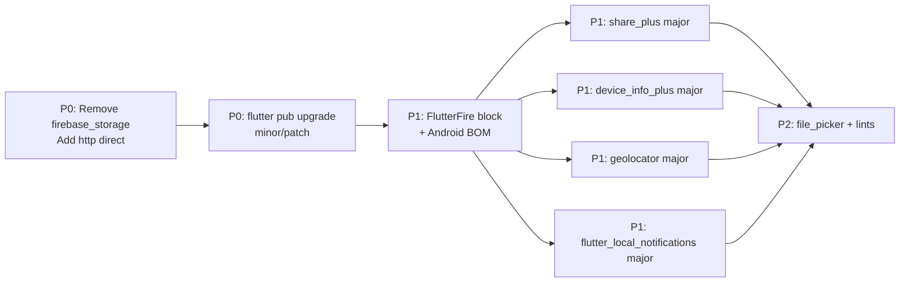

# Flutter Dependency Audit

**Project:** CasaZero (`d:\Sajid\casazero`)  
**Date:** July 10, 2026  
**Toolchain:** Flutter 3.41.7 · Dart 3.11.5  
**Scope:** `pubspec.yaml`, `pubspec.lock`, `flutter pub outdated --json`, static import analysis, Android/iOS native config  
**Constraint:** Analysis only — no source modifications

---

## Executive Summary

CasaZero declares **26 direct dependencies** and **2 dev dependencies**, resolving to **~100 locked packages**. The dependency graph is **functionally coherent** for a GetX + Dio + Firebase production app, but **version currency is weak**: **17 of 26** direct packages have newer resolvable versions, including **5 with major-version gaps**. No packages are discontinued, retracted, or flagged by pub.dev security advisories in the current lockfile.

**Critical findings:**
- `firebase_storage` is declared but **never imported** in `lib/` — yet it still pulls **Firebase Storage native SDKs** on iOS/Android (~2–4 MB APK/IPA overhead estimate).
- `http` is used directly in two services but is only a **transitive** dependency — fragile if a parent package drops it.
- **Firebase version skew**: FlutterFire plugins lag latest; Android Gradle uses Firebase BOM `34.13.0` plus native `firebase-analytics` not mirrored in `pubspec.yaml`.
- **Five packages** are 3+ major versions behind: `device_info_plus`, `geolocator`, `share_plus`, `flutter_local_notifications`, `flutter_lints` (dev).

| Dimension | Score |
|-----------|-------|
| Version Currency | 52 |
| Security Posture | 95 |
| Usage Hygiene | 60 |
| Native / Platform Alignment | 65 |
| SDK Compatibility | 92 |
| Binary Efficiency | 55 |
| **Final Dependency Health Score** | **69 / 100** |

---

## 1. Environment & SDK Compatibility

| Item | Value | Status |
|------|-------|--------|
| `pubspec.yaml` SDK constraint | `^3.9.2` | ✅ Compatible with Dart 3.11.5 |
| Flutter channel | stable 3.41.7 | ✅ Current stable |
| Android `minSdk` | 24 (Flutter default) | ✅ Meets geolocator 10.x; verify before upgrading to geolocator 14 |
| Android `targetSdk` / `compileSdk` | 36 (Flutter default) | ✅ |
| Android Gradle Plugin | 8.9.1 | ✅ |
| Kotlin | 2.1.0 | ✅ |
| iOS deployment target | 15.0 (`Podfile`, `project.pbxproj`) | ✅ Supports all current plugins |
| Core library desugaring | Enabled (`desugar_jdk_libs 2.1.5`) | ✅ Required by `flutter_local_notifications` |

**Verdict:** Flutter/Dart SDK constraints are healthy. No blocking incompatibility detected at current versions.

---

## 2. Security Advisories

Source: `flutter pub outdated --json` advisory flags per locked package.

| Check | Result |
|-------|--------|
| `isCurrentAffectedByAdvisory` | **0 packages** flagged |
| `isCurrentRetracted` | **0 packages** flagged |
| `isDiscontinued` | **0 packages** flagged |

**Notes:**
- Pub.dev advisory integration shows a **clean bill of health** for the current lockfile.
- Security risk is **operational**, not dependency-CVE driven: tokens stored via `get_storage` (plaintext), Bearer tokens logged in `ApiService` (see Network Layer Audit).
- Recommend adding `flutter_secure_storage` for auth tokens — **not present** in `pubspec.yaml`.

---

## 3. Outdated Packages

### 3.1 Direct Dependencies — Version Matrix

| Package | Constraint | Locked | Latest | Gap | Upgradable Now |
|---------|------------|--------|--------|-----|----------------|
| `archive` | ^4.0.0 | 4.0.7 | 4.0.9 | Patch | ✅ |
| `cached_network_image` | ^3.4.1 | 3.4.1 | — | At constraint | — |
| `cloud_firestore` | ^6.1.0 | 6.1.0 | 6.6.0 | Minor | ✅ |
| `cupertino_icons` | ^1.0.8 | 1.0.8 | 1.0.9 | Patch | ✅ |
| `device_info_plus` | ^9.1.1 | 9.1.2 | **13.2.0** | **4 major** | ⚠️ Breaking |
| `dio` | ^5.4.0 | 5.9.0 | 5.10.0 | Minor | ✅ |
| `file_picker` | ^10.3.6 | 10.3.6 | 11.0.2 | Minor | ✅ |
| `firebase_auth` | ^6.1.2 | 6.1.2 | 6.5.4 | Minor | ✅ |
| `firebase_core` | ^4.2.1 | 4.2.1 | 4.11.0 | Minor | ✅ |
| `firebase_messaging` | ^16.0.4 | 16.0.4 | 16.4.1 | Minor | ✅ |
| `firebase_storage` | ^13.0.4 | 13.0.4 | 13.4.3 | Minor | ✅ (or remove) |
| `flutter_animate` | ^4.5.0 | 4.5.2 | — | At constraint | — |
| `flutter_local_notifications` | ^19.5.0 | 19.5.0 | **22.0.1** | **3 major** | ⚠️ Breaking |
| `flutter_screenutil` | ^5.9.0 | 5.9.3 | — | At constraint | — |
| `flutter_svg` | ^2.2.2 | 2.2.2 | 2.3.0 | Minor | ✅ |
| `geolocator` | ^10.1.0 | 10.1.1 | **14.0.3** | **4 major** | ⚠️ Breaking |
| `get` | ^4.7.2 | 4.7.2 | 4.7.3 | Patch | ✅ |
| `get_storage` | ^2.1.1 | 2.1.1 | — | At constraint | — |
| `image_picker` | ^1.2.1 | 1.2.1 | 1.2.3 | Patch | ✅ |
| `intl` | ^0.20.2 | 0.20.2 | 0.20.3 | Patch | ✅ |
| `lucide_icons_flutter` | ^3.1.6 | 3.1.6 | 3.1.14+2 | Patch | ✅ |
| `open_filex` | ^4.4.0 | 4.7.0 | — | At constraint | — |
| `path_provider` | ^2.1.5 | 2.1.5 | 2.1.6 | Patch | ✅ |
| `permission_handler` | ^12.0.1 | 12.0.1 | 12.0.3 | Patch | ✅ |
| `qr_flutter` | ^4.1.0 | 4.1.0 | — | At constraint | — |
| `share_plus` | ^10.1.2 | 10.1.4 | **13.2.0** | **3 major** | ⚠️ Breaking |
| `url_launcher` | ^6.3.1 | 6.3.2 | — | At constraint | — |

### 3.2 Dev Dependencies

| Package | Locked | Latest | Gap |
|---------|--------|--------|-----|
| `flutter_launcher_icons` | 0.13.1 | 0.14.4 | Minor |
| `flutter_lints` | 5.0.0 | **6.0.0** | Major |

### 3.3 Key Transitive Drift

| Package | Locked | Latest | Pulled By |
|---------|--------|--------|-----------|
| `_flutterfire_internals` | 1.3.64 | 1.3.73 | FlutterFire suite |
| `http` | 1.6.0 | — | `cached_network_image`, `flutter_cache_manager` |
| `sqflite` | 2.4.2 | 2.4.3 | `cached_network_image` → `flutter_cache_manager` |

**Summary:** **65%** of direct dependencies (17/26) have newer versions. **5** require major-version migration planning.

---

## 4. Deprecated Packages

| Category | Finding |
|----------|---------|
| Pub.dev discontinued | **None** |
| Retracted versions | **None** in lockfile |
| De facto deprecated patterns | `get_storage` for secrets (use `flutter_secure_storage` instead) |
| Legacy Android permissions | `READ/WRITE_EXTERNAL_STORAGE` with `maxSdkVersion="32"` — correct for API 33+ transition |

No package should be removed solely for deprecation status.

---

## 5. Unused, Missing & Duplicate Packages

### 5.1 Unused Direct Dependencies

| Package | Evidence | Impact |
|---------|----------|--------|
| **`firebase_storage`** | Zero `import` statements in `lib/` | Native Firebase Storage linked on iOS (`Podfile.lock`: `Firebase/Storage 12.4.0`) and Android; wasted binary size |

### 5.2 Low-Value Direct Dependencies

| Package | Usage | Recommendation |
|---------|-------|----------------|
| `cupertino_icons` | Single `CupertinoIcons.back` in `main_scaffold.dart` | Keep or replace with `Icons.arrow_back_ios`; marginal size impact (~50 KB font) |

### 5.3 Missing Recommended Dependencies

| Package | Why | Used By |
|---------|-----|---------|
| **`http`** | Direct imports exist; version not pinned | `device_info_service.dart`, `geocoding_service.dart` |
| **`flutter_secure_storage`** | Auth tokens in plaintext `get_storage` | Security best practice |
| **`connectivity_plus`** | No network reachability layer | Resilience (optional) |
| **`firebase_analytics`** (Flutter) | Android Gradle adds native Analytics only | Cross-platform analytics parity |
| **`package_info_plus`** | App version display / support diagnostics | Optional |

### 5.4 Duplicate / Overlapping Concerns

| Overlap | Packages | Assessment |
|---------|----------|------------|
| HTTP clients | `dio` (REST API) + `http` (geocoding, IP lookup) | Acceptable split; pin `http` directly |
| File selection | `image_picker` + `file_picker` | Intentional — images vs documents |
| File opening | `open_filex` only | No duplicate |
| Firebase Analytics | Android native (`build.gradle.kts`) vs no Flutter plugin | **Inconsistent** — iOS has no equivalent |
| Icon systems | Material + `lucide_icons_flutter` + `flutter_svg` + `cupertino_icons` | Justified by design; `lucide` adds font weight |

---

## 6. Native Compatibility

### 6.1 Android

| Component | Configuration | Compatibility |
|-----------|---------------|---------------|
| `applicationId` | `com.example.casazero` | ⚠️ Placeholder — Play Store blocker |
| Release signing | Debug keys | ⚠️ Production blocker |
| Firebase BOM | `34.13.0` | ⚠️ Should align with FlutterFire upgrade |
| Native Analytics | `firebase-analytics` via Gradle | ✅ Android only |
| Permissions | Location, notifications, media, internet | ✅ Match feature set |
| Desugaring | Enabled | ✅ Required for notifications on API < 26 |
| Duplicate `INTERNET` permission | Lines 4 & 10 in `AndroidManifest.xml` | ⚠️ Harmless but sloppy |

### 6.2 iOS

| Component | Configuration | Compatibility |
|-----------|---------------|---------------|
| Deployment target | 15.0 | ✅ |
| Firebase pods | Core, Auth, Messaging, Firestore, **Storage** | Storage pod from unused `firebase_storage` |
| Push / camera entitlements | Per Cross-Platform Audit | ⚠️ May need entitlements for production |
| `Info.plist` | Malformed entries (prior audit) | ⚠️ Fix before App Store |

### 6.3 FlutterFire ↔ Native Alignment

When upgrading FlutterFire, update **both**:
1. All `firebase_*` / `cloud_firestore` pubspec entries together
2. Android Firebase BOM in `android/app/build.gradle.kts`
3. Run `pod install` on iOS after `flutter pub upgrade`

---

## 7. Binary Size Impact

Qualitative assessment (release APK/IPA contributors):

| Tier | Package(s) | Estimated Impact | Notes |
|------|------------|------------------|-------|
| **High** | Firebase suite (Core, Auth, FCM, Firestore) | +8–15 MB | Core production stack — keep |
| **High (waste)** | `firebase_storage` (unused) | +2–4 MB | **Remove** |
| **Medium** | `lucide_icons_flutter` | +1–3 MB | 7 variable font weights in assets |
| **Medium** | `cached_network_image` + `sqflite` | +1–2 MB | Image disk cache |
| **Medium** | `geolocator` + location services | +0.5–1 MB | Platform location APIs |
| **Low–Medium** | `flutter_local_notifications` | +0.5–1 MB | Native notification channels |
| **Low** | `flutter_animate` | +~100 KB | Pure Dart animations |
| **Low** | `archive` | +~200 KB | ZIP extraction for downloads |
| **Low** | `qr_flutter` | +~100 KB | 2FA QR screens only |
| **Low** | Inter custom fonts (4 weights) | +~400 KB | Declared in `pubspec.yaml` assets |
| **Negligible** | `get`, `dio`, `intl`, `flutter_screenutil` | < 100 KB each | Dart-only |

**Quick wins:** Remove `firebase_storage` (~2–4 MB). Consider subsetting Lucide font weights if package supports it.

---

## 8. Usage Verification (Direct Dependencies)

| Package | Import Count (files) | Feature Area |
|---------|---------------------|--------------|
| `get` / `get_storage` | Widespread | DI, routing, local storage |
| `dio` | Via `ApiService` | REST API |
| `firebase_core` | `main.dart` | Bootstrap |
| `firebase_auth` | Auth services | Authentication |
| `firebase_messaging` | `FcmService` | Push notifications |
| `cloud_firestore` | Chat, presence | Real-time data |
| `firebase_storage` | **0** | **Unused** |
| `flutter_local_notifications` | `FcmService` | Local notification display |
| `cached_network_image` | ~6 files | Profile, hero, tickets |
| `flutter_svg` | Widespread | Asset icons |
| `flutter_animate` | ~20 files | UI motion |
| `lucide_icons_flutter` | 2 files | Nav bar, building selector |
| `image_picker` | Profile, maintenance | Photo capture |
| `file_picker` | Documents, maintenance | Document upload |
| `permission_handler` | FCM, downloads, location | Runtime permissions |
| `geolocator` | Login, trusted devices | Location |
| `device_info_plus` | Device fingerprinting | Trusted devices |
| `path_provider` | Downloads, ZIP | File paths |
| `open_filex` | `file_opener_service.dart` | Open downloaded files |
| `archive` | `zip_download_service.dart` | ZIP extraction |
| `share_plus` | Documents, notifications | Share sheets |
| `url_launcher` | Hub, profile, tickets | External links |
| `qr_flutter` | 4 files | 2FA setup |
| `intl` | 1 file | Date formatting in maintenance dialog |
| `cupertino_icons` | 1 reference | Back button icon |

---

## 9. Dependency Matrix

| Package | Type | Locked | Latest | Status | Usage | Android | iOS | Size | Security |
|---------|------|--------|--------|--------|-------|---------|-----|------|----------|
| `firebase_core` | Direct | 4.2.1 | 4.11.0 | 🟡 Outdated | Active | ✅ | ✅ | High | ✅ |
| `firebase_auth` | Direct | 6.1.2 | 6.5.4 | 🟡 Outdated | Active | ✅ | ✅ | High | ✅ |
| `firebase_messaging` | Direct | 16.0.4 | 16.4.1 | 🟡 Outdated | Active | ✅ | ✅ | High | ✅ |
| `cloud_firestore` | Direct | 6.1.0 | 6.6.0 | 🟡 Outdated | Active | ✅ | ✅ | High | ✅ |
| `firebase_storage` | Direct | 13.0.4 | 13.4.3 | 🔴 Unused | **None** | Native linked | Pod linked | High waste | ✅ |
| `dio` | Direct | 5.9.0 | 5.10.0 | 🟡 Outdated | Active | ✅ | ✅ | Low | ✅ |
| `get` | Direct | 4.7.2 | 4.7.3 | 🟢 Minor | Active | ✅ | ✅ | Low | ✅ |
| `get_storage` | Direct | 2.1.1 | — | 🟢 Current | Active | ✅ | ✅ | Low | ⚠️ Plaintext |
| `flutter_local_notifications` | Direct | 19.5.0 | 22.0.1 | 🔴 Major behind | Active | ✅ | ✅ | Med | ✅ |
| `device_info_plus` | Direct | 9.1.2 | 13.2.0 | 🔴 Major behind | Active | ✅ | ✅ | Low | ✅ |
| `geolocator` | Direct | 10.1.1 | 14.0.3 | 🔴 Major behind | Active | ✅ | ✅ | Med | ✅ |
| `share_plus` | Direct | 10.1.4 | 13.2.0 | 🔴 Major behind | Active | ✅ | ✅ | Low | ✅ |
| `permission_handler` | Direct | 12.0.1 | 12.0.3 | 🟡 Outdated | Active | ✅ | ✅ | Low | ✅ |
| `cached_network_image` | Direct | 3.4.1 | — | 🟢 Current | Active | ✅ | ✅ | Med | ✅ |
| `image_picker` | Direct | 1.2.1 | 1.2.3 | 🟡 Outdated | Active | ✅ | ✅ | Low | ✅ |
| `file_picker` | Direct | 10.3.6 | 11.0.2 | 🟡 Outdated | Active | ✅ | ✅ | Low | ✅ |
| `path_provider` | Direct | 2.1.5 | 2.1.6 | 🟡 Outdated | Active | ✅ | ✅ | Low | ✅ |
| `open_filex` | Direct | 4.7.0 | — | 🟢 Current | Active | ✅ | ✅ | Low | ✅ |
| `archive` | Direct | 4.0.7 | 4.0.9 | 🟡 Outdated | Active | ✅ | ✅ | Low | ✅ |
| `flutter_svg` | Direct | 2.2.2 | 2.3.0 | 🟡 Outdated | Active | ✅ | ✅ | Low | ✅ |
| `flutter_animate` | Direct | 4.5.2 | — | 🟢 Current | Active | ✅ | ✅ | Low | ✅ |
| `flutter_screenutil` | Direct | 5.9.3 | — | 🟢 Current | Active | ✅ | ✅ | Low | ✅ |
| `lucide_icons_flutter` | Direct | 3.1.6 | 3.1.14+2 | 🟡 Outdated | Active | ✅ | ✅ | Med | ✅ |
| `qr_flutter` | Direct | 4.1.0 | — | 🟢 Current | Active | ✅ | ✅ | Low | ✅ |
| `intl` | Direct | 0.20.2 | 0.20.3 | 🟡 Outdated | Low (1 file) | ✅ | ✅ | Low | ✅ |
| `cupertino_icons` | Direct | 1.0.8 | 1.0.9 | 🟡 Outdated | Minimal | ✅ | ✅ | Low | ✅ |
| `url_launcher` | Direct | 6.3.2 | — | 🟢 Current | Active | ✅ | ✅ | Low | ✅ |
| `http` | **Transitive** | 1.6.0 | — | ⚠️ Unpinned | 2 services | ✅ | ✅ | Low | ✅ |
| `flutter_lints` | Dev | 5.0.0 | 6.0.0 | 🔴 Major behind | Dev only | — | — | — | ✅ |
| `flutter_launcher_icons` | Dev | 0.13.1 | 0.14.4 | 🟡 Outdated | Dev only | — | — | — | ✅ |

**Legend:** 🟢 Current or patch-only · 🟡 Minor outdated · 🔴 Major behind or unused · ⚠️ Risk note

---

## 10. Upgrade Priority

### P0 — Immediate (this sprint)

| # | Action | Rationale | Effort |
|---|--------|-----------|--------|
| 1 | **Remove `firebase_storage`** from `pubspec.yaml` | Zero Dart usage; removes native Storage SDK from iOS/Android builds | Low |
| 2 | **Add `http` as direct dependency** | `device_info_service.dart` and `geocoding_service.dart` import it; prevents silent breakage | Low |
| 3 | **Run `flutter pub upgrade`** for safe minor/patch bumps | `dio`, `firebase_*`, `archive`, `intl`, `permission_handler`, `get`, `lucide_icons_flutter`, etc. | Low |

### P1 — High (next release)

| # | Action | Rationale | Effort |
|---|--------|-----------|--------|
| 4 | **Upgrade FlutterFire suite as a block** | Align `firebase_core`, `firebase_auth`, `firebase_messaging`, `cloud_firestore` + Android BOM | Medium |
| 5 | **Upgrade `share_plus` 10 → 13** | 3 major versions behind; API/share sheet changes likely | Medium |
| 6 | **Upgrade `device_info_plus` 9 → 13** | Trusted-device fingerprinting; breaking platform API changes | Medium |
| 7 | **Upgrade `geolocator` 10 → 14** | Login location; verify `minSdk` and iOS permission strings | Medium |
| 8 | **Upgrade `flutter_local_notifications` 19 → 22** | FCM local display; check Android 13+ channel APIs | Medium |
| 9 | **Add `flutter_secure_storage`** | Replace plaintext token storage in `get_storage` | Medium |

### P2 — Medium (scheduled maintenance)

| # | Action | Rationale | Effort |
|---|--------|-----------|--------|
| 10 | Upgrade `file_picker` 10 → 11 | Document upload paths; test scoped storage | Low–Med |
| 11 | Upgrade `flutter_lints` 5 → 6 | New lint rules; may surface existing issues | Low |
| 12 | Upgrade `flutter_launcher_icons` 0.13 → 0.14 | Dev tooling only | Low |
| 13 | Add `firebase_analytics` Flutter plugin OR remove Android-only Gradle analytics | Consistent cross-platform telemetry | Low |
| 14 | Align Android Firebase BOM with FlutterFire release notes | Prevent native/Dart SDK mismatch | Low |

### P3 — Low (optional polish)

| # | Action | Rationale | Effort |
|---|--------|-----------|--------|
| 15 | Evaluate `cupertino_icons` removal | Single icon usage | Low |
| 16 | Audit `lucide_icons_flutter` font weights shipped | Reduce APK asset size | Low |
| 17 | Consider `connectivity_plus` for offline UX | Network layer has no reachability check | Low |
| 18 | Deduplicate `INTERNET` permission in `AndroidManifest.xml` | Cleanup only | Trivial |

### Recommended Upgrade Order (dependency-safe)



---

## 11. Risk Register

| Risk | Severity | Mitigation |
|------|----------|------------|
| Major upgrades break trusted-device flow | High | Test `device_info_plus` + `geolocator` on physical Android/iOS |
| FlutterFire upgrade breaks FCM token registration | High | Staged rollout; test `FcmService` end-to-end |
| Transitive `http` removed by parent package | Medium | Pin `http` in `pubspec.yaml` |
| `firebase_storage` native SDK bloat | Medium | Remove unused dependency |
| Firebase BOM / FlutterFire version skew | Medium | Upgrade in single PR with release notes |
| `share_plus` 13 breaking share intents | Medium | Test document share + notification share flows |
| Tokens in `get_storage` | High (security) | Add `flutter_secure_storage` (separate security workstream) |

---

## 12. Final Health Score Breakdown

| Category | Weight | Score | Weighted |
|----------|--------|-------|----------|
| Version Currency | 25% | 52 | 13.0 |
| Security Posture | 20% | 95 | 19.0 |
| Usage Hygiene | 15% | 60 | 9.0 |
| Native / Platform Alignment | 20% | 65 | 13.0 |
| SDK Compatibility | 10% | 92 | 9.2 |
| Binary Efficiency | 10% | 55 | 5.5 |
| **Total** | **100%** | — | **68.7 → 69** |

### Score Interpretation

| Range | Meaning |
|-------|---------|
| 85–100 | Production-grade dependency hygiene |
| 70–84 | Acceptable with planned upgrade cadence |
| **55–69** | **Functional but accumulating technical debt** ← CasaZero |
| < 55 | High risk of breakage, bloat, or security gaps |

### Path to 85+

1. Remove `firebase_storage` and add direct `http` → **+3** (usage + binary)
2. Complete P0 + P1 upgrades (FlutterFire block + 4 major packages) → **+10** (currency + native)
3. Add `flutter_secure_storage`, align analytics → **+3** (security + platform)
4. Establish quarterly `flutter pub outdated` review → sustained

**Target score after P0+P1:** ~**82 / 100**

---

## 13. Commands Reference

```bash
# Check outdated packages
flutter pub outdated

# Safe upgrade within constraints
flutter pub upgrade

# Major version upgrade (review changelogs first)
flutter pub upgrade --major-versions

# Verify dependency tree
flutter pub deps --style=tree

# After Firebase upgrades
cd ios && pod install && cd ..
flutter build apk --release   # verify Android
flutter build ios --release   # verify iOS
```

---

## 14. Conclusion

CasaZero's dependency stack is **appropriate for its architecture** (GetX, Dio, Firebase, file/media handling) and shows **no pub.dev security advisories** on the current lockfile. The primary gaps are **version staleness** (especially FlutterFire and four major-version laggards), **one unused Firebase package inflating native binaries**, and **missing direct pins** for packages the app imports (`http`).

Addressing **P0 items alone** (remove `firebase_storage`, pin `http`, minor upgrades) is low-effort and improves health by ~5 points. Completing **P1** brings the project into the **acceptable production band (80+)** with manageable migration testing.

---

*Generated by static analysis. Re-run `flutter pub outdated` after any `pubspec.yaml` change.*
