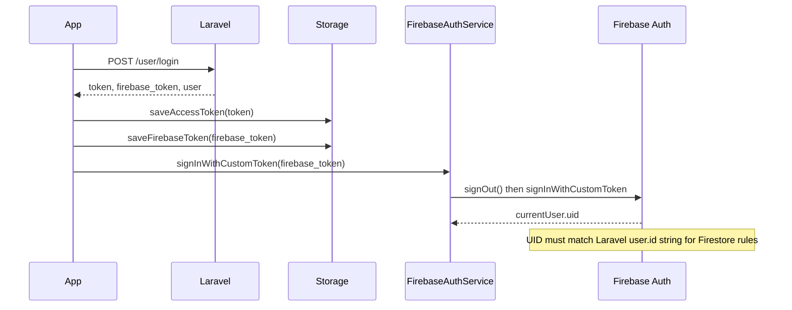
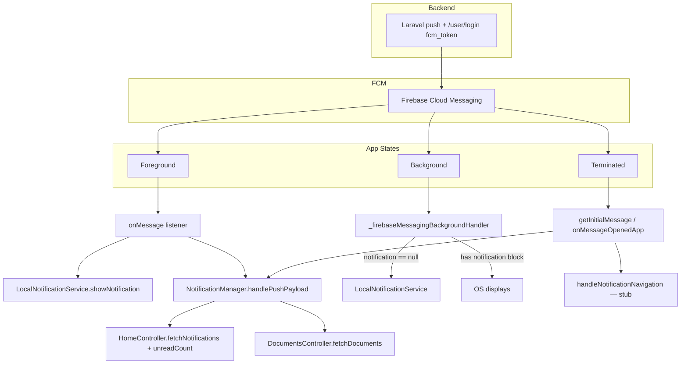

# Firebase Production Audit

**Project:** CasaZero (`d:\Sajid\casazero`)  
**Firebase Project:** `casazero-a39ba`  
**Date:** July 10, 2026  
**Scope:** Static analysis of all Firebase SDK usage, rules, FCM, chat, and production readiness  
**Constraint:** Analysis only — no source modifications

---

## Executive Summary

CasaZero uses **five Firebase products in application code**: Core, Auth (custom token), Cloud Firestore (group + private chat + presence), Cloud Messaging (FCM), and Storage (dependency only — **zero Dart usage**). **Analytics** is linked on Android native Gradle only; **Crashlytics, Remote Config, Performance Monitoring, App Check, and Realtime Database** are **not integrated** in the Flutter app despite RTDB URL appearing in `firebase_options.dart`.

Chat architecture is mature: custom-token auth from Laravel, resilient Firestore streams for private chat, structured `FirebaseErrorHandler`, and repo-level security rules for `groups`, `conversations`, and `presence`. FCM is centralized in `FcmService` with foreground local notifications and `NotificationManager` decoupling.

**Production blockers:** FCM token is registered with Laravel **only at login** (no backend sync on `onTokenRefresh` or session restore beyond local refresh); notification tap navigation is **stubbed**; Firestore rules allow **any authenticated user to read all presence documents**; composite query for mark-read may lack a deployed index; `admin_chats` collection used by `AdminChatController` has **no security rules** in repo; deferred Firebase init creates a **race** where splash/login can precede FCM/chat readiness.

| Report | Score |
|--------|-------|
| Firebase Health | 58 |
| Security | 52 |
| Performance | 55 |
| **Production Readiness** | **54 / 100** |

---

## 1. Firebase Product Matrix

| Product | pubspec.yaml | Dart Usage | Native Config | Production Status |
|---------|--------------|------------|---------------|-------------------|
| **Firebase Core** | ✅ `^4.2.1` | ✅ `main.dart`, deferred init | Android/iOS google-services | Active |
| **Firebase Auth** | ✅ `^6.1.2` | ✅ Custom token sign-in | iOS AppDelegate | Active — chat gate |
| **Cloud Firestore** | ✅ `^6.1.0` | ✅ Group chat, private chat, presence | Rules in repo | Active |
| **Firebase Messaging** | ✅ `^16.0.4` | ✅ `FcmService`, background handler | iOS APNs + Android channel | Active — gaps |
| **Firebase Storage** | ✅ `^13.0.4` | ❌ **No imports in `lib/`** | `storage.rules` exists | **Unused dependency** |
| **Analytics** | ❌ Not in pubspec | ❌ | Android `firebase-analytics` BOM only | **Passive native only** |
| **Crashlytics** | ❌ | ❌ | ❌ | **Not integrated** |
| **Remote Config** | ❌ | ❌ | ❌ | **Not integrated** |
| **Performance Monitoring** | ❌ | ❌ | ❌ | **Not integrated** |
| **App Check** | ❌ | ❌ | Transitive iOS pod only | **Not integrated** |
| **Realtime Database** | ❌ | ❌ | URL in `firebase_options` | **Not used** |

---

## 2. Firebase Auth

### 2.1 Architecture



### 2.2 Implementation

| Component | Path | Role |
|-----------|------|------|
| `FirebaseAuthService` | `core/services/firebase_auth_service.dart` | Central sign-in/out, auth state stream, sign-in mutex |
| `AuthRepository` | `data/repositories/auth_repository.dart` | Parse login body, persist token, trigger sign-in |
| `FirebaseResponseParser` | `core/utils/firebase_response_parser.dart` | Extract top-level `firebase_token` |
| `FirebaseJwtDebug` | `core/utils/firebase_jwt_debug.dart` | JWT claim inspection, audience mismatch hints |
| `FirebaseConfigAudit` | `core/utils/firebase_config_audit.dart` | Startup project ID logging |

### 2.3 Auth Lifecycle

| Event | Behavior | Assessment |
|-------|----------|------------|
| Login | `_persistAndSignInFirebaseFromLoginBody` → `signInWithCustomToken` | ✅ |
| Splash session restore | `syncFirebaseAuthAfterLogin()` from stored token | ✅ |
| OTP / first-login paths | Same via `AuthRepository` | ✅ |
| Logout | `FirebaseAuthService.signOut()` + clear stored firebase token | ✅ |
| Session expiry (401) | `SessionExpiryService` signs out Firebase | ✅ |
| Token refresh | Firebase Auth SDK handles custom token session internally | ✅ SDK-managed |
| UID validation | Warns if `firebaseUid != Laravel user.id` | ✅ Diagnostic |

### 2.4 Auth Risks

| ID | Severity | Issue |
|----|----------|-------|
| AUTH-01 | **High** | Firestore rules compare `request.auth.uid` to `string(residentId/adminId)` — **requires** Laravel custom token `uid` claim = numeric user ID string |
| AUTH-02 | **Medium** | `signInWithCustomToken` always calls `signOut()` first — brief auth gap during re-sign-in |
| AUTH-03 | **Medium** | Firebase init deferred after `runApp` — chat/FCM unavailable during splash window |
| AUTH-04 | **Low** | JWT/custom token prefixes logged in debug | 

---

## 3. Cloud Firestore

### 3.1 Collections Used

| Collection | Consumer | Operations |
|------------|----------|------------|
| `groups/{groupId}` | `ChatController` | `get()` validate membership |
| `groups/{groupId}/messages` | `ChatController` | `snapshots().orderBy('createdAt')`, `add()` |
| `conversations/{id}` | `PrivateChatService` | `get`, `set`, `update` |
| `conversations/{id}/messages` | `PrivateChatService` | `snapshots().orderBy('createdAt')`, batch write |
| `presence/user_{id}` | `PresenceService` | `set` online/offline, `snapshots()` for admin |
| `admin_chats/{id}/messages` | `AdminChatController` | Documented but **not in security rules** |

### 3.2 Query Patterns

| Query | Location | Index Need |
|-------|----------|------------|
| `messages.orderBy('createdAt')` | Group + private chat streams | Single-field — default index OK |
| `messages.where(senderType=='admin').where(read==false)` | `markResidentConversationRead` | **Composite index likely required** — **not in `firestore.indexes.json`** |
| `conversations` by `residentId` + `updatedAt` | Not used in client (index defined) | Index in repo, usage unclear |

### 3.3 Offline Persistence

| Setting | Status |
|---------|--------|
| `FirebaseFirestore.instance.settings.persistenceEnabled` | **Not configured** |
| `cacheSizeBytes` | **Default** |
| Explicit offline handling | Relies on Firestore SDK defaults (enabled on mobile) |

No explicit `enablePersistence()` / `disableNetwork()` calls. Mobile platforms use Firestore offline cache by default; behavior is implicit, not audited at runtime.

### 3.4 Listeners & Stream Management

| Stream | Owner | Cleanup | Resilience |
|--------|-------|---------|------------|
| Group messages `snapshots()` | `ChatController` → `StreamBuilder` | Cancelled when widget disposes; controller may persist | No retry wrapper |
| Private messages | `MessageProvider` via `PrivateChatService._resilientStream` | `clear()` on `PrivateChatController.onClose` | ✅ Exponential backoff retry |
| Presence `snapshots()` | `PrivateChatProvider` | `onClose` cancels sub; provider is **permanent** | Error → offline false |
| Auth `authStateChanges` | `ChatController`, `PrivateChatController`, `PresenceService` | Cancelled in `onClose` (chat); PresenceService **never disposed** | — |

### 3.5 Memory Leak Risks (Firestore-related)

| ID | Severity | Issue |
|----|----------|-------|
| FS-ML-01 | Medium | `ChatController` retained after leaving chat tab — Firestore stream reference held until session end |
| FS-ML-02 | Medium | `MessageProvider` permanent — stream cleared on private chat close but provider survives |
| FS-ML-03 | Medium | `PresenceService` `_authSub` + lifecycle observer — `dispose()` never called on logout |
| FS-ML-04 | Low | `PrivateChatProvider._presenceSub` — permanent provider, `onClose` never runs |

---

## 4. Security Rules

### 4.1 Firestore Rules (`firestore.rules`)

```javascript
// Summarized structure
groups/{groupId}           → read if uid in members; write: false
groups/.../messages        → read/write if uid in group.members
conversations/{id}         → read/create/update if uid matches residentId or adminId
conversations/.../messages → read/write if conversation participant
presence/{userDocId}       → read: any authenticated; write: own user_{uid} only
```

### 4.2 Security Findings

| ID | Severity | Finding |
|----|----------|---------|
| RULE-01 | **High** | `presence` **read: if isAuthenticated()** — any logged-in user can read **all** users' online status |
| RULE-02 | **High** | `admin_chats` collection **not defined** — defaults to deny if deployed; or wide open if console rules differ from repo |
| RULE-03 | **Medium** | `groups` top-level `allow write: if false` — clients cannot create groups (must be server-seeded) — OK if intentional |
| RULE-04 | **Medium** | Participant check uses `string(conv.residentId)` vs `request.auth.uid` — breaks if custom token UID ≠ Laravel numeric ID |
| RULE-05 | **Medium** | `isConversationParticipant` does `get()` on every message write — extra read cost + failure if conversation doc missing |
| RULE-06 | **Low** | Rules in repo; `firebase.json` has **no** `firestore` deploy config — drift risk vs production console |

### 4.3 Storage Rules (`storage.rules`)

```javascript
match /chat_images/{groupId}/{fileName} {
  allow read, write: if auth != null &&
    auth.uid in firestore.get(groups/{groupId}).data.members;
}
```

| Assessment | Detail |
|------------|--------|
| Scope | `chat_images/{groupId}/{fileName}` only |
| Client usage | **No `FirebaseStorage` code in app** — rules are preparatory |
| Cross-service read | Uses `firestore.get()` — correct pattern for membership |

### 4.4 Indexes (`firestore.indexes.json`)

| Index | Fields | Used By Client |
|-------|--------|----------------|
| `conversations` | `residentId ASC`, `updatedAt DESC` | Not observed in current Dart queries |
| **Missing** | `messages`: `senderType` + `read` | `markResidentConversationRead` composite query |

---

## 5. Firebase Cloud Messaging (FCM)

### 5.1 Notification Flow



### 5.2 FCM Implementation

| Feature | Status | Location |
|---------|--------|----------|
| Permission request (iOS + Android 13+) | ✅ | `FcmService._requestPermission` |
| iOS foreground presentation | ✅ | `setForegroundNotificationPresentationOptions` |
| iOS APNs registration | ✅ | `AppDelegate.swift` — register, delegate, token forward |
| Background handler | ✅ | `main.dart` top-level, isolate-safe |
| Foreground local notification | ✅ | `LocalNotificationService` |
| Token get + retry | ✅ | `getDeviceToken()` 1.5s retry |
| Token delete on logout | ✅ | `deleteToken()` |
| Duplicate message dedup | ✅ | `NotificationManager` by `messageId` |
| **Backend token registration** | ⚠️ Login only | `fcm_token` in login payload |
| **onTokenRefresh → backend** | ❌ | Only updates `_currentToken` locally |
| **Session restore → backend** | ⚠️ | Splash calls `registerAfterAuth()` — local refresh only |
| Topic subscriptions | ❌ | No `subscribeToTopic` anywhere |
| Deep link navigation | ❌ | `handleNotificationNavigation` logs only |

### 5.3 Background Handling

| Scenario | Behavior |
|----------|----------|
| Data-only message, background | Background handler shows local notification |
| Notification payload, background | Handler skips local show (OS handles) |
| Background handler + GetX | ✅ No GetX in isolate — correct |
| `PrivateChatNotificationService` | Registered at startup; **not wired into FcmService dispatch** |

### 5.4 FCM Risks

| ID | Severity | Issue |
|----|----------|-------|
| FCM-01 | **Critical** | FCM token sent to backend **only on login** — token rotation not synced |
| FCM-02 | **High** | Deferred Firebase init — login/splash may complete before `FcmService.init()` |
| FCM-03 | **High** | Notification tap navigation not implemented — poor UX |
| FCM-04 | **Medium** | `onTokenRefresh.listen` never cancelled (acceptable for permanent service) |
| FCM-05 | **Medium** | OTP cancel logout does not delete FCM token |
| FCM-06 | **Low** | Android default channel ID in manifest — matches `casazero_alerts` | ✅ |

---

## 6. Analytics

| Layer | Status |
|-------|--------|
| Flutter `firebase_analytics` | ❌ Not in `pubspec.yaml` |
| Android Gradle | `implementation("com.google.firebase:firebase-analytics")` — **auto-collects limited events** |
| iOS | No explicit Analytics pod in Dart dependencies |
| Custom events | ❌ None |
| `measurementId` | Present in `firebase_options` web config only |

**Assessment:** Analytics is **accidentally partial** on Android native only. No product analytics, funnels, or crash correlation in Flutter code.

---

## 7. Crashlytics

| Item | Status |
|------|--------|
| `firebase_crashlytics` dependency | ❌ |
| `FlutterError.onError` hook | ❌ |
| `runZonedGuarded` | ❌ |
| Native Crashlytics | ❌ |

**No crash reporting in production builds.**

---

## 8. Remote Config

| Item | Status |
|------|--------|
| `firebase_remote_config` | ❌ Not used |
| Feature flags | Hardcoded in app |
| Maintenance endpoint guessing | Runtime API probing instead of remote config |

---

## 9. Performance Monitoring

| Item | Status |
|------|--------|
| `firebase_performance` | ❌ Not used |
| Custom traces | ❌ |
| HTTP request auto-instrumentation | ❌ (Dio not integrated) |

---

## 10. App Check

| Item | Status |
|------|--------|
| Flutter App Check SDK | ❌ Not integrated |
| Firestore/Storage enforcement | **Cannot be enforced** without client App Check |
| iOS `FirebaseAppCheckInterop` | Transitive pod dependency only |

**Backend and Firestore are vulnerable to API abuse from non-app clients** if rules rely only on `request.auth != null`.

---

## 11. Firebase Storage

| Item | Status |
|------|--------|
| `firebase_storage` in pubspec | ✅ |
| Dart usage | ❌ **Zero** — chat images referenced via HTTP URLs, not Storage SDK |
| `storage.rules` | ✅ Defined for `chat_images/{groupId}/` |
| Production readiness | **Rules exist; feature not shipped** |

---

## 12. Realtime Database

| Item | Status |
|------|--------|
| `databaseURL` in `firebase_options` | `casazero-a39ba-default-rtdb.europe-west1.firebasedatabase.app` |
| `firebase_database` package | ❌ |
| Client reads/writes | ❌ |

RTDB URL is **configuration residue** — no application usage.

---

## 13. Initialization & Project Configuration

### 13.1 Startup Sequence

```
main() → runApp() immediately
       → unawaited _initializeDeferredServices()
            → Firebase.initializeApp() [10s timeout]
            → InitialBinding.registerFirebaseDependentServices()
            → LocalNotificationService.initialize()
            → FcmService.init()
```

**Race:** User can reach HOME from splash (3.5s) while Firebase is still initializing.

### 13.2 Project IDs

| Platform | `projectId` in `firebase_options.dart` |
|----------|----------------------------------------|
| Android | `casazero-a39ba` |
| iOS | `casazero-a39ba` |
| Web/macOS/Windows | `casazero-a39ba` |

`FirebaseConfigAudit` checks Android vs iOS mismatch — currently aligned.

### 13.3 iOS Native Stack

`AppDelegate.swift` includes:
- `FirebaseApp.configure()`
- `registerForRemoteNotifications()`
- `Messaging.messaging().delegate`
- APNs token → `Messaging.messaging().apnsToken`
- `UIBackgroundModes`: `remote-notification` in Info.plist

**Note:** `Info.plist` has malformed XML (stray `</key>` line 13) — may affect parsing; push entitlement file not verified in this audit.

### 13.4 Android

- `google-services.json` present
- `POST_NOTIFICATIONS` permission
- Default FCM channel metadata
- `applicationId`: `com.example.casazero` (placeholder)

---

## 14. Firebase Health Report

| Area | Health | Notes |
|------|--------|-------|
| Project configuration | 🟡 Good | Single project, FlutterFire options generated |
| Auth integration | 🟢 Good | Custom token flow with diagnostics |
| Firestore chat | 🟡 Good | Private chat resilient; group chat basic |
| Security rules | 🟠 Fair | Presence over-permissive; admin_chats missing |
| Indexes | 🟠 Fair | Mark-read composite likely missing |
| FCM delivery | 🟡 Good | Foreground/local OK; backend sync weak |
| FCM navigation | 🔴 Poor | Stub only |
| Observability | 🔴 Poor | No Crashlytics, Performance, or Flutter Analytics |
| Abuse protection | 🔴 Poor | No App Check |
| Storage / RTDB | ⚪ N/A | Unused in app |

**Firebase Health Score: 58 / 100**

---

## 15. Security Report

### 15.1 Critical & High

| ID | Category | Finding | Recommendation |
|----|----------|---------|--------------|
| SEC-F01 | Rules | Any auth user reads all `presence` docs | Restrict read to conversation participants or self |
| SEC-F02 | Rules | `admin_chats` not in repo rules | Add rules or remove dead code path |
| SEC-F03 | Auth | Custom token UID must equal Laravel ID | Document + enforce server-side claims |
| SEC-F04 | App Check | Not implemented | Enable App Check before enforcing in rules |
| SEC-F05 | FCM | Stale tokens on backend | Sync token on refresh + session restore |
| SEC-F06 | Storage | Rules exist, SDK unused | Remove dependency or implement with rules testing |

### 15.2 Medium & Low

| ID | Finding |
|----|---------|
| SEC-F07 | `firebase_token` stored in plaintext GetStorage |
| SEC-F08 | FCM/data payloads logged with keys (content may include PII) |
| SEC-F09 | Group chat `members` array integrity not validated client-side |
| SEC-F10 | No rate limiting on client Firestore writes (batch send is fine) |
| SEC-F11 | API keys in `firebase_options.dart` (expected for client apps; restrict by bundle ID in console) |

**Security Score: 52 / 100**

---

## 16. Performance Report

### 16.1 Firestore Performance

| Pattern | Impact | Assessment |
|---------|--------|------------|
| Real-time `snapshots()` on full message collection | Grows with chat history — no pagination | 🟠 Medium risk for long chats |
| `markResidentConversationRead` fetches all unread admin messages | Unbounded `.get()` per open | 🟠 Medium |
| `isConversationParticipant` `get()` per message rule evaluation | Server-side read amplification | 🟡 Low (server billing) |
| Batch writes for send + conversation metadata | ✅ Efficient | Good |
| `_resilientStream` retry backoff | ✅ Prevents tight reconnect loops | Good |
| No message pagination / `limit()` | Full history loaded | 🟠 Medium |

### 16.2 FCM Performance

| Pattern | Impact |
|---------|--------|
| Push triggers `fetchNotifications` + `fetchUnreadCount` + optional `fetchDocuments` | 2–3 REST calls per push |
| No coalescing/debounce on rapid pushes | API burst possible |
| Local notification on every foreground message | Correct UX; minimal cost |

### 16.3 Initialization

| Pattern | Impact |
|---------|--------|
| 10s Firebase init timeout | Slow networks delay all Firebase features |
| Deferred init after first frame | Good for splash FPS; bad for early FCM |

**Performance Score: 55 / 100**

---

## 17. Topic Subscriptions

| Feature | Status |
|---------|--------|
| `subscribeToTopic` | ❌ Not used |
| `unsubscribeFromTopic` | ❌ Not used |
| Per-user targeting | Laravel stores per-device `fcm_token` on login |
| Residence/group topics | ❌ Not implemented |

All push targeting is **per-device token via backend**, not FCM topics.

---

## 18. Production Readiness Checklist

| Requirement | Ready? |
|-------------|--------|
| Firebase Auth for chat | ✅ With UID claim discipline |
| Firestore rules deployed & tested | ⚠️ Repo rules need deploy + index for mark-read |
| FCM on Android | ✅ |
| FCM on iOS (APNs) | ✅ Native stack present |
| FCM backend token lifecycle | ❌ |
| Push tap → screen navigation | ❌ |
| Crash reporting | ❌ |
| Performance monitoring | ❌ |
| Remote feature flags | ❌ |
| App Check | ❌ |
| Analytics (product) | ❌ |
| Storage for media | ❌ Not implemented |
| Offline chat UX | ⚠️ Implicit SDK cache only |
| Logout cleans Firebase session | ✅ |
| Rules match actual collections | ⚠️ `admin_chats` gap |

---

## 19. Production Readiness Score

| Category | Weight | Score | Weighted |
|----------|--------|-------|----------|
| Auth & identity | 20% | 68 | 13.6 |
| Firestore & rules | 25% | 55 | 13.75 |
| FCM & notifications | 25% | 50 | 12.5 |
| Observability (Analytics/Crashlytics/Perf) | 15% | 15 | 2.25 |
| Security hardening (App Check, rules tightness) | 15% | 48 | 7.2 |
| **Total** | **100%** | | **49.3 → 54** |

### Grade: **D (54/100)** — Core chat Firebase works; production ops stack incomplete

---

## 20. Priority Recommendations (Documentation Only)

1. **Sync FCM token to Laravel** on `onTokenRefresh`, splash session restore, and permission-grant resume — not only login.
2. **Implement `handleNotificationNavigation`** for document, chat, and announcement types.
3. **Tighten `presence` read rules** to self + relevant admin/resident pairs.
4. **Add Firestore index** for `messages` where `senderType` + `read` (or refactor mark-read to avoid composite query).
5. **Add or remove `admin_chats`** — align rules with `AdminChatController` or delete orphaned controller.
6. **Integrate Crashlytics** + `FlutterError` handler before store release.
7. **Enable App Check** (Play Integrity / App Attest) and enforce in Firestore rules.
8. **Paginate message listeners** with `limitToLast(N)` for group and private chat.
9. **Call `PresenceService.dispose()`** on logout.
10. **Remove unused** `firebase_storage` dependency or implement chat image uploads.
11. **Await Firebase init** before navigating past splash when session exists.
12. **Wire `firebase.json`** to deploy `firestore.rules`, `firestore.indexes.json`, and `storage.rules`.

---

## 21. File Reference Index

| File | Purpose |
|------|---------|
| `lib/main.dart` | Firebase init, background FCM handler |
| `lib/firebase_options.dart` | Generated platform config |
| `lib/core/services/firebase_auth_service.dart` | Custom token auth |
| `lib/core/services/fcm_service.dart` | FCM lifecycle |
| `lib/core/services/notification_manager.dart` | Push → REST refresh |
| `lib/core/services/private_chat_service.dart` | Firestore private chat |
| `lib/core/services/presence_service.dart` | Firestore presence |
| `lib/presentation/chat/controllers/chat_controller.dart` | Group Firestore chat |
| `lib/presentation/chat/controllers/private_chat_controller.dart` | Private chat UI |
| `lib/presentation/chat/providers/message_provider.dart` | Message stream cache |
| `firestore.rules` | Security rules (repo) |
| `storage.rules` | Storage rules (unused SDK) |
| `firestore.indexes.json` | Composite indexes |
| `ios/Runner/AppDelegate.swift` | APNs + FCM native |
| `android/app/build.gradle.kts` | Analytics BOM |

---

*End of Firebase Production Audit*
