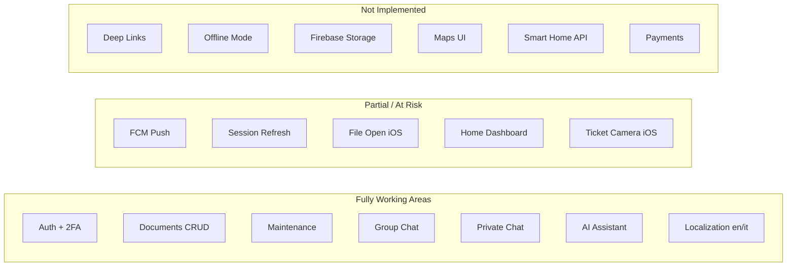

# Flutter Functionality Audit Report

**Project:** CasaZero  
**Audit date:** July 9, 2026  
**Scope:** Full Flutter codebase (`lib/`), Android native config (`android/`), iOS native config (`ios/`)  
**Method:** Static code analysis only — no source modifications, no runtime device testing  
**Backend:** `https://backend.casazero.site/api` (Laravel REST) — API behavior inferred from client code; live backend verification was not performed  

---

## Executive Summary

CasaZero is a **GetX-based Flutter resident portal** (~206 Dart files) integrating a **Laravel REST API** for business data and **Firebase** (Auth, Firestore, FCM) for realtime chat and push notifications. The app covers authentication (including 2FA and trusted devices), home/residence dashboard, construction progress timeline, documents, maintenance, support tickets, group + private chat, AI assistant, and profile/settings.

**Android** is the more complete platform: native file handling, notification channel configuration, and storage permissions are largely in place. Core user journeys are implemented end-to-end in Dart.

**iOS** has several **production-blocking native gaps**: malformed `Info.plist`, missing `NSCameraUsageDescription`, missing Push Notifications entitlements (`aps-environment`), and an incomplete native file-opener MethodChannel (only one of three Android methods is implemented).

**Cross-platform blockers** include: refresh tokens never persisted at login (silent token refresh will fail), FCM tokens not re-registered with the backend after session restore, push notification tap navigation stubbed, hardcoded development credentials in the login screen, and Android release builds signed with debug keys using placeholder package ID `com.example.casazero`.

| Platform | Readiness | Summary |
|----------|-----------|---------|
| **Android** | **74 / 100** | Core features implemented; release signing, security hygiene, and notification deep-navigation need work |
| **iOS** | **66 / 100** | Same Dart features as Android, but native config gaps break camera capture and may block reliable push |
| **Overall** | **70 / 100** | Functional MVP on Android; iOS and production hardening required before store release |

---

## Platform Compatibility Overview

---

## Feature Matrix

| Feature | Android | iOS | Status | Notes |
|---------|---------|-----|--------|-------|
| **Splash Screen** | ✅ | ✅ | Fully Working | 3.5s branded splash; auto-routes to home if token + user data exist (`splash_controller.dart`) |
| **Login (email/password)** | ✅ | ✅ | Fully Working | Device info, geolocation, FCM token sent on login (`auth_repository.dart`) |
| **Logout** | ✅ | ✅ | Fully Working | API logout + Firebase sign-out + FCM token delete + storage clear (`profile_controller.dart`) |
| **Session auto-restore** | ✅ | ✅ | Fully Working | Splash restores session from `GetStorage` (`splash_controller.dart`) |
| **Token refresh (401)** | 🔴 | 🔴 | Not Working | Interceptor exists but `saveRefreshToken()` never called at login (`auth_repository.dart` has no refresh token handling) |
| **First-login setup** | ✅ | ✅ | Fully Working | Password + 2FA setup route (`first_login_setup_screen.dart`) |
| **OTP verification** | ✅ | ✅ | Fully Working | Login, forgot-password, 2FA flows (`otp_verification_controller.dart`) |
| **Forgot / reset password** | ✅ | ✅ | Fully Working | Named routes + validators (`forgot_password_controller.dart`) |
| **2FA management** | ✅ | ✅ | Fully Working | Activation, deactivation, method change screens |
| **Trusted devices** | ✅ | ✅ | Fully Working | List/revoke via API (`trusted_devices_controller.dart`) |
| **Firebase initialization** | ✅ | ✅ | Fully Working | Deferred init with 10s timeout; app continues if Firebase fails (`main.dart`) |
| **Firebase Auth (custom token)** | ✅ | ✅ | Fully Working | Laravel returns `firebase_token` → `signInWithCustomToken` (`firebase_auth_service.dart`) |
| **FCM push (receive)** | 🟡 | 🟡 | Partially Working | Foreground/background handlers implemented; iOS needs entitlements; tap navigation stubbed |
| **FCM token backend sync** | 🟡 | 🟡 | Partially Working | Token sent only on `POST /user/login`; `registerAfterAuth()` refreshes locally only (`fcm_service.dart` L2–3, L91–101) |
| **Local notifications** | ✅ | ✅ | Fully Working | Channel `casazero_alerts` on Android; Darwin settings on iOS (`local_notification_service.dart`) |
| **In-app notifications list** | ✅ | ✅ | Fully Working | Fetch, mark read, delete, unread badge (`home_controller.dart`, `notifications_modal.dart`) |
| **Notification tap → navigate** | 🔴 | 🔴 | Not Working | Chat/ticket handlers are TODO stubs; FCM `handleNotificationNavigation()` only logs (`notification_manager.dart` L50–58) |
| **Firestore group chat** | ✅ | ✅ | Fully Working | Text-only realtime via `groups/{groupId}/messages` (`chat_controller.dart`) |
| **Firestore private admin chat** | ✅ | ✅ | Fully Working | `conversations/{id}/messages` via `PrivateChatScreen` (`private_chat_service.dart`) |
| **Chat image/file attachments** | ⚪ | ⚪ | Not Implemented | `sendTextMessage()` only in all chat controllers |
| **Chat presence (online)** | ✅ | ✅ | Fully Working | Firestore `presence/user_{id}` (`presence_service.dart`) |
| **Home / residence dashboard** | 🟡 | 🟡 | Partially Working | Hero, welcome, construction timeline active; QuickTiles, LatestNotifications, ViewAllBuildings commented out (`home_screen.dart` L51–128) |
| **Residence switching** | ✅ | ✅ | Fully Working | `HomeController` residence selector |
| **Construction progress timeline** | ✅ | ✅ | Fully Working | API-driven vertical timeline when `underConstruction` (`construction_progress_section.dart`) |
| **Documents list / search / filter** | ✅ | ✅ | Fully Working | Client-side search + category filter (`documents_screen.dart`) |
| **Document upload** | ✅ | ✅ | Fully Working | Multipart or base64 via `document_repository.dart` |
| **Document download** | ✅ | 🟡 | Partially Working | Android has full native chooser + MediaStore indexing; iOS native channel lacks `openWithChooser` (`MainActivity.kt` vs `AppDelegate.swift`) |
| **Encrypted ZIP download** | ✅ | ✅ | Fully Working | Download, extract, password prompt, open via `OpenFilex` (`zip_download_service.dart`) |
| **Document delete** | ✅ | ✅ | Fully Working | API `deleteDocument` wired (`documents_controller.dart` L772) |
| **Document share** | ✅ | ✅ | Fully Working | `share_plus` (`documents_controller.dart`) |
| **Maintenance task list / filter** | ✅ | ✅ | Fully Working | Categories, counts, residence-scoped (`maintenance_controller.dart`) |
| **Maintenance task create** | ✅ | ✅ | Fully Working | File attachment via `file_picker`, max 10MB |
| **Support tickets list** | ✅ | ✅ | Fully Working | Filter by status (`tickets_controller.dart`) |
| **Support ticket create** | ✅ | 🟡 | Partially Working | Gallery photos work; **camera capture broken on iOS** (missing `NSCameraUsageDescription`) |
| **CasaZero AI chat** | ✅ | ✅ | Fully Working | REST `/casazero-ai/send-message` + history (`ai_repository.dart`) |
| **Ecosystem Hub** | ✅ | ✅ | Fully Working | Permission-filtered cards → AI, chat, tickets (`hub_controller.dart`) |
| **Profile view / edit** | ✅ | ✅ | Fully Working | API-backed profile CRUD (`profile_repository.dart`) |
| **Profile photo upload** | ✅ | ✅ | Fully Working | `ImagePicker` gallery + multipart upload (`profile_controller.dart`) |
| **Notification preference toggles** | ✅ | ✅ | Fully Working | Synced to API (`profile_repository.dart` L53–56) |
| **Language switch (en/it)** | ✅ | ✅ | Fully Working | `LocaleController` + backend sync |
| **Document password** | ✅ | ✅ | Fully Working | Dedicated screens + 2FA verification route |
| **Smart Home** | ⚪ | ⚪ | Not Implemented | Mock local device state only (`smart_home_screen.dart` L58–79) |
| **Maps (embedded)** | ⚪ | ⚪ | Not Implemented | No `google_maps_flutter` in `pubspec.yaml` |
| **Location (login device info)** | ✅ | ✅ | Fully Working | `geolocator` when-in-use; falls back to `0,0` if denied (`device_info_service.dart`) |
| **Geocoding (trusted devices)** | ✅ | ✅ | Fully Working | OpenStreetMap Nominatim HTTP (`geocoding_service.dart`) |
| **Deep links / universal links** | ⚪ | ⚪ | Not Implemented | No URL schemes, App Links, or `app_links` package |
| **Firebase Storage** | ⚪ | ⚪ | Not Implemented | Dependency in `pubspec.yaml` but zero Dart usage |
| **Firebase Realtime Database** | ⚪ | ⚪ | Not Implemented | URL in config only; no Dart usage |
| **Offline support** | ⚪ | ⚪ | Not Implemented | No connectivity layer; Firestore implicit cache only |
| **Payments** | ⚪ | ⚪ | Not Implemented | Notification type label only (`notification_item.dart`) |
| **Demo controls panel** | ⚪ | ⚪ | Not Implemented | `DemoHomeWrapper` exists but is **not wired** into `MainScaffold` |
| **Background services** | 🟡 | 🟡 | Partially Working | FCM Dart isolate handler only; no native foreground services |
| **Form validation** | ✅ | ✅ | Fully Working | `Validators` class used in auth, password, maintenance dialogs |
| **Accessibility** | 🟡 | 🟡 | Partially Working | `accessibility.dart` helpers + some `Semantics` widgets; not app-wide |
| **Responsive / tablet layout** | ✅ | ✅ | Fully Working | `ScreenUtil`, `TabletCenteredLayout`, responsive dialogs |

---

## Android Audit

### Configuration summary

| Item | Status | Evidence |
|------|--------|----------|
| `minSdk` | 24 | Flutter default (`build.gradle.kts`) |
| `targetSdk` / `compileSdk` | 36 | Flutter default |
| `applicationId` | `com.example.casazero` | Placeholder — TODO in Gradle (L25–26) |
| Firebase `google-services.json` | ✅ Present | Package matches `applicationId` |
| Google Services plugin | ✅ Applied | `build.gradle.kts` L6–7 |
| Release signing | 🔴 Debug keys | `signingConfig = debug` (L37–39) |
| ProGuard / R8 minification | ⚪ Not configured | No `proguard-rules.pro` |

### Permissions declared (`AndroidManifest.xml`)

| Permission | Declared | Used by app |
|------------|----------|-------------|
| `INTERNET` | ✅ (duplicate entry) | API, downloads |
| `ACCESS_FINE_LOCATION` | ✅ | Login device tracking |
| `ACCESS_COARSE_LOCATION` | ✅ | Login device tracking |
| `POST_NOTIFICATIONS` | ✅ | FCM (Android 13+) |
| `READ_MEDIA_IMAGES` | ✅ | Gallery / image picker |
| `READ/WRITE_EXTERNAL_STORAGE` | ✅ (maxSdk 32) | Legacy storage |
| `CAMERA` | ❌ Not in project manifest | Used via `ImageSource.camera` in tickets — may be merged from `image_picker` plugin at build time |
| `READ_MEDIA_VIDEO/AUDIO` | ❌ | Not needed for current flows |

### Intent filters & deep links

- **Launcher only** — no `VIEW` intent filters, no App Links, no custom URL schemes.

### Notification channels

- Manifest default FCM channel: `casazero_alerts`
- Dart creates matching channel in `local_notification_service.dart` with max importance, sound, vibration, lights.

### Native platform channel

`MainActivity.kt` implements full file-opener channel:
- `showOpenCancelConfirmation`
- `openWithChooser`
- `indexFileInMediaStore` (API 29+)

`FileProvider` configured with `file_paths.xml` (external, files, cache paths).

### Android-specific findings

| Finding | Severity |
|---------|----------|
| Release builds use debug signing | Critical |
| Placeholder `com.example.casazero` package ID | Critical |
| Hardcoded login credentials in `auth_controller.dart` | Critical |
| `CAMERA` not explicitly declared (plugin merge dependency) | Medium |
| Duplicate `INTERNET` permission | Minor |
| No deep link intent filters | Medium (if product requires inbound links) |

---

## iOS Audit

### Configuration summary

| Item | Status | Evidence |
|------|--------|----------|
| Minimum iOS | 15.0 | `Podfile` |
| Bundle ID | `com.attoexa.casazero` | `firebase_options.dart` L70, `GoogleService-Info.plist` |
| `GoogleService-Info.plist` | ✅ Present | Aligned with bundle ID |
| Entitlements file | ❌ Missing | No `*.entitlements` under `ios/` |
| Push capability (`aps-environment`) | ❌ Missing | Required for production APNs |
| `Info.plist` validity | 🔴 Malformed | Stray `</key>` on line 13 |

### Permission usage descriptions (`Info.plist`)

| Key | Status | App usage |
|-----|--------|-----------|
| `NSPhotoLibraryUsageDescription` | ✅ | Profile photo, ticket gallery |
| `NSCameraUsageDescription` | ❌ **Missing** | `ImageSource.camera` in `create_ticket_dialog.dart` |
| `NSMicrophoneUsageDescription` | ❌ Not needed | App uses `pickImage` only |
| `NSLocationWhenInUseUsageDescription` | ✅ | Login geolocation |
| `NSLocationAlwaysAndWhenInUseUsageDescription` | ⚠️ Over-declared | Dart only requests when-in-use; no background location mode |

### Background modes

- `remote-notification` declared — appropriate for FCM background delivery.

### AppDelegate (`AppDelegate.swift`)

| Capability | Status |
|------------|--------|
| `FirebaseApp.configure()` | ✅ |
| APNs registration | ✅ `registerForRemoteNotifications()` |
| APNs token → FCM | ✅ |
| `MessagingDelegate` | ✅ (logs token) |
| File opener channel | 🟡 `showOpenCancelConfirmation` only — **no** `openWithChooser` or `indexFileInMediaStore` |
| URL / universal link handlers | ❌ |

### iOS-specific findings

| Finding | Severity |
|---------|----------|
| Malformed `Info.plist` (stray `</key>`) | Critical |
| Missing `NSCameraUsageDescription` | Critical |
| Missing Push Notifications entitlements | Critical |
| Incomplete file-opener MethodChannel vs Android | Medium |
| `NSLocationAlwaysAndWhenInUseUsageDescription` without background location usage | Minor |
| Bundle ID mismatch vs Android (`com.attoexa.casazero` vs `com.example.casazero`) | Medium (operational, not runtime-breaking on either platform alone) |

---

## Working Features

The following are **fully implemented in Dart** with evidence of complete API/Firebase integration. Backend success depends on live API availability (not verified in this audit).

### Authentication & security
- Email/password login with device fingerprinting (device ID, name, platform, IP, lat/lng, FCM token)
- First-login password + 2FA setup flow
- OTP verification (login, forgot password, 2FA)
- Change password, forgot password, reset password
- 2FA activation, deactivation, method management
- Trusted device list and revocation
- Document password management with 2FA verification
- Session expiry handling on 401 (`session_expiry_service.dart`)
- Firebase custom-token sign-in after Laravel login

### Home & residence
- Residence hero image and welcome section
- Residence name display and switching
- Construction progress timeline (API `status-with-phases`) with phase status, linked documents, external URL launch
- Pull-to-refresh on home

### Documents
- Category filtering and text search
- Upload (multipart/base64)
- Download with progress tracking
- Encrypted ZIP download with password dialog
- Delete with confirmation
- Share via system share sheet

### Maintenance
- Task listing with category filters and counts
- Create task with optional file attachment (10MB limit)
- Residence-scoped data tied to selected residence

### Support tickets
- Issue type fetch from API
- Ticket list with status filter
- Create ticket with title, description, category, priority, photos (gallery)

### Chat
- Chat hub (group vs admin selection)
- Group/residence chat (Firestore realtime, text messages, avatars)
- Private resident ↔ admin chat (Firestore `conversations` collection)
- Online presence indicators
- Laravel notification trigger on new messages (`notification_repository.dart`)

### AI, Hub, Profile
- CasaZero AI send/receive with message history
- Hub ecosystem cards (AI, chat, assistenza) with permission gating
- Profile CRUD, image upload, language preference, notification toggles
- Logout

### Infrastructure
- GetX state management, named routes, in-scaffold navigation
- English and Italian localization (~1900 translation keys)
- Error toasts via `MessagePopupController`
- Loading states on major screens
- Portrait orientation lock (deferred init in `main.dart`)

---

## Partially Working Features

| Feature | Platform(s) | Root cause |
|---------|-------------|------------|
| **Token refresh** | Both | `ApiService._refreshToken()` reads `getRefreshToken()` but `auth_repository.dart` never calls `saveRefreshToken()` on login — refresh path always fails |
| **FCM backend registration after restore** | Both | `registerAfterAuth()` only refreshes local token; comment states backend registration is login-only (`fcm_service.dart`) |
| **Push notification tap navigation** | Both | `NotificationManager.handleNotificationNavigation()` logs only; `home_controller.dart` chat/ticket/AI notification handlers are TODO stubs |
| **Private chat push handler** | Both | `PushTypes.privateChatMessage` case is empty (`notification_manager.dart` L38–40) |
| **Home dashboard completeness** | Both | `QuickTiles`, `LatestNotifications`, `ViewAllBuildingsCard`, `WelcomeMessage` commented out in `home_screen.dart` |
| **Ticket camera capture** | iOS | `NSCameraUsageDescription` missing from `Info.plist` — iOS will reject/deny camera access |
| **Document file open (native chooser)** | iOS | `AppDelegate.swift` lacks `openWithChooser`; falls back to `OpenFilex` which may auto-open without chooser (`file_opener_service.dart` L76–85) |
| **FCM on iOS physical devices** | iOS | No `aps-environment` entitlement; APNs registration may fail without Xcode Push capability |
| **Accessibility** | Both | Helpers exist (`accessibility.dart`) but coverage is limited to some widgets (app bar, buttons, construction progress, notifications) |
| **Android CAMERA permission** | Android | Not in checked-in manifest; relies on `image_picker` manifest merger — verify on release build |
| **AI screen ticket integration** | Both | TODO handlers for ticket creation/tap in `ai_screen.dart` L503, L578 |

---

## Not Working Features

| Feature | Platform(s) | Root cause |
|---------|-------------|------------|
| **Silent session refresh** | Both | Refresh token never persisted at login (see above) |
| **Notification → chat screen** | Both | `onNotificationChat()` only prints debug log (`home_controller.dart` L692–697) |
| **Notification → tickets screen** | Both | `onNotificationAssistance()` only prints debug log (`home_controller.dart` L700–705) |
| **Ticket camera on iOS** | iOS | Missing `NSCameraUsageDescription` in `Info.plist` |

*Note: Features marked "not working" are broken due to **confirmed missing or stubbed client code/config**. API-dependent failures cannot be ruled in or out without backend testing.*

---

## Missing Features

| Feature | Evidence |
|---------|----------|
| **Deep links / universal links** | No `app_links`, no URL schemes in manifests/plist, no AppDelegate link handlers |
| **Firebase Storage usage** | `firebase_storage` in `pubspec.yaml` only — no Dart imports |
| **Firebase Realtime Database** | Config URL present; no Dart usage |
| **Embedded maps** | No maps package in dependencies |
| **Offline-first / connectivity handling** | No `connectivity_plus` or response caching layer |
| **Payment processing** | No payment SDK or API integration |
| **Smart Home backend** | `SmartHomeScreen` uses hardcoded local `Device` list |
| **Chat file/image attachments** | Text-only `sendTextMessage()` in all chat controllers |
| **Demo controls in production UI** | `DemoHomeWrapper` not referenced from `main_scaffold.dart` |
| **Biometric authentication** | No `local_auth` package |
| **FCM token update endpoint** | No API constant for post-login token registration |
| **Automated tests** | Only default `widget_test.dart` placeholder |

---

## Critical Issues

| # | Severity | Platform | Feature | Description | Root cause | Recommended fix |
|---|----------|----------|---------|-------------|------------|-----------------|
| 1 | **Critical** | Both | Security | Hardcoded email/password pre-filled in login controller | Dev credentials left in production path (`auth_controller.dart` L44–47) | Remove pre-filled values; use empty `TextEditingController()` |
| 2 | **Critical** | Both | Session / token refresh | Access token cannot be refreshed after 401 | `saveRefreshToken()` never called at login; `auth_repository.dart` has no `refresh` handling | Parse and persist `refresh_token` from login response body |
| 3 | **Critical** | Android | Release build | Release APK/AAB signed with debug keys | `build.gradle.kts` L37–39 | Configure production keystore and signing config |
| 4 | **Critical** | Android | Distribution | Placeholder application ID `com.example.casazero` | Gradle TODO not completed | Set production `applicationId` and update `google-services.json` |
| 5 | **Critical** | iOS | Build / config | Malformed `Info.plist` | Stray `</key>` on line 13 | Remove erroneous closing tag; validate plist with `plutil` |
| 6 | **Critical** | iOS | Camera / tickets | Camera capture will fail on iOS | `NSCameraUsageDescription` not in `Info.plist` | Add camera usage description string |
| 7 | **Critical** | iOS | Push notifications | APNs may not work on physical devices | No `Runner.entitlements` with `aps-environment`; no Push capability in project | Enable Push Notifications in Xcode; add entitlements for Debug/Release |
| 8 | **High** | Both | Push reliability | FCM token not sent to backend after session restore | `registerAfterAuth()` only caches token locally | Add backend endpoint call on splash restore and token refresh |
| 9 | **High** | Both | Notifications UX | Tapping push does not navigate to relevant screen | `handleNotificationNavigation()` stubbed | Implement route mapping by `type` payload field |

---

## Medium Priority Issues

| # | Platform | Feature | Description | Root cause |
|---|----------|---------|-------------|------------|
| 1 | iOS | File downloads | Native "Open with" chooser incomplete | `AppDelegate` missing `openWithChooser` / `indexFileInMediaStore` handlers |
| 2 | Both | Home screen | Dashboard sections disabled | `QuickTiles`, `LatestNotifications`, etc. commented out in `home_screen.dart` |
| 3 | Both | FCM | Private chat pushes not handled | Empty handler in `notification_manager.dart` |
| 4 | Both | Chat architecture | Unused `AdminChatScreen` / `admin_chats` collection | `MainScaffold` uses `PrivateChatScreen` instead; dead code path |
| 5 | Both | Bundle IDs | Android `com.example.casazero` vs iOS `com.attoexa.casazero` | Incomplete Android rebranding |
| 6 | Android | Manifest | `CAMERA` not explicitly declared | Relies on plugin manifest merge — verify on release build |
| 7 | Both | Downloads | Separate Dio clients without 401 interceptor | `download_service.dart`, `zip_download_service.dart`, `document_repository.dart` download path |
| 8 | iOS | Location | Over-declared always location key | `NSLocationAlwaysAndWhenInUseUsageDescription` without background location usage |
| 9 | Both | AI | Ticket shortcuts in AI screen not wired | TODO in `ai_screen.dart` |
| 10 | Both | Dependencies | Unused `firebase_storage` dependency | Increases binary size without functionality |
| 11 | Android | Deep links | No App Links configuration | Product cannot open app from web/email links |
| 12 | iOS | Deep links | No universal links / URL schemes | Same as above |

---

## Minor Issues

| # | Area | Description |
|---|------|-------------|
| 1 | UI/UX | `delete_functionality_coming_soon` translation key exists but document delete is implemented — stale copy |
| 2 | UI/UX | Folder typo: `documents/viwes`, `ai/viwes` instead of `views` |
| 3 | UI/UX | Construction progress "View buildings" navigates to AI screen, not buildings list (`home_screen.dart` L95) |
| 4 | UI/UX | `notifications_modal.dart` comments say "Chat screen not implemented" but chat exists — misleading comments; handlers still stubbed |
| 5 | Config | Duplicate `INTERNET` permission in Android manifest |
| 6 | Config | Default language inconsistency: `StorageService` defaults `'it'`, `AppConstants.DEFAULT_LANGUAGE = 'en'` (unused) |
| 7 | Config | macOS `firebase_options.dart` uses `com.example.casazero` while iOS uses `com.attoexa.casazero` |
| 8 | Security | Extensive `print()` debug logging including API tokens in `api_service.dart` L44–45 |
| 9 | Testing | No meaningful unit/widget/integration tests beyond Flutter template |
| 10 | UX | Smart Home accessible in navigation stack but shows mock data — may confuse users if reached |
| 11 | Accessibility | `Semantics` not applied consistently across all interactive elements |
| 12 | Android | No `VIBRATE` permission — notification vibration may be inconsistent on some OEMs |

---

## Production Readiness Assessment

Ratings: **1 = Poor**, **3 = Acceptable**, **5 = Production-ready**

| Category | Score | Notes |
|----------|-------|-------|
| **Authentication** | 3/5 | Full flow implemented; refresh token gap and hardcoded dev credentials block production |
| **Security** | 2/5 | Dev credentials in source, debug signing, token logging, placeholder package ID |
| **Crash resistance** | 3/5 | Firebase init has timeout/fallback; malformed iOS plist is a crash risk at parse time |
| **Platform compatibility** | 3/5 | Android stronger; iOS native gaps for camera and push |
| **Offline handling** | 1/5 | No explicit offline strategy; Firestore cache only |
| **Error handling** | 4/5 | Consistent repository patterns, `ApiService` error mapping, Firebase error handler |
| **Performance** | 3/5 | Maintenance file size limits; no profiling evidence; large translation file |
| **Responsive UI** | 4/5 | ScreenUtil, tablet layouts, responsive dialogs |
| **Accessibility** | 2/5 | Partial Semantics and touch-target helpers |
| **Localization** | 5/5 | Full en/it coverage with backend sync |
| **App lifecycle** | 4/5 | FCM lifecycle observer, app status API, portrait lock |
| **Background execution** | 3/5 | FCM background Dart handler; no native background services |
| **Permission flow** | 3/5 | Runtime requests for location, notifications, storage; iOS camera missing |
| **Notification reliability** | 2/5 | Receive works; tap navigation broken; iOS entitlements missing; token re-sync gap |

---

## Recommended Action Plan

### Phase 1 — Production blockers (before any store submission)

1. Remove hardcoded credentials from `auth_controller.dart`.
2. Persist `refresh_token` from login response in `auth_repository.dart`.
3. Fix iOS `Info.plist` malformed XML.
4. Add `NSCameraUsageDescription` to iOS `Info.plist`.
5. Add iOS Push Notifications capability and `Runner.entitlements` with `aps-environment`.
6. Configure Android release signing and production `applicationId`.
7. Implement FCM token re-registration API call on splash session restore.

### Phase 2 — User experience gaps

1. Implement `NotificationManager.handleNotificationNavigation()` and wire `home_controller` notification handlers to `AppScreen.chat`, `AppScreen.tickets`, etc.
2. Implement private chat push handler in `NotificationManager`.
3. Uncomment or redesign home dashboard sections (`QuickTiles`, `LatestNotifications`).
4. Port `openWithChooser` to iOS `AppDelegate.swift` for parity with Android file opening.

### Phase 3 — Technical debt

1. Remove unused `firebase_storage` dependency or implement storage feature.
2. Consolidate download Dio clients to use shared auth interceptor.
3. Remove or wire `AdminChatScreen` / `admin_chats` dead code.
4. Add `app_links` if inbound deep linking is a product requirement.
5. Replace `print()` debug statements with conditional logging.
6. Add integration tests for auth, documents, and chat flows.

### Phase 4 — Backend verification (outside Flutter repo)

1. Verify login response includes `refresh_token` field expected by `ApiService`.
2. Confirm FCM payload `type` values match `NotificationManager` / `PushTypes` constants.
3. Validate construction phases, maintenance, and ticket APIs against staging environment.
4. Confirm APNs key uploaded to Firebase Console for iOS push.

---

## Final Score

| Metric | Score |
|--------|-------|
| **Android Readiness** | **74 / 100** |
| **iOS Readiness** | **66 / 100** |
| **Overall Production Readiness** | **70 / 100** |

### Scoring rationale

**Android (74):** Core business features (auth, documents, maintenance, tickets, chat, AI, profile) are implemented with working API and Firebase integrations. Android native configuration for notifications, FileProvider, and file opening is solid. Deductions for security hygiene (dev credentials, debug release signing, placeholder package ID), broken token refresh, stubbed notification navigation, and missing deep links.

**iOS (66):** Dart feature parity with Android, but native configuration gaps materially reduce confidence: malformed plist, missing camera permission string, missing push entitlements, and incomplete file-opener channel. Same cross-platform issues (token refresh, notification navigation) apply.

**Overall (70):** The app is a functional MVP suitable for internal/staging testing on Android. Production store release requires resolving critical security and iOS native configuration issues, plus notification navigation and session refresh fixes. Backend-dependent behavior was not runtime-tested; scores reflect **client-side implementation completeness only**.

---

*Report generated by static analysis of the CasaZero Flutter repository. No source code was modified during this audit.*
