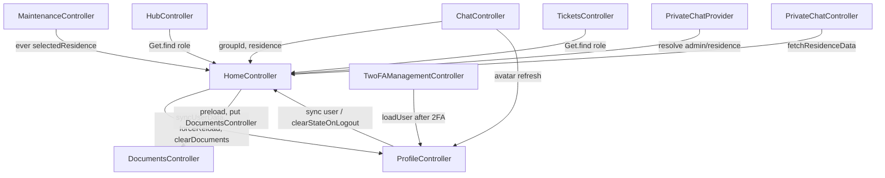
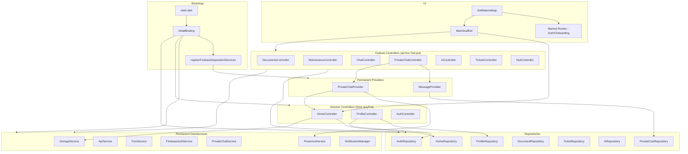
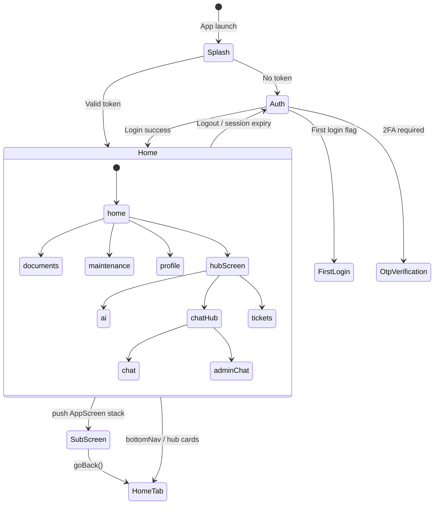
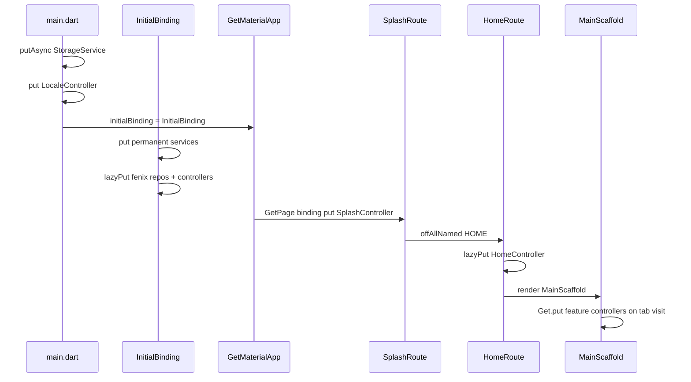

# Flutter GetX State Management Audit

**Project:** CasaZero (`d:\Sajid\casazero`)  
**Date:** July 10, 2026  
**Scope:** Static analysis of GetX DI, bindings, controller lifecycle, Rx/Obx, memory, and architecture  
**Constraint:** Analysis only — no source modifications

---

## Executive Summary

CasaZero uses **GetX exclusively** for state management (~206 Dart files). The architecture follows a recognizable pattern: **permanent `GetxService` singletons** for infrastructure, **fenix `lazyPut` repositories** for session-scoped data access, and a **hybrid navigation model** where `HomeController` drives in-scaffold tab switching while `GetMaterialApp` handles auth/onboarding routes.

**Strengths:** Clear `InitialBinding` bootstrap, Firebase-dependent services deferred until `Firebase.initializeApp`, chat controllers dispose streams/workers correctly, `HomeController.clearStateOnLogout()` provides a central logout reset.

**Weaknesses:** Tab/feature controllers are registered via ad-hoc `Get.put()` in `MainScaffold` and **never deleted**; repositories are both DI-registered and **directly instantiated** in controllers; **dual user state** (`HomeController.currentUser` vs `ProfileController.user`); outer `Obx` on `MainScaffold` rebuilds the entire shell on any `currentScreen` change; `MaintenanceController` registers an `ever()` worker without disposal; `PresenceService.dispose()` is never called on logout.

| Dimension | Score |
|-----------|-------|
| Dependency Injection | 58 |
| Bindings & Registration | 52 |
| Controller Lifecycle | 62 |
| Memory Management | 48 |
| Rx / Obx Patterns | 60 |
| Architecture & Separation | 55 |
| **Overall GetX Health** | **56 / 100** |

---

## 1. Dependency Injection

### 1.1 Registration Layers

| Layer | Mechanism | Examples |
|-------|-----------|----------|
| `main.dart` (pre-runApp) | `Get.putAsync` / `Get.put` | `StorageService`, `LocaleController` |
| `InitialBinding` | `Get.put(..., permanent: true)` | `ApiService`, `FcmService`, `DownloadService` |
| `InitialBinding` | `Get.lazyPut(..., fenix: true)` | `AuthRepository`, `HomeController`, `AuthController` |
| `InitialBinding.registerFirebaseDependentServices()` | Conditional `Get.put` | `MessageProvider`, `PresenceService`, `FirebaseAuthService` |
| `AppRoutes` per-route | `BindingsBuilder` + `Get.lazyPut` | `SplashController`, `OtpVerificationController` |
| `MainScaffold._buildBody()` | Ad-hoc `Get.put` if not registered | `DocumentsController`, `ChatController`, `TicketsController` |
| Widget-level | Inline `Get.put` | `documents_screen.dart`, `security_card.dart`, `demo_home_wrapper.dart` |

### 1.2 Permanent Services (`GetxService`)

| Service | Permanent | Lifecycle Hooks | Notes |
|---------|-----------|-----------------|-------|
| `StorageService` | ✅ | — | Registered in `main.dart` + guarded in `InitialBinding` |
| `ApiService` | ✅ | — | Holds Dio + token refresh |
| `DeviceInfoService` | ✅ | — | |
| `DownloadService` | ✅ | — | |
| `ZipDownloadService` | ✅ | — | |
| `FcmService` | ✅ | `onInit`/`onClose` | `WidgetsBindingObserver`; never deleted in practice |
| `NotificationManager` | ✅ | — | |
| `AppStatusService` | ✅ | `onInit`/`onClose` | Lifecycle observer for foreground/background API |
| `FirebaseAuthService` | ✅ | — | Firebase-dependent |
| `PrivateChatService` | ✅ | — | Firebase-dependent |
| `PresenceService` | ✅ | `dispose()` manual | **Not** `GetxService`; `dispose()` never invoked |
| `PrivateChatNotificationService` | ✅ | — | |

### 1.3 Fenix vs Non-Fenix Lazy Registration

```dart
// fenix: true — recreated after delete (session recovery)
Get.lazyPut<AuthController>(() => AuthController(), fenix: true);
Get.lazyPut<HomeController>(() => HomeController(), fenix: true);

// fenix: false (default) — deleted instance not auto-recreated
Get.lazyPut<TwoFAManagementController>(() => TwoFAManagementController());
Get.lazyPut<TrustedDevicesController>(() => TrustedDevicesController());
```

**Issue:** `TwoFAManagementController` and `TrustedDevicesController` lack `fenix: true` while also being re-`put` from `security_card.dart`, risking stale or duplicate instances.

### 1.4 Repository DI Bypass (Critical)

Repositories registered in `InitialBinding` are **bypassed** by direct construction in multiple controllers:

| Controller | DI Pattern | Problem |
|------------|------------|---------|
| `ProfileController` | `ProfileRepository()`, `AuthRepository()` | New instances; bypasses fenix singleton |
| `DocumentsController` | `DocumentRepository()` | Not in `InitialBinding` at all |
| `AiController` | `AiRepository()` | Not in `InitialBinding` |
| `TicketsController` | `TicketRepository()` | Not in `InitialBinding` |
| `HomeController` | `DocumentRepository()` in preload | Ad-hoc instance |
| `AuthController` | `DocumentRepository()` in login preload | Ad-hoc instance |

**Impact:** Multiple repository instances per type; `Get.find<AuthRepository>()` and `AuthRepository()` may hold different state; harder to mock/test; inconsistent token/session handling.

### 1.5 Duplicate Controller Registration

`HomeController`, `ProfileController`, and `AuthController` are registered in **both** `InitialBinding` (fenix lazyPut) **and** route `BindingsBuilder`. `MainScaffold` additionally `Get.put`s `ProfileController` if missing. GetX deduplicates by type, but the triple-path registration obscures ownership and makes lifecycle unpredictable.

---

## 2. Bindings

### 2.1 Formal Bindings

Only **one** dedicated binding class exists: `lib/app/bindings/initial_binding.dart`.

All other bindings are inline `BindingsBuilder` closures in `app_routes.dart` (14 routes).

### 2.2 Route Bindings Matrix

| Route | Binding | Controller Registration |
|-------|---------|------------------------|
| `/` (Splash) | ✅ | `Get.put(SplashController())` — eager, non-permanent |
| `/auth` | ✅ | `Get.lazyPut(AuthController)` |
| `/first-login-setup` | ✅ | `Get.lazyPut(FirstLoginController)` |
| `/otp-verification` | ✅ | `Get.lazyPut(OtpVerificationController)` |
| `/home` | ✅ | `Get.lazyPut(HomeController)` + post-frame `ensureDataForCurrentUser()` |
| `/two-fa-management` | ✅ | `Get.lazyPut(TwoFAManagementController)` |
| `/two-fa-activation` | ✅ | Conditional lazyPut if not registered |
| `/change-password` | ✅ | `Get.lazyPut(ChangePasswordController)` |
| `/forgot-password` | ✅ | `Get.lazyPut(ForgotPasswordController)` |
| `/trusted-devices` | ✅ | `Get.lazyPut(TrustedDevicesController)` |
| `/document-password` | ✅ | `Get.lazyPut(DocumentPasswordController)` |
| **Tab screens** (documents, hub, maintenance, AI, chat, tickets) | ❌ | Registered in `MainScaffold._buildBody()` — **no route binding** |

### 2.3 Missing Bindings

Feature controllers used inside `MainScaffold` have **no dedicated `Bindings` class**:

- `DocumentsController`, `HubController`, `MaintenanceController`, `AiController`, `ChatController`, `PrivateChatController`, `TicketsController`, `AdminChatController` (if used)

This scatters DI across UI code and prevents route-level lifecycle management.

---

## 3. Permanent vs Lazy Controllers

### 3.1 Session-Scope Controllers (Lazy / Fenix)

| Controller | Registration | Expected Lifetime |
|------------|--------------|-------------------|
| `AuthController` | InitialBinding fenix + `/auth` route | Until logout (`Get.delete` in `AuthNavigation`) |
| `HomeController` | InitialBinding fenix + `/home` route | Entire authenticated session |
| `ProfileController` | InitialBinding fenix + MainScaffold put | Entire session |
| `LocaleController` | `main.dart` + InitialBinding permanent | App lifetime |

### 3.2 Feature Controllers (Lazy Put, No Delete)

Registered on first tab visit via `Get.put()` in `MainScaffold`:

| Controller | Deleted on Tab Leave? | Deleted on Logout? |
|------------|----------------------|-------------------|
| `DocumentsController` | ❌ | ❌ (only `clearDocuments()` via HomeController) |
| `HubController` | ❌ | ❌ |
| `MaintenanceController` | ❌ | ❌ |
| `AiController` | ❌ | ❌ |
| `ChatController` | ❌ | ❌ |
| `PrivateChatController` | ⚠️ Partial (`Get.delete` only when switching to admin chat) | ❌ |
| `TicketsController` | ❌ | ❌ |

**Result:** Once visited, all tab controllers remain in GetX memory for the session — acceptable for performance preloading, problematic for stream/timer leaks if `onClose` is missing.

### 3.3 Permanent Providers (GetxController as Singleton)

| Provider | Registration | Role |
|----------|--------------|------|
| `MessageProvider` | `permanent: true` | Firestore message stream cache |
| `PrivateChatProvider` | `permanent: true` | Admin presence + chat context |

These survive controller deletion. `PrivateChatController.onClose()` calls `_messageProvider.clear()` — correct stream cleanup, but provider state (`isContextReady`, `adminOnline`) may persist across chat sessions.

---

## 4. Controller Lifecycle

### 4.1 Lifecycle Hook Coverage

| Controller | `onInit` | `onReady` | `onClose` | Disposes Resources |
|------------|----------|-----------|-----------|-------------------|
| `HomeController` | ✅ | ✅ | ❌ | N/A (session scope) |
| `ProfileController` | ✅ | ❌ | ❌ | — |
| `AuthController` | ✅ | ❌ | ✅ | TextEditingControllers |
| `SplashController` | ✅ | ✅ | ✅ | Timer |
| `DocumentsController` | ✅ | ❌ | ❌ | — |
| `MaintenanceController` | ✅ | ❌ | ❌ | **`ever()` worker leaked** |
| `HubController` | ❌ | ❌ | ❌ | — |
| `TicketsController` | ✅ | ❌ | ❌ | — |
| `AiController` | ✅ | ❌ | ✅ | Text/Scroll controllers |
| `ChatController` | ✅ | ❌ | ✅ | Auth sub, text/scroll |
| `PrivateChatController` | ✅ | ❌ | ✅ | Workers, subs, text/scroll, clears MessageProvider |
| `AdminChatController` | ✅ | ❌ | ✅ | Auth sub, text/scroll |
| `TwoFAManagementController` | ✅ | ❌ | ✅ | Text controllers |
| `TrustedDevicesController` | ✅ | ❌ | ❌ | — |
| `LocaleController` | ✅ | ❌ | ❌ | Permanent |
| `FirstLoginController` | ✅ | ❌ | ✅ | Text controllers |
| `OtpVerificationController` | ✅ | ❌ | ✅ | Timer |
| `ChangePasswordController` | ✅ | ❌ | ✅ | Text controllers |
| `ForgotPasswordController` | ✅ | ❌ | ✅ | Text controller |
| `ForgotChangePasswordController` | ✅ | ❌ | ✅ | Text controllers |
| `DocumentPasswordController` | ✅ | ❌ | ✅ | Text controllers |
| `DemoController` | ❌ | ❌ | ❌ | Demo only |
| `MessageProvider` | ❌ | ❌ | ✅ | Stream subscription |
| `PrivateChatProvider` | ❌ | ❌ | ✅ | Presence subscription |

**Summary:** 10 of 24 controllers lack `onClose`. Chat/auth flows are well-covered; tab/feature controllers are not.

### 4.2 `onInit` / `onReady` Patterns

**HomeController** — correct deferred initialization:

```dart
onInit()  → _loadUserData(), _loadApiToken()
onReady() → _initializeDataWithToken() or once(apiToken, ...) listener
```

Token-gated API calls correctly wait for `onReady`, avoiding race with storage hydration.

**MaintenanceController** — reactive binding in `onInit`:

```dart
ever(home.selectedResidence, (_) { fetchMaintenanceTasks(); });
```

Worker reference is **not stored** → cannot be disposed in `onClose` → **memory leak** if controller is ever deleted/recreated.

**PrivateChatController** — proper worker disposal:

```dart
_messageErrorWorker = ever<String?>(_messageProvider.messageError, ...);
_messagesScrollWorker = ever<List<PrivateChatMessage>>(_messageProvider.messages, ...);
// onClose: _messageErrorWorker?.dispose(); _messagesScrollWorker?.dispose();
```

### 4.3 `Get.delete` Usage (Minimal)

Only **3** explicit deletions in the codebase:

| Location | Target | Trigger |
|----------|--------|---------|
| `auth_navigation.dart` | `AuthController` (force) | Logout navigation |
| `main_scaffold.dart` | `PrivateChatController` | Switch group → admin chat |
| `home_controller.dart` | `PrivateChatController` | Notification deep-link |

No tab controller is ever deleted. Logout clears reactive state via `clearStateOnLogout()` but **does not** `Get.delete` feature controllers.

---

## 5. Memory Leak Report

### 5.1 Confirmed / High Confidence

| ID | Severity | Source | Description | Evidence |
|----|----------|--------|-------------|----------|
| ML-01 | **High** | `MaintenanceController` | `ever(home.selectedResidence, ...)` worker never disposed | `maintenance_controller.dart:85` — no `Worker?` field, no `onClose` |
| ML-02 | **High** | `PresenceService` | `dispose()` exists but is never called on logout/session end | `presence_service.dart:199` — no callers in `clearStateOnLogout` or `session_expiry_service` |
| ML-03 | **Medium** | Tab controllers | 7 controllers `Get.put` without matching `Get.delete`; accumulate for session | `main_scaffold.dart:902–1010` |
| ML-04 | **Medium** | `MessageProvider` | Permanent; `clear()` only from `PrivateChatController.onClose` — if controller not deleted, stream may stay bound | `private_chat_controller.dart:73` |
| ML-05 | **Medium** | `PrivateChatProvider` | `_presenceSub` only cancelled in `onClose`; provider is permanent so `onClose` never runs in normal flow | `private_chat_provider.dart:160` |
| ML-06 | **Medium** | Repository bypass | Multiple `AuthRepository()` / `ProfileRepository()` instances; orphaned instances if controllers GC'd but GetX still holds fenix singleton | `profile_controller.dart:17–18` |
| ML-07 | **Low** | `SplashController` | `Get.put` on splash route; `offAllNamed` may not delete controller depending on GetX smartManagement | `app_routes.dart:54` |
| ML-08 | **Low** | `ChatController` | `_messagesStream` Firestore stream; cancelled when `StreamBuilder` disposes widget, but controller retains reference until session end | `chat_screen.dart:172` |

### 5.2 Mitigated / Not Leaks

| Item | Reason |
|------|--------|
| `HomeController.once(apiToken, ...)` | `once` auto-disposes after first fire |
| `PrivateChatController` workers | Explicitly disposed in `onClose` |
| `FcmService` / `AppStatusService` observers | `onClose` removes observer (but services are permanent) |
| `SplashController` timer | Cancelled in `onClose` |

### 5.3 Logout Cleanup Gap

`clearStateOnLogout()` resets HomeController Rx state and nulls ProfileController.user, but does **not**:

- `Get.delete` feature controllers
- Call `PresenceService.dispose()`
- Call `MessageProvider.clear()` / `PrivateChatProvider` reset
- `Get.delete<HomeController>` / `ProfileController`

Controllers remain alive with stale internal state until next user login overwrites — risk of cross-user data flash if IDs are not re-checked.

---

## 6. Rx Usage

### 6.1 Scale

| Pattern | Approx. Count (lib/) |
|---------|---------------------|
| `.obs` / `Rx*` declarations | ~250+ across controllers |
| `Obx(` widgets | ~90+ usages in 50+ files |
| `GetBuilder` / `update(['id'])` | ~15 usages (chat input areas, password fields) |
| `ever` / `once` / `debounce` | 3 (`ever`×1, `once`×2) |

### 6.2 Rx Patterns Observed

**Good:**
- `HomeController.apiToken` as gate for all API calls
- `RxList` + `assignAll` in `MessageProvider` for Firestore snapshots
- `Rxn<T>` for nullable selections (`selectedResidence`, `expandedCardId`)
- Chat state enums as `Rx<ChatState>`

**Risky:**
- `ProfileController.user` and `HomeController.currentUser` both hold `UserModel` — manual sync required
- `MaintenanceController` holds 48 `.obs` fields — large reactive surface, many trigger filter recalculation
- `AiController.inputText` duplicates `TextEditingController.text` for Obx send-button — acceptable but redundant

### 6.3 Non-Reactive State in Reactive Controllers

Several controllers mix `GetBuilder` (`update(['input'])`) with `Obx` for the same screen (chat). This hybrid is intentional to avoid rebuilding message lists on keystroke — **good pattern**.

---

## 7. Obx Rebuild Scope

### 7.1 Over-Broad Obx (Performance Risk)

| Location | Scope | Reactive Dependencies | Impact |
|----------|-------|----------------------|--------|
| `main_scaffold.dart:84` | **Entire scaffold** (PopScope, AppBar, Body, NavBar) | `controller.currentScreen` + any `.value` read in `_buildAppBar()` | Full shell rebuild on every screen change |
| `home_screen.dart:31` | Whole home body | `isLoading` | OK — narrow |
| `home_screen.dart:90` | Construction section | `constructionPhasesFromApi`, `isResidenceUnderConstruction` | OK — localized |
| `tickets_screen.dart` | Full screen | Multiple ticket Rx fields | Medium — could split filter vs list |

**MainScaffold outer Obx** reads `currentScreen.value` in build method, but `_buildAppBar()` also reads `controller.canGoBack`, `unreadCount`, `residences`, etc. Any of those changing will rebuild the **entire** scaffold including body — not just the app bar.

### 7.2 Well-Scoped Obx

| Location | Pattern |
|----------|---------|
| `chat_screen.dart` | `Obx` only for `residenceName`; messages via `StreamBuilder` |
| `main_scaffold.dart:348` | Notification badge count isolated |
| `notification_item.dart` | Single item reactive |
| `locale_controller` + `main.dart` | `Obx` wraps only `GetMaterialApp` locale |

### 7.3 GetView vs Obx

Most feature screens use `GetView<XController>` — correct for static structure. Reactive sections wrapped in child `Obx` — good separation where applied.

---

## 8. Circular Dependencies

### 8.1 Dependency Graph (Controller Layer)



### 8.2 Assessment

| Type | Present? | Severity |
|------|----------|----------|
| **Construction-time circular DI** | ❌ No | — |
| **Runtime bidirectional Get.find** | ✅ Yes (Home ↔ Profile) | Medium |
| **Provider → Controller → Provider** | ⚠️ Partial (PrivateChatController → PrivateChatProvider → HomeController) | Low |
| **Repository → Service cycles** | ❌ No | — |

No hard deadlock risk — all links are lazy `Get.find()` at method call time, not field initialization. The Home ↔ Profile bidirectional sync is the main maintainability concern.

---

## 9. Global State

### 9.1 App-Global (Permanent)

| State | Owner | Access |
|-------|-------|--------|
| Auth tokens | `StorageService` | All repositories via `Get.find` |
| Locale | `LocaleController` | `Get.find`, `Obx` in `main.dart` |
| API client / interceptors | `ApiService` | Repositories |
| FCM token | `FcmService` | Auth, splash |
| Firebase auth session | `FirebaseAuthService` | Chat controllers |
| Chat message cache | `MessageProvider` | `PrivateChatController` |
| Admin presence | `PrivateChatProvider` | `PrivateChatScreen` |

### 9.2 Session-Global (Home Shell)

| State | Owner | Consumers |
|-------|-------|-----------|
| Current user | `HomeController.currentUser` | All tab screens, permissions |
| Selected residence | `HomeController.selectedResidence` | Maintenance, documents, chat |
| Residence API data | `HomeController.residenceData` | PrivateChatProvider, hero image |
| Navigation stack | `HomeController.currentScreen` / `screenHistory` | MainScaffold |
| Unread notifications | `HomeController.unreadCount` | AppBar badge |
| API token ready flag | `HomeController.apiToken` | Gate for all home APIs |

### 9.3 Assessment

Global state is **intentional** for a single-shell app. Risk is **stale state after logout** because permanent providers and non-deleted controllers are not reset.

---

## 10. Shared State & Duplication

### 10.1 Duplicated State

| Data | Location A | Location B | Sync Mechanism |
|------|------------|------------|----------------|
| User profile | `HomeController.currentUser` | `ProfileController.user` | Manual: `syncUserData()`, `refreshData()`, `forceReloadUser()` |
| User role | Read from Home in Hub/Tickets | Read from Profile in ChatController | Fallback chain in `_resolveRole()` |
| Residence name | `HomeController.residenceData` | `ChatController.residenceName` | Separate API fetch in ChatController |
| Documents | `DocumentsController.documents` | Preloaded in HomeController | `applyDocuments()` on preload |
| Maintenance tasks | `MaintenanceController.tasks` | — | Single source (OK) |
| Private chat messages | `MessageProvider.messages` | Exposed via PrivateChatController getters | OK — intentional indirection |

### 10.2 Single Source of Truth Violations

1. **User model** — two Rx holders; sync is best-effort with try/catch
2. **Residence name in chat** — re-fetched instead of reading `HomeController.residenceData`
3. **Repositories** — DI singleton vs `new Repository()` — multiple instances of same data layer

---

## 11. Controller Responsibility & Repository Separation

### 11.1 Responsibility Matrix (Simplified)

| Controller | UI State | Business Logic | API Calls | Navigation | Assessment |
|------------|----------|----------------|-----------|------------|------------|
| `HomeController` | Screen stack, loading | Residence selection, feed | Via `HomeRepository` | `AppScreen` enum | **Overloaded** — navigation + data + preload + logout |
| `ProfileController` | Save/upload flags | Profile edit, language | Via repos (bypassed instances) | `AuthNavigation` | Medium — also handles logout |
| `MaintenanceController` | Filters, expanded card, file pick | Task CRUD, filtering | **Direct `ApiService`** | — | **Fat controller** — 1400+ lines, no repository |
| `DocumentsController` | Categories, upload state | Document CRUD | Via `DocumentRepository` (local instance) | — | OK pattern, wrong DI |
| `ChatController` | Send state, chat state enum | Firestore streams, send | ApiService + Firestore | — | **Fat** — networking in controller |
| `AuthController` | Form, loading | Login flow | Via `AuthRepository` | GetX routes | OK |
| `AiController` | Messages, input | Chat history, send | Via `AiRepository` (local) | — | OK pattern |
| `TicketsController` | Filters, form | Ticket CRUD | Via `TicketRepository` (local) | — | OK pattern |

### 11.2 Repository Layer

| Repository | In InitialBinding | Used Via Get.find | Direct `new` |
|------------|-------------------|-------------------|--------------|
| `AuthRepository` | ✅ fenix | Auth, Splash, Chat, Session | ProfileController |
| `HomeRepository` | ✅ fenix | HomeController | — |
| `ProfileRepository` | ✅ fenix | TwoFA, TrustedDevices | ProfileController, security_card |
| `NotificationRepository` | ✅ fenix | Chat, FCM | — |
| `PrivateChatRepository` | ✅ fenix | PrivateChat, MessageProvider | — |
| `DocumentRepository` | ❌ | — | Documents, Home, Auth, OTP |
| `AiRepository` | ❌ | — | AiController |
| `TicketRepository` | ❌ | — | TicketsController |

**MaintenanceController** bypasses the repository layer entirely — calls `ApiService` with `ApiConstants` directly (largest architectural deviation).

---

## 12. Controller Matrix

| # | Controller | Base Class | Registration | Permanent | Fenix | Binding | onInit | onReady | onClose | Primary Dependencies |
|---|------------|------------|--------------|-----------|-------|---------|--------|---------|---------|---------------------|
| 1 | `StorageService` | GetxService | main + InitialBinding | ✅ | — | Initial | — | — | — | GetStorage |
| 2 | `LocaleController` | GetxController | main + InitialBinding | ✅ | — | Initial | ✅ | ❌ | ❌ | StorageService |
| 3 | `ApiService` | GetxService | InitialBinding | ✅ | — | Initial | — | — | — | StorageService |
| 4 | `FcmService` | GetxService | InitialBinding | ✅ | — | Initial | ✅ | ❌ | ✅ | NotificationManager |
| 5 | `HomeController` | GetxController | Initial + `/home` | ❌ | ✅ | Initial + Route | ✅ | ✅ | ❌ | HomeRepository, StorageService |
| 6 | `ProfileController` | GetxController | Initial + MainScaffold | ❌ | ✅ | Initial + Ad-hoc | ✅ | ❌ | ❌ | StorageService, repos (direct new) |
| 7 | `AuthController` | GetxController | Initial + `/auth` | ❌ | ✅ | Initial + Route | ✅ | ❌ | ✅ | AuthRepository, FcmService |
| 8 | `SplashController` | GetxController | `/` route put | ❌ | ❌ | Route | ✅ | ✅ | ✅ | StorageService, AuthRepository |
| 9 | `DocumentsController` | GetxController | MainScaffold put | ❌ | ❌ | Ad-hoc | ✅ | ❌ | ❌ | DocumentRepository (local) |
| 10 | `MaintenanceController` | GetxController | MainScaffold put | ❌ | ❌ | Ad-hoc | ✅ | ❌ | ❌ | ApiService, HomeController |
| 11 | `HubController` | GetxController | MainScaffold put | ❌ | ❌ | Ad-hoc | ❌ | ❌ | ❌ | HomeController |
| 12 | `TicketsController` | GetxController | MainScaffold put | ❌ | ❌ | Ad-hoc | ✅ | ❌ | ❌ | TicketRepository (local) |
| 13 | `AiController` | GetxController | MainScaffold put | ❌ | ❌ | Ad-hoc | ✅ | ❌ | ✅ | AiRepository (local) |
| 14 | `ChatController` | GetxController | MainScaffold put | ❌ | ❌ | Ad-hoc | ✅ | ❌ | ✅ | Firebase, ApiService, Home, Profile |
| 15 | `PrivateChatController` | GetxController | MainScaffold put | ❌ | ❌ | Ad-hoc | ✅ | ❌ | ✅ | Providers, repos, Home |
| 16 | `AdminChatController` | GetxController | Not in MainScaffold* | ❌ | ❌ | None found | ✅ | ❌ | ✅ | Firebase, Home, Profile |
| 17 | `MessageProvider` | GetxController | InitialBinding Firebase | ✅ | — | Initial Firebase | ❌ | ❌ | ✅ | PrivateChatRepository |
| 18 | `PrivateChatProvider` | GetxController | InitialBinding Firebase | ✅ | — | Initial Firebase | ❌ | ❌ | ✅ | PresenceService, HomeController |
| 19 | `TwoFAManagementController` | GetxController | Route + security_card | ❌ | ❌ | Route + Ad-hoc | ✅ | ❌ | ✅ | AuthRepository, ProfileRepository |
| 20 | `TrustedDevicesController` | GetxController | `/trusted-devices` | ❌ | ❌ | Route | ✅ | ❌ | ❌ | ProfileRepository |
| 21 | `FirstLoginController` | GetxController | `/first-login` | ❌ | ❌ | Route | ✅ | ❌ | ✅ | AuthRepository |
| 22 | `OtpVerificationController` | GetxController | `/otp-verification` | ❌ | ❌ | Route | ✅ | ❌ | ✅ | AuthRepository |
| 23 | `ChangePasswordController` | GetxController | Route + in-scaffold | ❌ | ❌ | Route | ✅ | ❌ | ✅ | AuthRepository |
| 24 | `ForgotPasswordController` | GetxController | Route | ❌ | ❌ | Route | ✅ | ❌ | ✅ | AuthRepository |
| 25 | `ForgotChangePasswordController` | GetxController | Route | ❌ | ❌ | Route | ✅ | ❌ | ✅ | AuthRepository |
| 26 | `DocumentPasswordController` | GetxController | Route | ❌ | ❌ | Route | ✅ | ❌ | ✅ | ProfileRepository |
| 27 | `DemoController` | GetxController | Demo wrapper put | ❌ | ❌ | Ad-hoc | ❌ | ❌ | ❌ | None |

\*`AdminChatController` exists but admin chat route uses `PrivateChatScreen` + `PrivateChatController` in current `MainScaffold` flow.

---

## 13. Architecture Diagram

### 13.1 GetX Layer Architecture



### 13.2 Navigation & State Flow



### 13.3 DI Registration Flow



---

## 14. Findings by Severity

### Critical

| ID | Finding |
|----|---------|
| G1 | **No feature controller teardown on logout** — tab controllers retain memory and may hold stale user-specific state |
| G2 | **`MaintenanceController.ever()` leak** — undisposed worker if controller lifecycle is ever managed |
| G3 | **Repository DI bypass** — `ProfileController` constructs new `AuthRepository()` / `ProfileRepository()`, defeating fenix singleton |

### High

| ID | Finding |
|----|---------|
| G4 | **`PresenceService.dispose()` never called** — Firestore presence writes and auth listener may survive logout |
| G5 | **Dual user state** (Home + Profile) — manual sync, error-prone |
| G6 | **MaintenanceController** — 1400+ lines, direct ApiService, no repository |
| G7 | **MainScaffold outer Obx** — rebuilds entire shell; reads many observables in child builders |

### Medium

| ID | Finding |
|----|---------|
| G8 | Only `PrivateChatController` gets `Get.delete` — inconsistent chat lifecycle |
| G9 | Triple registration path for Home/Profile/Auth controllers |
| G10 | `MessageProvider` / `PrivateChatProvider` permanent without session reset |
| G11 | `AdminChatController` appears orphaned vs current navigation |
| G12 | `security_card.dart` inline `Get.put(ProfileRepository())` |

### Low

| ID | Finding |
|----|---------|
| G13 | `HubController` has no lifecycle hooks — stateless computed getter (acceptable) |
| G14 | `DemoController` — dev-only, no cleanup |
| G15 | Mixed `Obx` + `GetBuilder` — intentional for chat, undocumented |

---

## 15. Recommendations (Documentation Only)

1. **Introduce `MainBinding`** for tab controllers with explicit `Get.lazyPut` + `fenix: true` and delete-on-logout in `clearStateOnLogout()`.
2. **Single user Rx** — either `HomeController.currentUser` only with Profile reading via `Get.find`, or a dedicated `UserSessionController`.
3. **Register all repositories** in `InitialBinding` with fenix; remove `Repository()` from controller fields.
4. **Extract `MaintenanceRepository`** — move ApiService calls out of MaintenanceController.
5. **Store `Worker?` from `ever()`** in MaintenanceController and dispose in `onClose`.
6. **Call `PresenceService.dispose()`** and provider `clear()`/`reset()` from logout path.
7. **Split MainScaffold Obx** — separate reactive app bar badge from body `screenKey` widget.
8. **Session teardown** — `Get.delete<DocumentsController>(force: true)` etc. on logout.

---

## 16. Final Score

| Category | Weight | Score | Weighted |
|----------|--------|-------|----------|
| Dependency Injection consistency | 20% | 58 | 11.6 |
| Bindings & registration clarity | 15% | 52 | 7.8 |
| Lifecycle management (onInit/Ready/Close) | 20% | 62 | 12.4 |
| Memory & resource cleanup | 20% | 48 | 9.6 |
| Rx / Obx efficiency | 10% | 60 | 6.0 |
| Architecture & separation of concerns | 15% | 55 | 8.25 |
| **Total** | **100%** | | **55.65 → 56** |

### Grade: **D+ (56/100)** — Functional but fragile

The app ships a working GetX architecture suitable for a single-session shell app, with **strong chat/auth lifecycle handling** offset by **inconsistent DI**, **missing teardown on logout**, **state duplication**, and **fat controllers** that bypass the repository layer. Production risk is moderate: memory growth across long sessions, possible stale state after user switch, and performance overhead from broad `Obx` scopes.

---

*End of GetX State Management Audit*
