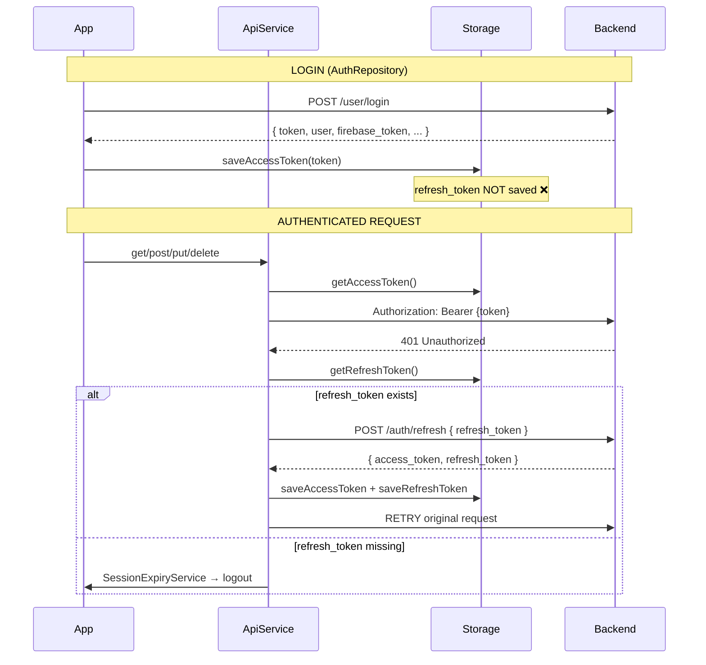
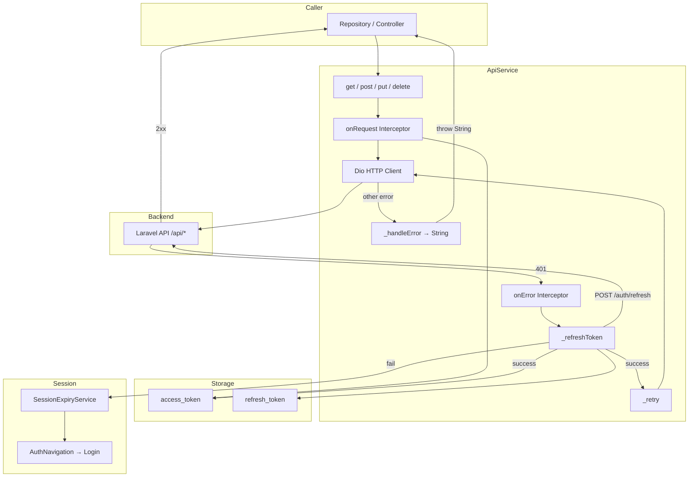
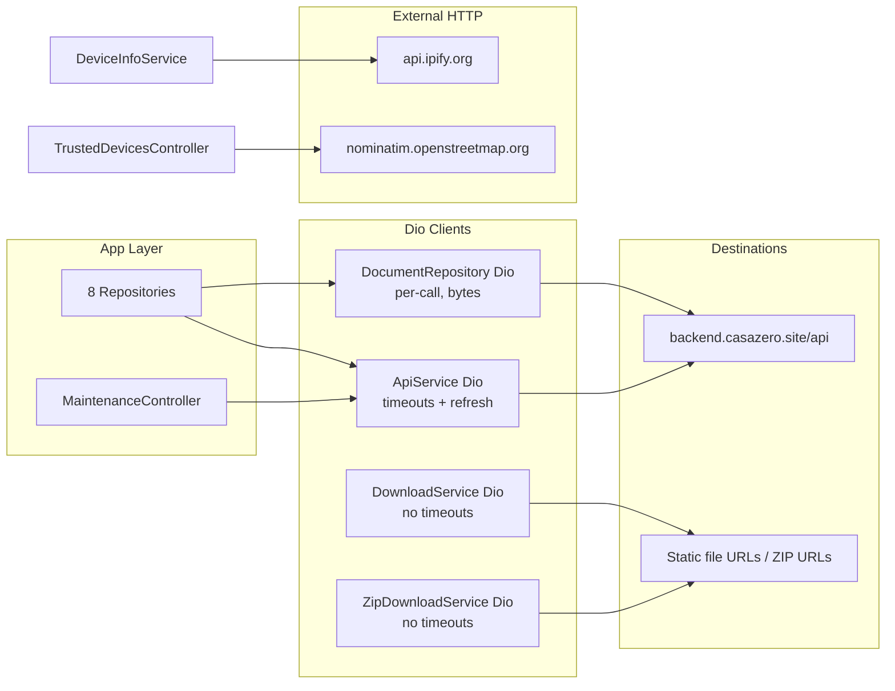
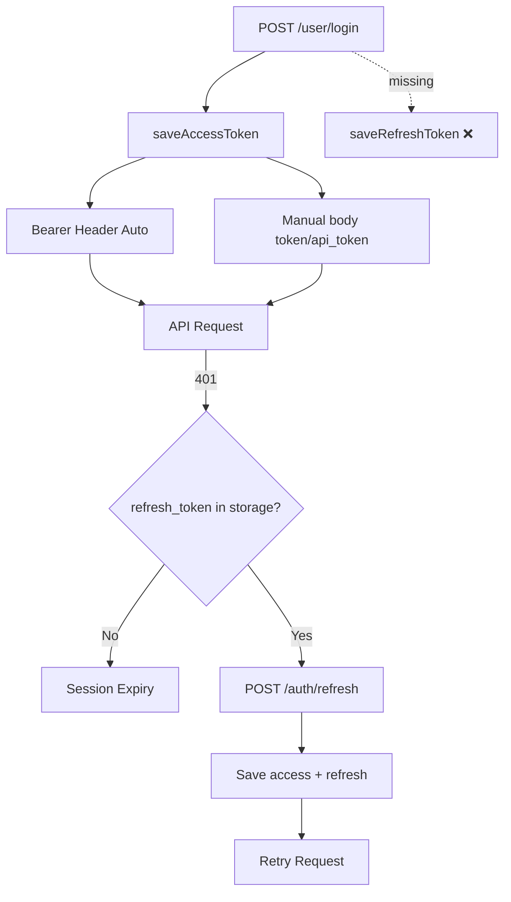

# Flutter Network Layer Audit

**Project:** CasaZero (`d:\Sajid\casazero`)  
**Date:** July 10, 2026  
**Scope:** Static analysis of all HTTP/Dio networking — configuration, auth, uploads, downloads, errors, security  
**Constraint:** Analysis only — no source modifications

---

## Executive Summary

CasaZero routes **all Laravel REST traffic** through a single `ApiService` (`Dio` singleton) with one `InterceptorsWrapper` for Bearer auth and 401 refresh. **Four additional Dio instances** exist for downloads/ZIP/binary document fetch, plus **two `package:http` clients** for IP lookup and geocoding.

**Strengths:** Centralized API client, session-expiry handling with navigation, password redaction in login debug logs, multipart document upload as primary path, progress tracking on file downloads.

**Critical gaps:** Refresh token is **never saved at login** (refresh flow is effectively broken on first 401); **full access tokens logged** on every request in debug; **no request cancellation** (`CancelToken` unused); **no concurrent 401 refresh mutex**; document binary download uses a **separate Dio without interceptors, timeouts, or refresh**; dual auth model (Bearer header **and** body `token`/`api_token` on most endpoints).

| Dimension | Score |
|-----------|-------|
| Client Configuration | 62 |
| Authentication & Token Lifecycle | 42 |
| Error Handling & Parsing | 58 |
| Upload/Download Reliability | 55 |
| Request Deduplication & Cancellation | 35 |
| Security | 45 |
| **Reliability Score** | **50 / 100** |

---

## 1. Dio Configuration

### 1.1 HTTP Client Inventory

| Client | Location | Base URL | Timeouts | Interceptors | Purpose |
|--------|----------|----------|----------|--------------|---------|
| **ApiService** `_dio` | `api_service.dart` | `https://backend.casazero.site/api` | 30s connect + receive | Auth + 401 refresh | All REST API |
| **DownloadService** `_dio` | `download_service.dart` | None (full URL) | **None** | Bearer only (onRequest) | Static file URL download |
| **ZipDownloadService** `_dio` | `zip_download_service.dart` | None | **None** | Bearer only (onRequest) | ZIP stream download |
| **Ad-hoc Dio** | `document_repository.dart:832` | `BASE_URL` | **None** | **None** | Binary `download_document` POST |
| **http.Client** | `device_info_service.dart` | `api.ipify.org` | 5s | N/A | Public IP at login |
| **http.Client** | `geocoding_service.dart` | `nominatim.openstreetmap.org` | 10s | User-Agent header | Reverse geocoding |

### 1.2 ApiService BaseOptions

```dart
BaseOptions(
  baseUrl: 'https://backend.casazero.site/api',
  connectTimeout: Duration(milliseconds: 30000),  // AppConstants.CONNECTION_TIMEOUT
  receiveTimeout: Duration(milliseconds: 30000),  // AppConstants.RECEIVE_TIMEOUT
  headers: {
    'Content-Type': 'application/json',
    'Accept': 'application/json',
  },
)
```

| Setting | Value | Assessment |
|---------|-------|------------|
| `connectTimeout` | 30s | Adequate for mobile |
| `receiveTimeout` | 30s | May be short for large base64 uploads |
| `sendTimeout` | **Not set** | Large uploads can hang indefinitely on slow uplink |
| `validateStatus` | Default (2xx only) | 4xx/5xx throw `DioException` — OK |
| `responseType` | Default (JSON) | Binary downloads need per-request override |
| `followRedirects` | Default (true) | OK |
| Certificate pinning | **None** | Standard TLS only |
| `LogInterceptor` / PrettyDio | **None** | Custom `print` logging instead |

### 1.3 Secondary Dio Gaps

`DownloadService` and `ZipDownloadService` create bare `Dio()` with:
- No `connectTimeout` / `receiveTimeout` / `sendTimeout`
- No 401 handling or token refresh
- No shared error normalization
- Bearer attached manually in `onRequest` only

`DocumentRepository.downloadDocument()` creates a **new `Dio` per call** with JSON headers only — token sent in **request body**, not `Authorization` header. No refresh on 401.

---

## 2. Interceptors

### 2.1 ApiService Interceptor Chain

Single `InterceptorsWrapper` with two hooks:

#### `onRequest`
1. Reads `StorageService.getAccessToken()`
2. Sets `Authorization: Bearer {token}` or removes header
3. **Logs full request URI and complete token string**

```dart
print('🌐 [API REQUEST] ${options.method} ${options.uri}');
print('🔑 [API TOKEN] ${token ?? 'NO_TOKEN_FOUND'}');  // FULL TOKEN
```

#### `onError` (401 only)
1. Skips if path is auth endpoint (`/user/login`, `/user/logout`, `/auth/refresh`, etc.)
2. Skips if no `Authorization` header or no stored access token
3. Calls `_refreshToken()` → on success, `_retry()` original request
4. On refresh failure → `SessionExpiryService.handleSessionExpired()` → rejects with `DioExceptionType.cancel` + `SESSION_EXPIRED`

**Missing interceptor capabilities:**
- No request/response logging redaction (except login via `LoginApiDebug`)
- No retry for network timeouts (only 401)
- No request ID / correlation
- No global loading indicator hook
- No `onResponse` validation (e.g. normalize `status` vs `success`)

### 2.2 Download Interceptors

`DownloadService` and `ZipDownloadService` only implement `onRequest` (Bearer). No `onError` — 401 on CDN/backend file URLs fails without session recovery.

---

## 3. Refresh Token

### 3.1 Flow Diagram



### 3.2 Critical Finding: Refresh Token Never Persisted at Login

| Step | Code Location | Behavior |
|------|---------------|----------|
| Login success | `auth_repository.dart:113–114` | `saveAccessToken(body['token'])` only |
| Refresh success | `api_service.dart:83–84` | Saves both `access_token` and `refresh_token` from refresh response |
| Login response | No `saveRefreshToken()` call anywhere in `auth_repository.dart` | **Refresh token never stored on login** |

**Impact:** First 401 after login calls `getRefreshToken()` → `null` → immediate forced logout. Token refresh is **non-functional** unless refresh token is populated by some other path (none found).

### 3.3 Refresh Implementation Issues

| Issue | Severity | Detail |
|-------|----------|--------|
| Refresh token not saved at login | **Critical** | See above |
| Response field assumption | High | Expects `access_token` / `refresh_token`; login uses `token` — field naming inconsistent with backend |
| No refresh mutex | High | Concurrent 401s trigger parallel `_refreshToken()` calls |
| Refresh uses same `_dio` | Medium | Goes through `onRequest` interceptor (adds stale Bearer) — usually OK |
| No refresh retry limit | Medium | Single attempt then session expiry |
| `_refreshToken` swallows errors | Medium | `catch (e) { return false; }` — no logging |

---

## 4. Authentication

### 4.1 Dual Auth Model

The backend accepts authentication via **two mechanisms used simultaneously**:

| Mechanism | Where Applied | Endpoints |
|-----------|---------------|-----------|
| `Authorization: Bearer {token}` | ApiService interceptor (automatic) | All ApiService calls |
| Body `token` | Manual in repository | `/user/profile`, `/documents/by_unit`, `/residences/by-token`, AI, logout |
| Body `api_token` | Manual in repository | Notifications, tickets, app status, issue types |

**Risk:** Token drift if interceptor token and body token ever differ; redundant payload size; inconsistent contract across endpoints.

### 4.2 Auth Endpoint Exclusions

401 interceptor skips session handling for:
- `/user/login`
- `/user/logout`
- `/auth/refresh`
- `/auth/forgot-password`
- `/auth/reset-password`

OTP, 2FA, and first-login endpoints are **not** excluded — a 401 on those routes could incorrectly trigger refresh/logout.

### 4.3 Session Expiry Handling

`SessionExpiryService.handleSessionExpired()`:
1. Guards with `_isHandling` flag (prevents duplicate logout UI)
2. Clears `HomeController` / `ProfileController` state
3. Signs out Firebase, deletes FCM token
4. `storage.clearAll(preserveLanguage: true)`
5. `AuthNavigation.replaceStackWithAuth()` + error popup

`SessionExpiryService.reset()` called after successful login — correct.

### 4.4 Token Storage

| Key | Storage | Encrypted |
|-----|---------|-----------|
| `access_token` | GetStorage | **No** |
| `refresh_token` | GetStorage | **No** |
| `firebase_token` | GetStorage | **No** |
| `device_token` | GetStorage | **No** |

---

## 5. Headers

### 5.1 Default Headers (ApiService)

| Header | Value | Notes |
|--------|-------|-------|
| `Content-Type` | `application/json` | Overridden by Dio for `FormData` multipart |
| `Accept` | `application/json` | |
| `Authorization` | `Bearer {access_token}` | Injected per request |

### 5.2 Per-Request Headers

| Client | Extra Headers |
|--------|---------------|
| GeocodingService | `User-Agent: CasaZero Mobile App` (Nominatim requirement) |
| Document download Dio | `Content-Type` / `Accept: application/json` only |
| Multipart uploads | Dio sets `multipart/form-data` boundary automatically |

### 5.3 Missing Headers

- No `Accept-Language` tied to `LocaleController` (language change uses dedicated API)
- No `X-Request-Id` / `X-Client-Version` / `X-Platform` on API calls (device info only at login)
- No `If-None-Match` / caching headers

---

## 6. Timeouts

| Client / Call | Connect | Receive | Send | Other |
|---------------|---------|---------|------|-------|
| ApiService | 30s | 30s | ∞ | |
| DownloadService | ∞ | ∞ | ∞ | |
| ZipDownloadService | ∞ | ∞ | ∞ | |
| Document download Dio | ∞ | ∞ | ∞ | |
| DeviceInfo IP (http) | — | 5s total | — | |
| Geocoding (http) | — | 10s total | — | |
| Geolocator position | — | 10s (`timeLimit`) | — | Login only |

**Performance risk:** Download and ZIP clients can block indefinitely on dead connections.

---

## 7. Retry

| Retry Type | Implemented | Location |
|------------|-------------|----------|
| 401 → refresh → retry once | ✅ | `api_service.dart` `_retry()` |
| Network timeout retry | ❌ | — |
| 5xx exponential backoff | ❌ | — |
| Maintenance update endpoint guessing | ⚠️ | Tries PUT `/maintenance/{id}` → PUT `/maintenance/update/{id}` → POST `/maintenance/update` sequentially |
| FCM token fetch | ✅ | `FcmService.getDeviceToken()` retries once |
| Firebase presence writes | ✅ | `PresenceService._scheduleRetry()` with backoff |

### 7.1 Maintenance Endpoint Retry (Anti-Pattern)

`MaintenanceController` update task performs up to **3 sequential API attempts** on different guessed endpoints. This is not idempotent-safe retry — it's runtime endpoint discovery that wastes bandwidth and may cause duplicate updates if multiple paths succeed on a misconfigured backend.

---

## 8. Multipart

### 8.1 Multipart Uploads

| Feature | Endpoint | Implementation | Auth |
|---------|----------|----------------|------|
| Profile image | `POST /user/profile_image/update/{userId}` | `FormData` + `MultipartFile.fromFile` | Bearer (interceptor) |
| Document upload | `POST /user_document_upload` | `FormData` with `document_file`, `token`, metadata | Bearer + body `token` |

**Profile upload:** No explicit `token` in FormData — relies on Bearer only.

**Document upload:** Primary method is `DocumentUploadMethod.multipart` (default). Fields match Postman format.

### 8.2 Base64 Upload (Fallback)

`DocumentRepository._uploadDocumentBase64()`:
- Reads entire file into memory
- Encodes to base64 data URI (`data:{mime};base64,{data}`)
- Sends as JSON POST
- **~33% payload inflation** + JSON overhead
- Risk of **30s receive timeout** on large files
- Extensive debug logging (token prefix only)

### 8.3 Ticket Image Upload

`TicketRepository.createSupportTicket()`:
- Embeds single image as base64 data URI in JSON body
- UI allows up to 5 photos; **only first photo path used** in repository (if passed)
- No multipart alternative

### 8.4 Maintenance File Attachment

`MaintenanceController` has file picker state (`selectedFile`, 10MB limit) but **file is not attached to API requests** in store/update calls — UI state only.

---

## 9. Downloads

### 9.1 Download Paths

| Method | Service | Protocol | Progress | Auth |
|--------|---------|----------|----------|------|
| Static file URL | `DownloadService.downloadDocument()` | `Dio.download()` to disk | ✅ `onReceiveProgress` | Bearer on URL fetch |
| API binary | `DocumentRepository.downloadDocument()` | Ad-hoc Dio POST, `ResponseType.bytes` | ❌ | Body `{ token, document_id }` |
| Bytes save | `DownloadService.saveDocumentBytes()` | Local file write | N/A | N/A |
| ZIP + extract | `ZipDownloadService.downloadAndOpenZip()` | `Dio.download()` + archive extract | ✅ | Bearer |

### 9.2 Download Flow Issues

| Issue | Severity |
|-------|----------|
| `cancelDownload()` only clears Rx maps — **does not cancel Dio download** | High |
| No `CancelToken` passed to `_dio.download()` | High |
| Document API download bypasses refresh interceptor | Medium |
| Android hardcoded `/storage/emulated/0/Download` | Low (platform) |
| Duplicate filename handling via timestamp suffix | OK |

---

## 10. Uploads

| Upload | Max Size Guard | Progress | Cancellation | Error Parsing |
|--------|----------------|----------|--------------|---------------|
| Document multipart | File empty check | `isUploading` Rx only | ❌ | Map `message` field |
| Document base64 | Same | Same | ❌ | DioException + Map |
| Profile image | None explicit | `isUploadingImage` | ❌ | Generic catch |
| Ticket image | File exists check | Dialog loading state | ❌ | Returns null on failure |
| AI message | Empty string check | `isSending` | ❌ | Custom parsing |

**Memory:** Base64 document upload loads full file into RAM twice (bytes + encoded string).

---

## 11. Cancellation

| Mechanism | Used? |
|-----------|-------|
| Dio `CancelToken` | **Never** — 0 usages in codebase |
| `DownloadService.cancelDownload()` | Clears UI state only |
| Widget `dispose` cancellation | Not wired to in-flight HTTP |
| OTP timer cancel | ✅ `SplashController` / `OtpVerificationController` |

**Impact:** Navigating away during upload/download does not abort the HTTP request. Responses may update disposed controllers (mitigated partially by GetX permanence).

---

## 12. Duplicate Requests

### 12.1 Guards Present

| Location | Guard |
|----------|-------|
| `HomeController._initializeDataWithToken` | `_isInitialized` + `_initialLoadInProgress` |
| `HomeController.fetchResidenceData` | `_residenceDataFetchInProgress` |
| `FcmService.init` | `_initialized` flag |
| `FcmService` listeners | `_listenersSetup` flag |
| `NotificationManager` | Dedup by FCM `messageId` |
| `MessageProvider.bindConversation` | Skips if same `conversationId` |
| `PrivateChatService` | "never duplicates" conversation |

### 12.2 Duplicate Request Risks

| Scenario | Risk | Evidence |
|----------|------|----------|
| App resume | `AppLifecycleRefreshWrapper` fires `fetchNotifications`, `fetchUnreadCount`, `fetchDocuments` with **no debounce** | `app_lifecycle_refresh_wrapper.dart:47–51` |
| Residence switch | `selectResidence` → `fetchResidenceData` + `fetchDocuments`; Maintenance `ever()` also refetches | Multiple listeners |
| Documents preload + screen open | `HomeController._preloadDocuments` + `DocumentsController.onInit` | Mitigated by `skipInitialFetch` flag when preloaded |
| Login document preload | `AuthController`, `OtpVerificationController`, `HomeController` all preload documents | Redundant on auth paths |
| Trusted devices geocoding | Sequential with 1.1s delay per device | Intentional rate limit, not parallel dedup |
| Pull-to-refresh + lifecycle resume | Overlapping fetches possible | No in-flight mutex on repositories |

**No global request deduplication** (e.g. same GET within 500ms coalesced).

---

## 13. Error Handling

### 13.1 ApiService `_handleError`

Converts `DioException` → **localized string** (not typed exception):

| DioExceptionType | Message |
|----------------|---------|
| `connectionTimeout` / `receiveTimeout` | Connection timeout message |
| `badResponse` | Status-specific (401, 403, 404, 5xx) + extract `message`/`error` from JSON |
| `cancel` | Session expired or "Request cancelled" |
| Other | "Network error. Please try again." |

**HTML error pages:** Detects `<!DOCTYPE` / `<html` and avoids returning raw HTML to UI.

**Problem:** Public methods `get/post/put/delete` **throw String**, not `DioException`. Repositories must catch `String` or generic `catch (e)` — inconsistent with `on DioException` blocks.

### 13.2 Repository-Level Parsing

| Pattern | Repositories |
|---------|--------------|
| `status == true` | Home, Auth, Profile, Document, Maintenance |
| `success == true` | Ticket, AI, some notifications |
| `status == true \|\| success == true` | TicketRepository (dual check) |
| String body `json.decode` | TicketRepository, some edge cases |
| `FirebaseResponseParser.normalizeBody` | Auth login only |

**No shared `ApiResponse<T>` parser** — each repository reimplements success detection.

### 13.3 Silent Failures

Several repositories return empty lists/`null` on error without surfacing to UI:
- `TicketRepository.fetchIssueTypes()` → `[]`
- `TicketRepository.fetchMyTickets()` → `[]`
- Geocoding → `'Unknown Location'`

---

## 14. Parsing & Serialization

### 14.1 Request Serialization

| Format | Usage |
|--------|-------|
| JSON Map | Default for all ApiService POST/PUT |
| `FormData` | Profile image, document multipart |
| Base64 data URI in JSON | Document fallback, ticket images |
| Query parameters | Rare GET calls |

### 14.2 Response Deserialization

| Model | Parser |
|-------|--------|
| `UserModel.fromJson` | Auth, Profile |
| `ResidenceModel.fromJson` | Home |
| `DocumentModel.fromJson` | Documents |
| `FeedItemModel` | Home (with locale-aware parsing) |
| `TicketModel.fromJson` | Tickets |
| `TrustedDeviceModel` | Profile |
| AI messages | Custom `Message.fromApiResponse` in controller |

### 14.3 Utilities

| Utility | Role |
|---------|------|
| `FirebaseResponseParser` | Login body normalization, firebase token extraction |
| `LoginApiDebug` | Verbose login logging with password redaction |
| `FirebaseJwtDebug` | JWT structure debug (auth flow) |

### 14.4 Parsing Gaps

- No `json_serializable` / `freezed` code generation — manual `fromJson` everywhere
- Inconsistent date parsing (try/catch → `DateTime.now()` fallback in AI messages)
- `HomeRepository.getUserResidences` documents PUT but calls **POST** (`_apiService.post`)

---

## 15. Logging

### 15.1 Log Volume by Layer

| Layer | What's Logged | Redaction |
|-------|---------------|-----------|
| ApiService interceptor | Method, URI, **full access token** | ❌ None |
| ApiService error | Status, full response body | ❌ May include PII |
| AuthRepository login | Device info, FCM token, token prefix | Password via LoginApiDebug |
| LoginApiDebug | Full normalized login body | Password redacted; **API token exists logged** |
| Repositories | Extensive emoji-prefixed prints | Token **prefix** (10–20 chars) in most |
| Document base64 upload | File metadata, token prefix | Base64 content not logged (length only) |
| Download services | URLs, paths, progress % | Token in download interceptor |

### 15.2 Production Risk

All logging uses `print()` with **no `kDebugMode` guard** in `ApiService` interceptor — **tokens leak to device logs in release builds** if logging is not stripped by tree-shaking (print is not stripped).

---

## 16. Security

### 16.1 Security Findings

| ID | Severity | Finding |
|----|----------|---------|
| SEC-01 | **Critical** | Full Bearer token printed on every API request (`api_service.dart:45`) |
| SEC-02 | **Critical** | Refresh token never saved at login — broken renewal forces re-auth (availability) |
| SEC-03 | **High** | Tokens stored in GetStorage **without encryption** |
| SEC-04 | **High** | Hardcoded dev credentials in `AuthController` (`email` + `password` pre-filled) |
| SEC-05 | **High** | No certificate pinning — standard TLS only |
| SEC-06 | **Medium** | Dual auth (Bearer + body token) increases token exposure surface in request bodies |
| SEC-07 | **Medium** | Base64 document/ticket uploads send file content in JSON — larger attack window for memory dumps |
| SEC-08 | **Medium** | `DocumentRepository` download Dio has no auth interceptor — relies on body token only |
| SEC-09 | **Medium** | External IP sent to `api.ipify.org` on every login (third-party dependency) |
| SEC-10 | **Medium** | Geocoding sends lat/lng to Nominatim (OpenStreetMap) — privacy consideration |
| SEC-11 | **Low** | No request signing beyond Bearer token |
| SEC-12 | **Low** | `LoginApiDebug` logs firebase token prefix (20 chars) |
| SEC-13 | **Low** | HTTP allowed in URL builder (`buildOriginUrl`) if relative paths misconfigured |

### 16.2 Transport Security

- Production API: **HTTPS** (`https://backend.casazero.site`)
- No cleartext exceptions found in Android network security config (not audited in depth)
- Firebase/Firestore: separate Google TLS stack

---

## 17. Network Flow Diagram

### 17.1 Request Lifecycle (ApiService)



### 17.2 Multi-Client Architecture



### 17.3 Authentication Token Paths



---

## 18. Performance Findings

| ID | Severity | Finding | Impact |
|----|----------|---------|--------|
| PERF-01 | High | Base64 document upload inflates payload ~33%+ | Slow uploads, timeout risk, memory pressure |
| PERF-02 | High | No `sendTimeout` on ApiService | Large uploads may hang |
| PERF-03 | Medium | Download/ZIP Dio clients have zero timeouts | Hung connections block isolates |
| PERF-04 | Medium | New `Dio()` per document download call | Connection pool waste |
| PERF-05 | Medium | App resume triggers 3+ API calls without debounce | Battery + server load |
| PERF-06 | Medium | Maintenance update tries up to 3 endpoints sequentially | 2–3× latency on updates |
| PERF-07 | Medium | Trusted device geocoding: 1.1s × N devices sequential | Slow trusted devices screen |
| PERF-08 | Low | Verbose `print` on every request | I/O overhead in debug |
| PERF-09 | Low | Full response body logged on errors | Log spam on failing endpoints |
| PERF-10 | Low | Home document preload on login + tab open | Extra bandwidth (intentional cache warming) |

---

## 19. Endpoint Coverage Matrix

| Repository | HTTP Methods | Via ApiService | Direct Dio/http | Multipart | Base64 Body |
|------------|--------------|----------------|-----------------|-----------|-------------|
| AuthRepository | POST, GET | ✅ | — | — | — |
| HomeRepository | GET, POST | ✅ | — | — | — |
| ProfileRepository | POST, GET | ✅ | — | ✅ profile | — |
| DocumentRepository | GET, POST, DELETE | ✅ | ✅ download bytes | ✅ upload | ✅ fallback |
| TicketRepository | POST | ✅ | — | — | ✅ image |
| AiRepository | POST | ✅ | — | — | — |
| NotificationRepository | POST | ✅ | — | — | — |
| PrivateChatRepository | — | Firestore only | — | — | — |
| MaintenanceController | GET, POST, PUT, DELETE | ✅ | — | — | — |
| DeviceInfoService | GET | — | ✅ ipify | — | — |
| GeocodingService | GET | — | ✅ nominatim | — | — |

**Estimated API surface:** 50+ distinct endpoints in `ApiConstants`.

---

## 20. Reliability Score Breakdown

| Category | Weight | Score | Weighted | Rationale |
|----------|--------|-------|----------|-----------|
| Client configuration | 15% | 62 | 9.3 | Good base timeouts on main client; secondary clients weak |
| Auth & token lifecycle | 25% | 42 | 10.5 | Refresh broken at login; dual auth; token logging |
| Error handling | 15% | 58 | 8.7 | Centralized but throws String; inconsistent parsing |
| Upload/download | 15% | 55 | 8.25 | Multipart OK; no cancel; binary download isolated |
| Dedup & cancellation | 15% | 35 | 5.25 | No CancelToken; weak duplicate guards |
| Security | 15% | 45 | 6.75 | HTTPS OK; no pinning; plaintext token storage/logs |
| **Total** | **100%** | | **48.75 → 50** | |

### Grade: **D (50/100)** — Functional for happy path, fragile on token expiry and edge cases

---

## 21. Priority Recommendations (Documentation Only)

1. **Save `refresh_token` at login** in `AuthRepository` (match backend response field names).
2. **Remove or gate token logging** behind `kDebugMode`; never print full Bearer tokens.
3. **Add refresh mutex** to prevent concurrent refresh storms on 401.
4. **Unify auth** — prefer Bearer only; remove body `token` duplication where backend allows.
5. **Add `CancelToken`** to uploads/downloads; wire to widget/controller dispose.
6. **Configure timeouts** on DownloadService, ZipDownloadService, and document download Dio.
7. **Route document binary download** through ApiService with `ResponseType.bytes` and shared interceptors.
8. **Introduce `ApiResponse` parser** for consistent `status`/`success` handling.
9. **Debounce lifecycle refresh** (300–500ms) to prevent resume request bursts.
10. **Encrypt sensitive tokens** in storage (flutter_secure_storage for access/refresh tokens).

---

*End of Network Layer Audit*
