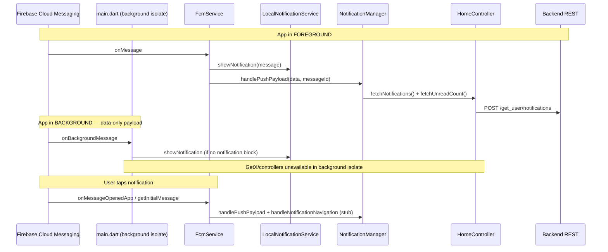

# Push Notification Analysis — CasaZero

**Scope:** Full Flutter client review — FCM (`firebase_messaging`), local notifications (`flutter_local_notifications`), `FcmService`, `NotificationManager`, notifications modal, auth/token flow, and native Android/iOS configuration.

**Date:** 2026-07-01

---

## Executive summary

CasaZero has a **solid baseline** push-notification stack: Firebase is initialized correctly, FCM listeners are wired, Android 13+ permission is requested, a high-importance notification channel exists, and foreground/data-only messages can show tray notifications.

However, **tray delivery** and **in-app notification list** are still separate concerns. The bell/modal only shows what the **REST API** returns (`POST /get_user/notifications`), not the raw FCM payload.

**Xiaomi / Redmi (MIUI):** Push is **not guaranteed** without user-side device settings. The app uses standard FCM (no MIUI-specific code). On many Redmi/Xiaomi phones pushes work **only after** the user enables Autostart, disables battery restrictions, and grants notification permission. Stale FCM tokens on the backend (token sent only at login) make MIUI problems worse.

| Area | Status |
|------|--------|
| FCM init & listeners | ✅ Works |
| Foreground tray notification | ✅ Works (with correct payload) |
| Data-only background tray (Android) | ✅ Mostly works |
| In-app notifications modal | ⚠️ Depends on backend API |
| FCM token sync after login | ✅ Works |
| FCM token sync after refresh / session restore | ❌ Not implemented |
| Deep link on notification tap | ❌ Not implemented |
| Xiaomi/Redmi without manual setup | ⚠️ Unreliable |

---

## Architecture

### Key files

| Responsibility | File |
|----------------|------|
| Firebase init, background handler | `lib/main.dart` |
| FCM permissions, token, listeners | `lib/core/services/fcm_service.dart` |
| Refresh list/unread on push | `lib/core/services/notification_manager.dart` |
| Tray notifications (foreground + data-only background) | `lib/helpers/local_notification_service.dart` |
| Notifications modal UI | `lib/core/widgets/notifications_modal.dart` |
| API: list, unread, mark read | `lib/data/repositories/home_repository.dart` |
| Login sends `fcm_token` | `lib/data/repositories/auth_repository.dart` |
| Service registration | `lib/app/bindings/initial_binding.dart` |
| Android manifest & channel | `android/app/src/main/AndroidManifest.xml` |
| iOS background mode & APNs | `ios/Runner/Info.plist`, `ios/Runner/AppDelegate.swift` |
| Firebase project config | `lib/firebase_options.dart`, `android/app/google-services.json` |

---

## What works well

### 1. Firebase & FCM bootstrap

- `Firebase.initializeApp(options: DefaultFirebaseOptions.currentPlatform)` with timeout and error handling (`lib/main.dart`).
- `firebase_options.dart` exists and matches Android `google-services.json` project `casazero-a39ba`.
- Background handler registered via `FirebaseMessaging.onBackgroundMessage`.
- `LocalNotificationService.initialize()` runs before `runApp`.

### 2. Android configuration

- `POST_NOTIFICATIONS` declared in manifest (Android 13+).
- Runtime permission requested via `permission_handler` + `FirebaseMessaging.requestPermission` in `FcmService`.
- Default FCM channel aligned with app channel:
  - Manifest: `com.google.firebase.messaging.default_notification_channel_id` → `casazero_alerts`
  - Code: `LocalNotificationService.channelId` → `casazero_alerts`
- Notification channel uses `Importance.max`, sound, vibration, lights.
- `google-services` Gradle plugin applied (`android/app/build.gradle.kts`).

### 3. iOS configuration

- `UIBackgroundModes` includes `remote-notification` in `Info.plist`.
- `AppDelegate.swift` configures Firebase, registers for remote notifications, sets APNs token on `Messaging`, and implements `MessagingDelegate`.
- Foreground presentation options set (`alert`, `badge`, `sound`).

### 4. Foreground push handling

- `FirebaseMessaging.onMessage` → `handlePushMessage` → local tray notification + `NotificationManager`.
- `LocalNotificationService.resolveContent()` reads title/body from:
  - FCM `notification` block, or
  - Data keys: `title`, `body`, `message`, `content`, etc., with sensible fallbacks.

### 5. Background data-only messages (Android)

- `_firebaseMessagingBackgroundHandler` posts a local notification when `message.notification == null`.
- Avoids duplicate tray entries when FCM already shows a system notification (notification payload).

### 6. Open-from-notification flows

- `onMessageOpenedApp` and `getInitialMessage` dispatch to `NotificationManager` to refresh notifications/unread when the user opens the app from a push.

### 7. Auth integration

- Login payload includes `fcm_token` from `FcmService.getDeviceToken()` (with one retry).
- Token deleted on logout via `FcmService.deleteToken()`.
- `registerAfterAuth()` called after login, OTP, and splash session restore (refreshes **local** token).

### 8. In-app notification features (when API has data)

- Fetch list: `POST /get_user/notifications`
- Unread badge: `POST /get_user/unread_count`
- Mark read / mark all read wired through `HomeController` and `NotificationsModal`
- Push type constants in `lib/core/constants/push_types.dart` (`document_uploaded`, `sync_notifications`, `private_chat_message`)

---

## What does not work perfectly (gaps & risks)

### 1. Modal list ≠ FCM payload (backend dependency)

**Symptom:** Push appears in tray but bell/modal is empty or missing the new item.

**Cause:** `NotificationsModal` and `HomeController.feedItems` load **only** from `POST /get_user/notifications`. FCM data is never merged into the local list.

**Requirement:** Backend must **persist** each notification and return it via the REST API when FCM is sent. Sending FCM alone is insufficient for the in-app feed.

---

### 2. FCM token sent to backend only at login

**Code:** `FcmService` comment and `onTokenRefresh` listener only update `_currentToken` locally. `registerAfterAuth()` does **not** call the backend. The only server registration path is `fcm_token` on `POST /user/login`.

**Impact:**

- After FCM token rotation (common on Android, especially MIUI reinstalls / clears data / OS updates), backend may target a **stale token** → no delivery until next login.
- Splash session restore refreshes local token but **does not** update the server.

**Severity:** High for long-lived sessions and Xiaomi devices.

---

### 3. Background handler cannot refresh in-app state

The background isolate correctly shows tray notifications for data-only messages but **cannot** call `NotificationManager` / `HomeController` (GetX not available).

**Impact:** Unread badge and modal stay stale until the user opens the app or a foreground/`onMessageOpenedApp` path runs.

---

### 4. No notification tap / deep-link handling

- `LocalNotificationService.initialize()` has **no** `onDidReceiveNotificationResponse`.
- `NotificationManager.handleNotificationNavigation()` only logs; no route navigation.

**Impact:** Tapping a **locally shown** foreground notification may not open the relevant screen. Tapping FCM system notifications may open the app without navigating to document/chat.

---

### 5. Possible duplicate notifications on iOS (foreground)

`FcmService` sets iOS foreground presentation (system banner) **and** calls `LocalNotificationService.showNotification()` for every foreground message.

**Impact:** User may see **two** notifications for the same push while the app is open on iOS.

---

### 6. Private chat push is incomplete

`PrivateChatNotificationService` is registered but `handleIncomingPayload` is **not** hooked into `FcmService`. Chat push type `private_chat_message` has no dedicated FCM routing; navigation is marked “Future”.

---

### 7. `NotificationManager` duplicate `messageId` skip

If the same `messageId` is delivered twice, the second delivery is skipped entirely (no refresh). Rare with normal FCM IDs but can confuse debugging.

---

### 8. `FcmService.init()` is fire-and-forget

`InitialBinding` calls `fcmService.init()` without `await`. A push arriving in the first moments after cold start might miss listeners (low probability).

---

### 9. Firebase init failure is non-fatal

If Firebase fails to initialize, the app continues with **no** FCM. Only console logs indicate the problem. Check logs for `Firebase initialization failed`.

---

### 10. Release signing still uses debug keys

`android/app/build.gradle.kts` release build uses debug signing. Not a push bug directly, but production Play builds need proper signing for reliable distribution.

---

### 11. Package name is still `com.example.casazero`

Ensure Firebase console, backend, and store listing all use the same application ID consistently.

---

## Xiaomi / Redmi (MIUI) — detailed assessment

### Is there Xiaomi-specific code?

**No.** Grep across the repo finds zero references to Xiaomi, Redmi, MIUI, battery optimization, or autostart.

The app relies on **standard Google FCM** + Android notification APIs, which MIUI allows but often restricts by default.

### When push **can** work on Xiaomi/Redmi

| Condition | App support | User / device action |
|-----------|-------------|----------------------|
| Notification permission (Android 13+) | ✅ Requested in code | User must tap Allow |
| FCM token on server | ✅ At login only | User must log in after token changes |
| App not killed by battery saver | ❌ Not handled in app | Disable battery restrictions for CasaZero |
| Autostart (MIUI) | ❌ Not handled in app | Enable Autostart in MIUI Security app |
| Notification channel enabled | ✅ `casazero_alerts` channel | User must not mute channel in MIUI settings |
| Correct FCM payload | Depends on backend | Use `notification` block and/or agreed `data` keys |

### Typical MIUI failure modes (not fixed by current code)

1. **Autostart disabled** — App process killed; FCM may not wake the app; data-only background handler never runs.
2. **Battery optimization** — Delayed or dropped pushes when screen is off.
3. **MIUI notification permissions** — Separate toggles per app/channel; “floating notifications” / “lock screen” may be off.
4. **Stale FCM token on backend** — Very common after MIUI “clear app data” without re-login.
5. **Aggressive task killer** — User swipes app from recents; delivery less reliable until reopened.

### Verdict for Xiaomi/Redmi

| Scenario | Expected behavior |
|----------|-------------------|
| App in **foreground**, permission granted, valid token | ✅ **Should work** — local notification + API refresh |
| App in **background**, notification payload, MIUI allows FCM | ✅ **Usually works** — system tray |
| App in **background**, data-only, MIUI allows background work | ⚠️ **May work** — depends on `onBackgroundMessage` running |
| App **force-stopped** or Autostart off | ❌ **Often fails** — no code mitigation |
| User logged in weeks ago, token rotated | ❌ **Often fails** — token not re-sent to backend |

**Bottom line:** Push on Xiaomi/Redmi is **partially supported** by standard FCM setup but **not production-hardened** for MIUI. Expect support tickets unless you add token re-registration, optional MIUI setup guidance, and backend persistence for the modal.

---

## Backend contract checklist

For reliable end-to-end behavior, the server should:

1. **Persist** notification rows before or when sending FCM.
2. Send FCM with either:
   - A `notification` block (title + body) for system tray on background, **or**
   - `data` keys matching `LocalNotificationService.resolveContent()` (`title`, `body`, `message`, etc.).
3. Include `type` in `data` when using `PushTypes` (`document_uploaded`, `sync_notifications`, `private_chat_message`).
4. Store and update `fcm_token` on every login; ideally expose an endpoint to **update token** without full re-login.
5. Target the correct Firebase project (`casazero-a39ba`) and the device token last seen at login.

---

## Recommended fix priority

| Priority | Item | Why |
|----------|------|-----|
| P0 | API to update `fcm_token` + call on `onTokenRefresh` and session restore | Fixes silent failures on MIUI and long sessions |
| P0 | Confirm backend persists notifications for modal | Fixes “push but empty bell” |
| P1 | MIUI setup screen or in-app guide (Autostart, battery, notifications) | Reduces Xiaomi support burden |
| P1 | `onDidReceiveNotificationResponse` + real navigation | Completes tap-to-open |
| P2 | iOS: skip local notification when system foreground presentation is used | Avoid duplicate banners |
| P2 | Wire `PrivateChatNotificationService` into `FcmService` | Chat push end-to-end |
| P3 | `await fcmService.init()` or readiness flag | Cold-start race |

---

## Debugging checklist

- [ ] Log `Firebase.apps.isEmpty` after startup on a **physical** device (not emulator-only for iOS push).
- [ ] Log `FcmService` token at login; verify backend DB stores the same token.
- [ ] Send test FCM with both `notification` and `data-only` payloads; log foreground and background.
- [ ] After push, call `POST /get_user/notifications` — confirm new row exists.
- [ ] On Redmi/Xiaomi: enable Autostart, disable battery restriction, re-login, retest.
- [ ] Android 13+: confirm notification permission granted in system settings.
- [ ] iOS: physical device, valid APNs key in Firebase, check `AppDelegate` APNs logs.

### Useful log tags

- `[FcmService]`, `[FCM Background]`, `[NotificationManager]`, `[HomeRepository]`, `[FirebaseAudit]`

---

## Conclusion

**Works well:** Core FCM plumbing, Android channel/permissions, iOS APNs setup, foreground notifications with data fallbacks, background tray for data-only Android messages, login-time token registration, and API-driven notification list/mark-read when the backend cooperates.

**Does not work perfectly:** Token sync after refresh or session restore, in-app list without backend persistence, no deep links, incomplete chat push, no MIUI-specific mitigations, and possible iOS duplicate foreground notifications.

**Xiaomi/Redmi:** Standard FCM — **works for some users** with correct device settings and fresh login, but **not reliably out of the box** without Autostart/battery configuration and backend token management. Treat MIUI as a **high-risk platform** until P0 fixes land.
