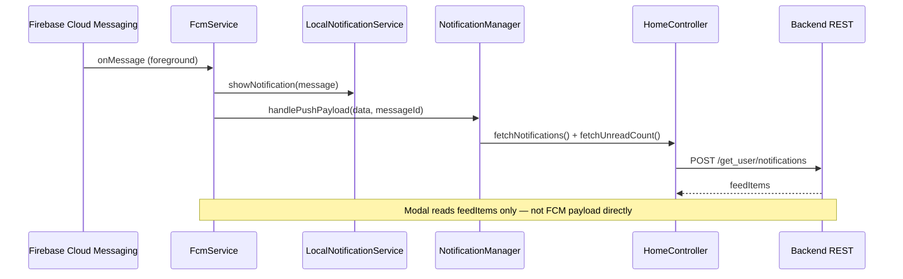

# Push notifications — engineering analysis (CasaZero)

**Scope:** Flutter client (`firebase_messaging`, `flutter_local_notifications`), `FcmService`, `NotificationManager`, notifications modal (`NotificationsModal`), and native configuration (Android / iOS).

**Date:** 2026-04-09

---

## Executive summary

Push delivery and the **in-app notifications modal** are **two different systems** in this codebase:

| Path | What it does |
|------|----------------|
| **FCM** | Receives Firebase messages; in foreground shows a **local** notification via `LocalNotificationService`; calls `NotificationManager.handlePushPayload` → `HomeController.fetchNotifications()`. |
| **Notifications modal** | Renders `HomeController.feedItems`, which come **only** from **`POST /get_user/notifications`** (`HomeRepository.getUserNotifications`). |

If pushes arrive but the modal stays empty, the most common explanations are: **(1)** the backend never wrote the row that the REST API returns, **(2)** the FCM payload is **data-only** so the tray notification has no title/body and looks “broken,” **(3)** **background/terminated** handling does not show a notification for data-only messages, or **(4)** the user/session has **no API token** when refresh runs.

---

## Architecture (actual flow)

---

## Critical findings (why things “don’t work”)

### 1. Notifications modal does not show “the push” — it shows API data

**Symptom:** User receives or expects a push, opens the bell/modal, sees nothing new (or empty list).

**Cause:** `NotificationsModal.show` calls `controller.fetchNotifications()`, which loads **`feedItems` from the backend** (`lib/presentation/home/controllers/home_controller.dart`, `lib/data/repositories/home_repository.dart`). There is **no** code path that appends the FCM payload into `feedItems` locally.

**Implication:** Backend must **create/update the notification record** that `GET_USER_NOTIFICATIONS` returns **before or when** sending FCM. If the server only sends FCM without persisting a notification, the modal will never reflect that event.

**Verification:** After a push, call the notifications API (or log `fetchNotifications` result). If `data` is empty while FCM fired, this is a **backend / contract** issue, not a Flutter UI bug.

---

### 2. Foreground local notification uses only `message.notification` (breaks data-only payloads)

**Code:** `lib/helpers/local_notification_service.dart` passes `message.notification?.title` and `message.notification?.body` into `_plugin.show(...)`.

**FCM behavior:** If the server sends a **data-only** message (no `notification` block in the FCM JSON), then `message.notification` is **`null`** on the client. You still get `onMessage` in foreground, but the local notification may show **empty title/body** or behave poorly depending on OS/version.

**Fix direction:** For data-only pushes, derive title/body from `message.data` (e.g. `title`, `body`, `message`, agreed keys with backend) and fall back to defaults.

---

### 3. Background handler does not display anything (data-only background = silent)

**Code:** `lib/main.dart` — `_firebaseMessagingBackgroundHandler` only initializes Firebase (if needed) and **`print`s**. It does **not** call `LocalNotificationService.showNotification`.

**FCM behavior (Android):**

- Messages with a **`notification` payload** are often shown by the system when the app is in background/terminated.
- **Data-only** messages are delivered to the background isolate; **you** must post a local notification (or do silent work). With the current handler, **nothing appears** in the tray for that case.

This alone explains “push doesn’t show” for many server payloads when the app is not in foreground.

---

### 4. iOS: missing `UIBackgroundModes` / `remote-notification`

**Observation:** `ios/Runner/Info.plist` has **no** `UIBackgroundModes` array with `remote-notification`.

**Impact:** Background delivery of **data** messages and some FCM behaviors are limited or unreliable without the proper capability. Apple’s docs and FlutterFire guidance recommend this for data/background handling.

**Fix direction:** Enable **Push Notifications** + **Background Modes → Remote notifications** in Xcode (or add the plist entries) and ensure APNs is configured for the Firebase iOS app.

---

### 5. Android: no default FCM notification channel meta-data

**Observation:** `android/app/src/main/AndroidManifest.xml` does not set:

`com.google.firebase.messaging.default_notification_channel_id`

**Impact:** System-displayed FCM notifications (notification payload in background) may use a **default channel** with lower importance, or channel behavior may not match your `default_channel` used by `flutter_local_notifications`. This can contribute to “I didn’t see/hear it” reports.

**Fix direction:** Align manifest meta-data with the channel created in `LocalNotificationService` (`default_channel`).

---

### 6. `NotificationManager` drops duplicate `messageId` entirely

**Code:** `lib/core/services/notification_manager.dart` — if `messageId` repeats `_lastProcessedMessageId`, it **returns immediately** and does **not** call `_refreshNotificationsAndUnread()`.

**Impact:** If Firebase or your pipeline ever **reuses** the same `messageId` for a new logical event, the app will **skip** refreshing the list and unread count. Unlikely for normal FCM IDs, but worth knowing for debugging “second push didn’t update UI.”

---

### 7. FCM token not registered with backend until authenticated

**Code:** `FcmService.sendTokenToBackend()` returns early if there is **no** `accessToken` in `StorageService`.

**Impact:** Expected for guest users. If testing pushes **before login**, or if token registration fails silently, the **wrong device** or **no device** may be targeted server-side.

---

### 8. Firebase initialization failures are swallowed; FCM never starts

**Code:** `lib/main.dart` — `Firebase.initializeApp()` is in try/catch; on failure the app continues and `FcmService.init()` exits early when `Firebase.apps.isEmpty`.

**Impact:** Any misconfiguration (`google-services.json`, bundle ID, etc.) results in **no listeners, no token**, with only console logs. Worth checking device logs for `Firebase initialization failed`.

---

### 9. Minor / secondary issues

| Item | Note |
|------|------|
| **No `firebase_options.dart`** | Project uses `Firebase.initializeApp()` without `DefaultFirebaseOptions`. Often OK when native config is correct; FlutterFire CLI file is still the recommended approach for consistency. |
| **`FcmService.init()` fire-and-forget** | `InitialBinding` calls `fcmService.init()` without `await`. Rare race if a message arrives before listeners attach. |
| **Local notification tap** | `LocalNotificationService.initialize(settings)` has no `onDidReceiveNotificationResponse` wiring in the snippet reviewed; tapping a local notification may not deep-link unless handled elsewhere. |
| **Notification `type` in data** | `NotificationManager` reads `data['type']` for logging/switch. Backend should send `type` matching `PushTypes` when you rely on document refresh; **default branch still refreshes notifications**, so wrong `type` does not block list refresh. |

---

## Code references (key touchpoints)

| Responsibility | File |
|----------------|------|
| Firebase init, background handler registration | `lib/main.dart` |
| Permissions, token, `onMessage`, dispatch | `lib/core/services/fcm_service.dart` |
| Refresh list/unread from API on push | `lib/core/services/notification_manager.dart` |
| Show foreground local notification | `lib/helpers/local_notification_service.dart` |
| Modal + `fetchNotifications()` | `lib/core/widgets/notifications_modal.dart` |
| API: notification list | `lib/data/repositories/home_repository.dart` (`getUserNotifications`) |
| Service registration order | `lib/app/bindings/initial_binding.dart` |

---

## Recommended fix order (pragmatic)

1. **Confirm payload shape** from backend (notification vs data-only) and **confirm** notifications are **persisted** before FCM for events that must appear in the modal.
2. **Background handler:** for data-only messages, call the same local notification helper (with title/body from `data`), respecting isolate constraints (no GetX in top-level isolate without proper setup).
3. **`LocalNotificationService.showNotification`:** support **data-only** title/body fallbacks.
4. **iOS:** add **remote-notification** background mode + verify APNs in Firebase.
5. **Android manifest:** set **default_notification_channel_id** to match `default_channel`.
6. **Optional:** generate and use **`firebase_options.dart`** via FlutterFire CLI for clearer init.

---

## Debugging checklist

- [ ] Log `Firebase.apps.isEmpty` after startup on a real device.
- [ ] Log `FcmService` token and verify backend stores it for the logged-in user.
- [ ] Log `onMessage` / background handler with **full** `message.data` and `message.notification`.
- [ ] After push, verify **`POST /get_user/notifications`** returns the new item (e.g. via Postman or app logs).
- [ ] iOS: physical device, correct **GoogleService-Info.plist**, push capability enabled.
- [ ] Android 13+: `POST_NOTIFICATIONS` is present; confirm runtime permission granted (you use `permission_handler` + FCM `requestPermission`).

---

## Conclusion

The client wiring is **partially complete**: foreground `onMessage` shows a **local** notification **only when** `RemoteMessage.notification` is populated, and the modal updates **only when** the **REST API** returns new rows. The strongest code-level gaps for “no tray notification” are **data-only payloads** and an **empty background handler**; the strongest explanation for “modal empty after push” is **backend not exposing that event** via `/get_user/notifications`, or **refresh skipped** (no auth token / duplicate `messageId`). Aligning payload shape, persistence, and native configuration with these flows should resolve most production reports.
