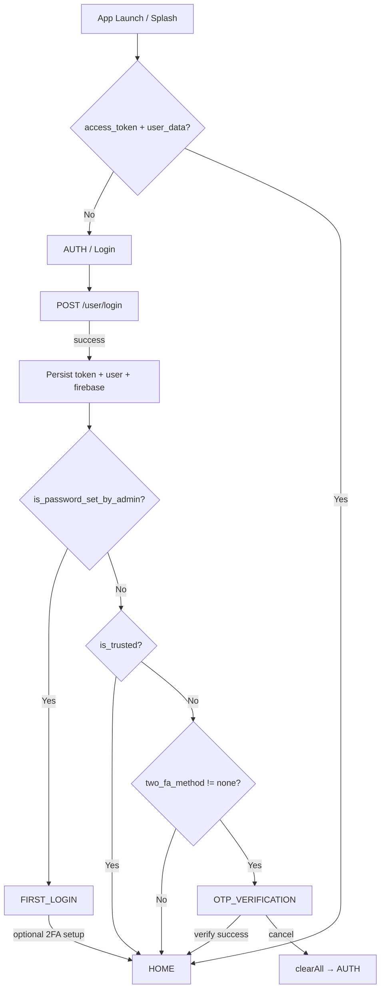
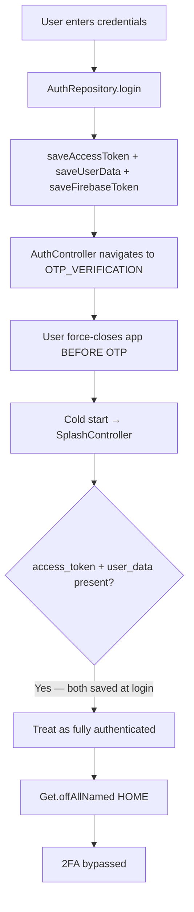
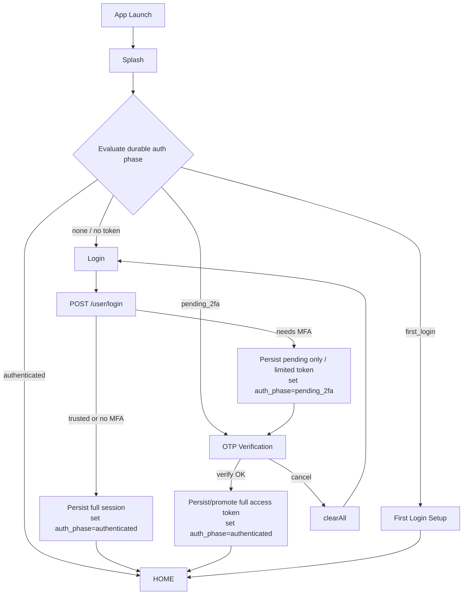

# Two-Factor Authentication (2FA) Security Audit Report

**Project:** CasaZero (Flutter / GetX)  
**Date:** 26 July 2026  
**Scope:** Client-side authentication and 2FA implementation (analysis only — no code changes)  
**Severity of primary finding:** **Critical** — incomplete 2FA can be bypassed after app restart

---

## Table of Contents

1. [Executive Summary](#1-executive-summary)
2. [Current Architecture](#2-current-architecture)
3. [Authentication Workflow Diagram](#3-authentication-workflow-diagram)
4. [Current 2FA Logic](#4-current-2fa-logic)
5. [Identified Security Issues](#5-identified-security-issues)
6. [Root Cause Analysis](#6-root-cause-analysis)
7. [Impact Assessment](#7-impact-assessment)
8. [Recommended Fixes](#8-recommended-fixes)
9. [Code-Level Changes](#9-code-level-changes)
10. [Secure Authentication Flow](#10-secure-authentication-flow)
11. [Final Summary](#11-final-summary)

---

## 1. Executive Summary

The CasaZero app implements 2FA as a **client-side navigation gate**, not as a **session-completion gate**.

On successful password login, the app immediately persists:

- API access token (`access_token`)
- Device token (`device_token`) — same Laravel `token` value
- User profile (`user_data`)
- Firebase custom token (`firebase_token`)

Only after that does it navigate to OTP verification when `is_trusted == false` and `two_fa_method != 'none'`.

On cold start, `SplashController` treats **any non-empty access token + user data** as a fully authenticated session and navigates to **HOME**. There is:

- No `pending_2fa` / `2fa_verified` flag
- No AuthGuard / route middleware
- No re-check of trusted-device or OTP completion state

**Result:** If a user logs in, reaches the OTP screen, force-closes the app, and reopens it, splash restores the session and **skips 2FA entirely**.

---

## 2. Current Architecture

### 2.1 Stack

| Layer | Technology |
|-------|------------|
| UI / state | Flutter + GetX (`GetxController`, `Rx`) |
| Routing | GetX named routes (`app_routes.dart`) — **no AuthGuard / middleware** |
| HTTP | Dio via `ApiService` (Bearer interceptor) |
| Persistence | **GetStorage** (unencrypted) via `StorageService` |
| Secure storage | **Not used** (`flutter_secure_storage` absent) |
| Domain layer | **Not present** |
| Push / chat auth | FCM + Firebase Auth custom token |

### 2.2 Inventory of 2FA-related components

#### Controllers / screens

| File | Role |
|------|------|
| `lib/presentation/auth/controllers/auth_controller.dart` | Login UI; post-login navigation by first-login / trusted / 2FA |
| `lib/presentation/auth/views/auth_screen.dart` | Login UI |
| `lib/presentation/otp_verification/controllers/otp_verification_controller.dart` | Login / forgot-password / document-password OTP |
| `lib/presentation/otp_verification/views/otp_verification_screen.dart` | OTP UI |
| `lib/presentation/first_login/controllers/first_login_controller.dart` | First-login password + optional 2FA setup |
| `lib/presentation/first_login/views/first_login_setup_screen.dart` | First-login UI |
| `lib/presentation/profile/controllers/two_fa_management_controller.dart` | Activate / deactivate 2FA in settings |
| `lib/presentation/profile/views/two_fa_*.dart` | 2FA management / activation / deactivation UI |
| `lib/presentation/profile/controllers/document_password_controller.dart` | Gates document password save behind OTP (correct pending pattern) |
| `lib/presentation/profile/views/document_password_2fa_verification_screen.dart` | Document-password OTP UI |
| `lib/presentation/splash/controllers/splash_controller.dart` | Cold-start auth restoration |
| `lib/presentation/trusted_device/*` | Trusted device list / revoke |

#### Repositories / models / services

| File | Role |
|------|------|
| `lib/data/repositories/auth_repository.dart` | Login, OTP send/verify, 2FA setup/disable, logout, Firebase sync |
| `lib/data/repositories/profile_repository.dart` | Trusted-device APIs |
| `lib/data/models/user_model.dart` | `twoFaMethod`, `is2FAEnabled` |
| `lib/data/models/two_factor_method_model.dart` | Method enums / models |
| `lib/core/services/storage_service.dart` | GetStorage persistence |
| `lib/core/constants/storage_keys.dart` | Key names |
| `lib/core/services/api_service.dart` | Bearer attach + 401 refresh / session expiry |
| `lib/core/services/session_expiry_service.dart` | Forced logout on expired session |
| `lib/core/navigation/auth_navigation.dart` | Safe navigate to AUTH |
| `lib/core/services/device_info_service.dart` | Device payload for login / OTP |
| `lib/core/services/firebase_auth_service.dart` | Firebase custom-token sign-in |
| `lib/core/constants/api_constants.dart` | Login + 2FA endpoint paths |
| `lib/app/routes/app_routes.dart` | Route map + bindings |
| `lib/app/bindings/initial_binding.dart` | Registers auth/storage services |

### 2.3 Storage keys involved in auth

| Key | Purpose | Written at login? | Cleared only after OTP? |
|-----|---------|-------------------|-------------------------|
| `access_token` | Bearer API token | **Yes (before OTP)** | No — only on logout / cancel / session expiry |
| `device_token` | Trusted-device recognition | **Yes (before OTP)** | Cleared on logout |
| `user_data` | Profile incl. `two_fa_method` | **Yes (before OTP)** | No |
| `firebase_token` | Firebase custom token | **Yes (before OTP)** | No |
| `firebase_project_id` | Firebase project | **Yes (before OTP)** | No |
| `is_first_login` | First-login flag | Yes | No |
| `pending_notification_nav` | Notification deep-link | N/A | Preserved across `clearAll` |
| `pending_2fa` / `2fa_verified` | **Does not exist** | — | — |

### 2.4 API endpoints

| Constant | Path | Used for |
|----------|------|----------|
| `LOGIN` | `POST /user/login` | Password login; returns `token`, `user`, `is_trusted`, `firebase_token` |
| `LOGOUT` | `POST /user/logout` | Logout |
| `REFRESH_TOKEN` | `POST /auth/refresh` | Token refresh (rarely used; refresh token often unset) |
| `SEND_EMAIL_OTP` | `POST /2fa/email/otp_send` | Send email OTP |
| `VERIFY_EMAIL_OTP` | `POST /2fa/email/otp_verify` | Verify email OTP |
| `SEND_SMS_OTP` | `POST /2fa/sms/otp_send` | Send SMS OTP |
| `VERIFY_SMS_OTP` | `POST /2fa/sms/otp_verify` | Verify SMS OTP |
| `SETUP_AUTHENTICATOR_2FA` | `GET /setup_2FA/{user_id}` | Authenticator setup |
| `VERIFY_QR_CODE` | `POST /verify_QR` | Authenticator verify (setup **and** login challenge) |
| `UPDATE_2FA_STATUS` | `/update/2fa_status` | Enable/update method |
| `DISABLE_2FA` | `/2fa/disable/{user_id}` | Disable 2FA |
| Trusted devices | `/get_all_trusted_device`, `/revoke_trusted_device` | Device trust management |

**Important:** OTP verify success does **not** persist a new access token. The token from password login remains the session credential.

### 2.5 What is missing

- Auth middleware / route guards on `HOME` and authenticated routes  
- Pending-2FA persistence flag  
- Distinction between “password verified” token and “fully authenticated” token  
- Splash re-evaluation of 2FA / first-login requirements  
- Encrypted token storage  

---

## 3. Authentication Workflow Diagram

### 3.1 Intended (happy-path) flow



### 3.2 Actual bypass flow (force-close during OTP)



### 3.3 Exact execution path for the reported bug

| Step | File | Method | What happens |
|------|------|--------|--------------|
| 1 | `auth_controller.dart` | `login()` | Calls repository |
| 2 | `auth_repository.dart` | `login()` L102–115 | **Persists `device_token`, `user_data`, `access_token` immediately** |
| 3 | `auth_repository.dart` | `_persistAndSignInFirebaseFromLoginBody()` | Persists Firebase token + signs in |
| 4 | `auth_controller.dart` | `_navigateBasedOnUserStatus()` L189–191 | Routes to `OTP_VERIFICATION` if 2FA enabled and not trusted |
| 5 | `otp_verification_controller.dart` | `onInit` / `sendOTP()` | Shows OTP; may auto-send email/SMS OTP |
| 6 | — | Force close | In-memory OTP UI destroyed; **GetStorage tokens remain** |
| 7 | `splash_controller.dart` | `_checkAuthenticationAndNavigate()` L46–54 | Sees token + user → `_navigateToHome()` |
| 8 | `app_routes.dart` | HOME binding | Loads home; may flush notification deep-links |
| 9 | `api_service.dart` | Request interceptor | Attaches Bearer token — APIs work without OTP |

---

## 4. Current 2FA Logic

### 4.1 Login flow

1. `AuthController.login()` validates email/password.  
2. `AuthRepository.login()` builds payload with device info, FCM token, and stored `device_token` (for trust recognition).  
3. On `status == true`:
   - Saves Laravel `token` as both device token and access token  
   - Saves `user` JSON  
   - Persists + signs in Firebase  
4. `AuthController` updates language on user, sets first-login flag, refreshes FCM, **preloads documents**, then navigates.

### 4.2 Post-login navigation (`_navigateBasedOnUserStatus`)

Priority order in `auth_controller.dart`:

1. `isPasswordSetByAdmin` → `FIRST_LOGIN`  
2. `isTrusted` → `HOME` (**skips 2FA**)  
3. `user.is2FAEnabled` (`two_fa_method` not empty / not `'none'`) → `OTP_VERIFICATION`  
4. Else → `HOME`

### 4.3 2FA initiation

On OTP screen init:

- Reads `two_fa_method` from stored `user_data`  
- Masks email/phone for display  
- Auto-calls `sendOTP()` for email/SMS (except forgot-password, which already sent OTP)

### 4.4 OTP / verification flow

`OtpVerificationController.verifyOTP()` → `AuthRepository.verifyOTP(method)`:

| Method | Endpoint |
|--------|----------|
| email | `POST /2fa/email/otp_verify` |
| sms | `POST /2fa/sms/otp_verify` |
| authenticator | `POST /verify_QR` |

On login-path success:

- Refresh FCM  
- Sync Firebase  
- Preload documents  
- `Get.offAllNamed(HOME)`  

Cancel (login path): `clearAll()` → navigate to AUTH.

### 4.5 Token generation / session creation

| Event | Token behavior |
|-------|----------------|
| Password login success | Full session written to GetStorage |
| OTP verify success | **No new token stored**; navigation only |
| Trusted device (`is_trusted`) | Same login token; OTP skipped in UI |
| Logout / cancel OTP | Storage cleared (language + pending notification nav preserved) |
| 401 + refresh fail | `SessionExpiryService` clears session → AUTH |

**Session creation is premature relative to 2FA.** The client treats password success as a durable authenticated session.

### 4.6 Authentication state management

There is no centralized auth state machine. Effective “logged in” means:

```text
access_token != null && access_token.isNotEmpty && user_data != null
```

This check is used by splash. Controllers do not maintain a `2faCompleted` or `AuthPhase` enum.

### 4.7 App restart behaviour

`SplashController` (≈3.5s delay):

- If token + user → ensure Firebase signed in → register FCM → **HOME**  
- Else → AUTH  

No checks for:

- Pending 2FA  
- First-login incomplete  
- `is_trusted` (trust is only evaluated at login response time)  
- Token validity with backend before entering home  

### 4.8 Deep links / navigation

- Notification deep-links use `PENDING_NOTIFICATION_NAV` and are flushed when HOME loads (`app_routes.dart` HOME binding + `NotificationManager`).  
- Because splash can land on HOME with a pre-2FA token, **queued deep-links can also execute in a bypassed session**.  
- There is no auth deep-link that reopens OTP.

### 4.9 Remember-me logic

There is **no remember-me checkbox**.

Equivalents in practice:

1. **Always-on persistence** — GetStorage keeps tokens across kills until logout.  
2. **Trusted device** — backend `is_trusted: true` skips OTP on next login.  
3. Login sends prior `device_token` so the backend can recognize the device.

### 4.10 Other 2FA contexts (not the bypass bug, but related)

| Context | Behaviour |
|---------|-----------|
| First login | Password change + optional 2FA setup, then HOME |
| Settings activate/deactivate | Separate screens; uses OTP for deactivation |
| Document password | **Correct pattern:** password held in memory (`_pendingPassword`) until OTP succeeds; not persisted early |

The document-password flow demonstrates the team already knows a “pending until verified” pattern — login 2FA does not use it for tokens.

---

## 5. Identified Security Issues

### Issue A — Critical: 2FA bypass after force-close / restart

**Description:** Incomplete 2FA is skipped on next launch because tokens were saved at password login and splash auto-navigates to HOME.

**Status:** Confirmed in client code.

### Issue B — High: Premature session persistence

Access, device, user, and Firebase credentials are written **before** OTP. OTP completion does not upgrade the session; it only changes the route.

### Issue C — High: Missing pending-2FA / 2FA-verified state

No storage key or in-memory durable flag tracks “password OK, 2FA outstanding”.

### Issue D — High: No route guard

`HOME` and other authenticated routes are reachable whenever navigation targets them. Splash is the only gate, and it is token-presence-based only.

### Issue E — Medium–High: API usable before 2FA

`ApiService` attaches the login Bearer token immediately. Example: `_preloadDocuments()` in `AuthController` runs **before** navigating to OTP, calling authenticated document APIs with a not-yet-2FA-complete session.

Whether the backend rejects these calls depends on server policy (not visible in this Flutter repo). Client behaviour assumes the token is fully usable.

### Issue F — Medium: Unencrypted token storage

Tokens live in GetStorage (typically SharedPreferences / file on device), not hardware-backed secure storage.

### Issue G — Medium: Development credentials hardcoded in login controller

`AuthController.onInit` pre-fills a real-looking email/password. Risk of shipping secrets and of testers overlooking auth UX.

### Issue H — Low–Medium: Authenticator login reuses setup verify endpoint

Login challenge for authenticator uses `POST /verify_QR` (same as setup). If backend does not distinguish contexts, session/trust side-effects may be inconsistent.

### Issue I — Informational: Trusted-device skip is by design

`is_trusted == true` skipping OTP is intentional product behaviour, not the force-close bypass. Ensure backend trust windows and revoke flows are strict.

---

## 6. Root Cause Analysis

### 6.1 Primary root cause

**Tokens are persisted at password-login success, and cold-start auth restoration equates “token present” with “fully authenticated”, with no pending-2FA gate.**

This is a composition of several defects; removing only one may be insufficient.

### 6.2 Contributing root causes

| # | Cause | Evidence |
|---|-------|----------|
| 1 | Premature token persistence | `auth_repository.dart` L102–115 saves access + user before return |
| 2 | Missing pending-2FA flag | `storage_keys.dart` has no 2FA pending/verified key |
| 3 | Incorrect auth restoration | `splash_controller.dart` L46–54 → HOME whenever token+user exist |
| 4 | 2FA only as navigation | `auth_controller.dart` L189–191; OTP success only navigates |
| 5 | No AuthGuard | `app_routes.dart` HOME has no middleware |
| 6 | OTP verify does not issue/replace session token | `verifyEmailOTP` returns success message only |
| 7 | Cancel clears session; kill does not | `cancelVerification` → `_logout` → `clearAll`; OS kill leaves storage intact |
| 8 | Possible backend weakness | If API accepts pre-OTP Bearer for general resources, server does not enforce 2FA either |

### 6.3 Why the bypass occurs (narrative)

1. Login succeeds → client believes it has a durable session.  
2. UI still asks for OTP, but that requirement lives only in the current navigation stack / controller memory.  
3. Force-close destroys the stack; it does **not** roll back GetStorage.  
4. Splash reconstructs “logged in” from storage and never asks: “Was 2FA finished?”  
5. User lands on HOME with a working Bearer token.

**OTP cancel is secure; app kill is not.** That asymmetry is the bug.

### 6.4 Files primarily responsible

| Responsibility | File |
|----------------|------|
| Write session too early | `lib/data/repositories/auth_repository.dart` |
| Navigate to OTP without marking pending | `lib/presentation/auth/controllers/auth_controller.dart` |
| Restore without 2FA check | `lib/presentation/splash/controllers/splash_controller.dart` |
| No durable 2FA keys | `lib/core/constants/storage_keys.dart` + `storage_service.dart` |
| No route protection | `lib/app/routes/app_routes.dart` |
| Bearer always attached | `lib/core/services/api_service.dart` |

---

## 7. Impact Assessment

| Dimension | Assessment |
|-----------|------------|
| Confidentiality | Attacker with brief physical access (or malware that cannot complete OTP UI but can restart app) may gain full account access after password entry alone |
| Integrity | Same — authenticated write APIs may be callable |
| Availability | N/A |
| Affected users | All users with 2FA enabled on an **untrusted** device who interrupt OTP |
| Exploitability | Trivial — force-close after login, reopen |
| Detection | Low — looks like normal auto-login |
| Compliance | Likely fails MFA requirements (NIST, SOC2, banking-style MFA expectations) |
| Trust feature interaction | Device may become trusted after OTP verify with device info; bypass may also skip trust registration inconsistently |

**Business impact:** 2FA appears enabled in profile/`two_fa_method` but does not actually protect the session across process death.

---

## 8. Recommended Fixes

### 8.1 Design principles

1. **Do not persist a full session until MFA is complete** (or persist only a short-lived “MFA pending” credential).  
2. **Persist an explicit auth phase** that survives process death.  
3. **Splash and route guards must enforce the same rules** as post-login navigation.  
4. **Backend must reject general API calls** until MFA is completed (defense in depth).  
5. Prefer **encrypted storage** for any credential that must live on disk.

### 8.2 Preferred architecture (production)

**Option 1 — Two-token / staged session (recommended)**

| Stage | Client holds | Can call |
|-------|--------------|----------|
| After password | `mfa_pending_token` (or no token; only `user_id` + temp session id) | OTP send/verify only |
| After OTP | `access_token` (+ refresh) | Full API |
| Splash | If only pending → OTP screen; if full → HOME |

**Option 2 — Single token + pending flag (faster client-only mitigation)**

- Still save token at login (if backend requires it for OTP endpoints).  
- Also set `auth_phase = pending_2fa`.  
- Splash: if `pending_2fa` → OTP (never HOME).  
- On OTP success: set `auth_phase = authenticated` (or clear pending).  
- On OTP cancel / logout: clear all.  
- **Must** pair with backend enforcement; otherwise a modified client can clear the flag.

**Option 3 — Do not save access token until OTP success**

- Keep password login response in memory only.  
- Persist only after `verifyOTP` returns success (ideally with final token from verify response).  
- Splash sees no token → AUTH (or resume pending if you store a non-privileged pending blob).

### 8.3 Splash / guard rules (must match login)

```text
if no credentials → AUTH
else if first_login_incomplete → FIRST_LOGIN
else if auth_phase == pending_2fa OR (2FA enabled AND !2fa_verified AND !trusted_for_this_session)
    → OTP_VERIFICATION
else → HOME
```

### 8.4 Backend recommendations (outside this repo, required for real security)

- Issue a **limited-scope** token after password (scopes: `2fa:send`, `2fa:verify` only).  
- Issue **full** token only from OTP verify.  
- Or mark session `mfa_completed=false` server-side and reject other routes with `403 MFA_REQUIRED`.  
- On OTP success, register/refresh trusted device only then.  
- Do not treat presence of password-login token as MFA-complete.

### 8.5 Additional hardening

- Move tokens to `flutter_secure_storage`.  
- Remove hardcoded login credentials from `AuthController`.  
- Stop preloading authenticated resources before MFA completes.  
- Add integration tests: kill app on OTP → relaunch → must not reach HOME.  
- Consider biometric unlock as optional UX after full MFA, not as MFA replacement.

---

## 9. Code-Level Changes

> Recommendations only. **Do not treat this section as already applied** — this audit did not modify the codebase.

### 9.1 Add storage keys

```dart
// lib/core/constants/storage_keys.dart
static const String AUTH_PHASE = 'auth_phase'; // 'none' | 'pending_2fa' | 'authenticated'
static const String TWO_FA_VERIFIED = 'two_fa_verified'; // bool, optional if AUTH_PHASE used
```

### 9.2 StorageService helpers

```dart
Future<void> setAuthPhase(String phase) async {
  await _box.write(StorageKeys.AUTH_PHASE, phase);
}

String getAuthPhase() =>
    _box.read(StorageKeys.AUTH_PHASE)?.toString() ?? 'none';

Future<void> markPending2FA() => setAuthPhase('pending_2fa');
Future<void> markFullyAuthenticated() => setAuthPhase('authenticated');
```

Ensure `clearAll()` removes these (it already `erase()`s the box).

### 9.3 AuthRepository.login — mark pending when 2FA required

After saving user/token (or preferably **before** saving full token — see Option 3):

```dart
final user = UserModel.fromJson(...);
final isTrusted = body['is_trusted'] == true;

if (!isTrusted && user.is2FAEnabled && !user.isPasswordSetByAdmin) {
  await _storageService.markPending2FA();
  // Stronger: do not saveAccessToken here; keep token in memory / separate pending key
} else {
  await _storageService.markFullyAuthenticated();
}
```

Ideal stronger change:

```dart
// Do NOT call saveAccessToken / saveFirebaseToken until MFA complete
// unless backend requires Bearer for OTP endpoints — then save under PENDING_ACCESS_TOKEN
// and teach ApiService to only attach it for allowlisted 2FA paths.
```

### 9.4 AuthController navigation (unchanged destinations, clearer phase)

Keep existing destinations, but ensure phase is set **before** `Get.offAllNamed(OTP_VERIFICATION)`.

Remove or defer `_preloadDocuments()` until after MFA success (move to OTP success / HOME init only).

### 9.5 OtpVerificationController — complete session on success

On login-path OTP success, before HOME:

```dart
await _storageService.markFullyAuthenticated();
// If using staged tokens:
// await _storageService.saveAccessToken(result['access_token']);
```

On cancel / `_logout`, existing `clearAll()` is correct.

### 9.6 SplashController — enforce pending 2FA

Replace token-only check:

```dart
void _checkAuthenticationAndNavigate() async {
  final accessToken = _storageService.getAccessToken();
  final userData = _storageService.getUserData();
  final phase = _storageService.getAuthPhase();

  if (accessToken == null || accessToken.isEmpty || userData == null) {
    _navigateToAuth();
    return;
  }

  final user = UserModel.fromJson(Map<String, dynamic>.from(userData));

  if (user.isPasswordSetByAdmin || _storageService.isFirstLogin()) {
    Get.offAllNamed(AppRoutes.FIRST_LOGIN);
    return;
  }

  if (phase == 'pending_2fa' ||
      (user.is2FAEnabled && phase != 'authenticated')) {
    await _ensureFirebaseSignedIn(); // only if needed for OTP
    Get.offAllNamed(AppRoutes.OTP_VERIFICATION);
    return;
  }

  await _ensureFirebaseSignedIn();
  await _registerFcmTokenAfterSessionRestore();
  _navigateToHome();
}
```

**Migration note:** Existing installs may have tokens without `AUTH_PHASE`. Safer default for users with `is2FAEnabled`:

- If `AUTH_PHASE` missing and `is2FAEnabled` → treat as `pending_2fa` **or** force re-login once.  
- Do **not** default missing phase to `authenticated` for 2FA users (that preserves the bug).

### 9.7 Optional GetX middleware (defense in depth)

```dart
class AuthGuard extends GetMiddleware {
  @override
  RouteSettings? redirect(String? route) {
    final storage = Get.find<StorageService>();
    final phase = storage.getAuthPhase();
    final token = storage.getAccessToken();

    if (token == null || token.isEmpty) {
      return const RouteSettings(name: AppRoutes.AUTH);
    }
    if (phase == 'pending_2fa') {
      return const RouteSettings(name: AppRoutes.OTP_VERIFICATION);
    }
    return null;
  }
}

// Attach to HOME and other authenticated GetPages:
GetPage(name: HOME, page: ..., middlewares: [AuthGuard()]),
```

### 9.8 ApiService allowlist (if pending token must exist)

```dart
bool _isMfaOnlyEndpoint(String path) {
  return path.contains('/2fa/') ||
      path.contains('/verify_QR') ||
      path.contains('/user/logout');
}

// In interceptor:
if (phase == 'pending_2fa' && !_isMfaOnlyEndpoint(options.path)) {
  return handler.reject(...); // or trigger navigation to OTP
}
```

### 9.9 Test plan (must pass before release)

| # | Scenario | Expected |
|---|----------|----------|
| 1 | Login → OTP → force kill → relaunch | OTP (or AUTH), **never HOME** |
| 2 | Login → OTP success → kill → relaunch | HOME |
| 3 | Login trusted device → kill → relaunch | HOME |
| 4 | Login → OTP → cancel | AUTH; no token |
| 5 | Login 2FA user → try open HOME via deep link while pending | Redirect to OTP |
| 6 | Document password 2FA cancel | Password not saved |
| 7 | Session expiry mid-app | AUTH; cleared storage |

---

## 10. Secure Authentication Flow



### Session rules (secure)

| Event | Persist full access token? | `auth_phase` |
|-------|----------------------------|--------------|
| Password OK, MFA required | No (or limited only) | `pending_2fa` |
| Password OK, trusted / no MFA | Yes | `authenticated` |
| OTP OK | Yes (final) | `authenticated` |
| OTP cancel / logout / expiry | Cleared | `none` |
| App kill during OTP | Pending still pending | Still `pending_2fa` → splash → OTP |

---

## 11. Final Summary

### Verdict

The reported behaviour is a **real Critical vulnerability** in the current Flutter client.

2FA is implemented as a **post-login screen**, not as a **requirement for a completed session**. Because:

1. `AuthRepository.login` saves a full session **before** OTP, and  
2. `SplashController` restores HOME from token presence **without** a pending-2FA check,

a user who force-closes on the OTP screen and reopens the app **bypasses verification**.

### Exact bypass path (one line)

`login() persists access_token` → `navigate OTP` → `process death` → `splash sees token` → `HOME`.

### Highest-priority remediations

1. Introduce durable `auth_phase` / pending-2FA state (or do not persist full token until OTP succeeds).  
2. Fix splash (and add AuthGuard) to route pending sessions to OTP, never HOME.  
3. Stop authenticated preloads before MFA.  
4. Enforce MFA completion on the **backend**.  
5. Add kill-app-on-OTP regression tests.  

### Out of scope / not the same bug

- Trusted-device OTP skip (`is_trusted`) is intentional product behaviour.  
- Document-password 2FA already uses an in-memory pending pattern and is a good reference for login MFA.  

---

*End of report. Analysis only — no application code was modified.*
