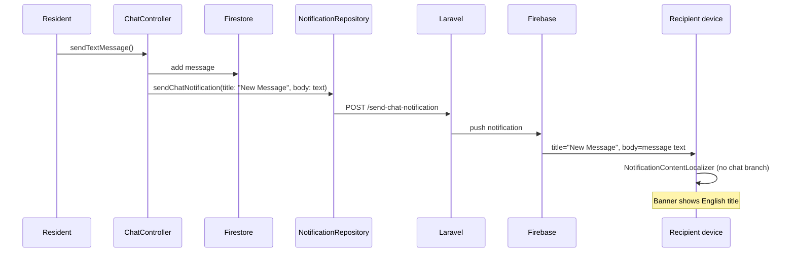

# Push Notification Bilingual Audit — Chat & Hardcoded English Text

**Project:** CasaZero (Flutter / GetX)  
**Date:** 7 August 2026  
**Scope:** Where push notifications are sent, what text is used, and why chat push appears English-only despite bilingual support elsewhere  
**Type:** Analysis only — no code was modified  

---

## Table of Contents

1. [Executive Summary](#1-executive-summary)
2. [Push Notification Architecture](#2-push-notification-architecture)
3. [Where Push Notifications Are Sent](#3-where-push-notifications-are-sent)
4. [Chat Push Flow (End-to-End)](#4-chat-push-flow-end-to-end)
5. [Hardcoded English Text Inventory](#5-hardcoded-english-text-inventory)
6. [Existing Bilingual Infrastructure](#6-existing-bilingual-infrastructure)
7. [Why Chat Push Stays English](#7-why-chat-push-stays-english)
8. [In-App vs System Banner Comparison](#8-in-app-vs-system-banner-comparison)
9. [Recommendations](#9-recommendations)
10. [Suggested Fix Checklist](#10-suggested-fix-checklist)

---

## 1. Executive Summary

Chat push notifications appear in **English only** because the **outgoing title is hardcoded** as `'New Message'` in both chat controllers, and the **display localizer does not rewrite chat titles** for the active app language.

Bilingual support **does exist** in the app (`app_translations.dart`, `FeedItemModel.localizedCenterTitle`, ticket localization in `NotificationContentLocalizer`), but it is **not connected** to the chat push send path or to FCM banner display for chat types.

| Area | Bilingual status |
|------|------------------|
| In-app Notification Center (chat items) | Works — uses `'notification_center_title_chat'.tr` |
| In-app feed fallback keys | Works — `'notification_new_message'.tr` / `_description` |
| Ticket push / feed | Partial — client-side rewrite in `NotificationContentLocalizer` |
| **Chat system push banner (FCM)** | **Broken — English title from client + no chat branch in localizer** |
| Admin → resident chat push | Not sent from Flutter; likely backend-only (not auditable in this repo) |

**Primary root cause (one line):**  
Resident sends message → Flutter POSTs `title: "New Message"` → Laravel/FCM delivers that string → `NotificationContentLocalizer` passes it through unchanged.

---

## 2. Push Notification Architecture

### 2.1 Two delivery paths

```
┌─────────────────────────────────────────────────────────────────┐
│  A) Server-initiated (Laravel backend)                         │
│     Documents, maintenance, tickets, announcements, admin chat   │
│     → FCM → device (notification and/or data payload)            │
└─────────────────────────────────────────────────────────────────┘

┌─────────────────────────────────────────────────────────────────┐
│  B) Client-triggered (Flutter → Laravel → FCM)                 │
│     Resident group chat + resident private chat only             │
│     POST /send-chat-notification                                 │
└─────────────────────────────────────────────────────────────────┘
```

### 2.2 Display path on device

```
FCM message
  → FcmService (foreground) / OS (background notification payload)
  → LocalNotificationService.resolveContent()   [data-only / foreground]
  → NotificationContentLocalizer.localize()     [tickets only today]
  → System banner / heads-up

FCM tap / feed refresh
  → NotificationManager.handlePushPayload()
  → HomeController.fetchNotifications()
  → FeedItemModel.localizedCenterTitle / localizedDisplayTitle  [in-app UI]
```

**Important split:** In-app Notification Center localizes chat well; **system push banners do not**.

---

## 3. Where Push Notifications Are Sent

### 3.1 Client-triggered (Flutter codebase)

| Trigger | File | Method | API | Title sent | Body sent |
|---------|------|--------|-----|------------|-----------|
| Condominium **group chat** message | `lib/presentation/chat/controllers/chat_controller.dart` | `_notifyGroupChatMessage()` | `POST /send-chat-notification` | **`'New Message'`** (hardcoded) | Message text (user language) |
| **Private chat** (resident → admin) | `lib/presentation/chat/controllers/private_chat_controller.dart` | `_notifyPrivateChatMessage()` | Same | **`'New Message'`** (hardcoded) | Message text (user language) |

**Repository forwarding (no localization):**

```14:36:lib/data/repositories/notification_repository.dart
  Future<void> sendChatNotification({
    required int receiverId,
    required int senderId,
    required String title,
    required String body,
    Map<String, dynamic>? data,
  }) async {
    final payload = <String, dynamic>{
      'receiver_id': receiverId,
      'sender_id': senderId,
      'title': title,
      'body': body,
    };
    // ...
    await _apiService.post(ApiConstants.SEND_CHAT_NOTIFICATION, data: payload);
  }
```

**Payload details:**

| Chat type | `receiver_id` | `data.type` | Notes |
|-----------|---------------|-------------|-------|
| Group | `0` | `group_chat` | Includes `group_id` |
| Private | Admin user id | `private_chat` | Includes `chat_id` |

**API contract documents English example:**

```269:278:lib/core/constants/api_constants.dart
  /// POST /send-chat-notification
  /// Request: {
  ///   "receiver_id": int,
  ///   "sender_id": int,
  ///   "title": "New Message",
  ///   "body": "Message text",
  ///   "data": { ... }
  /// }
  static const String SEND_CHAT_NOTIFICATION = '/send-chat-notification';
```

### 3.2 NOT sent from Flutter (backend / other)

| Event | Flutter behaviour | Push source |
|-------|-------------------|-------------|
| Admin sends private chat message | `AdminChatController.sendTextMessage()` writes Firestore only — **no** `sendChatNotification` call | Presumed Laravel webhook / Cloud Function (not in repo) |
| Document uploaded | No client send | Laravel → FCM |
| Maintenance updated | No client send | Laravel → FCM |
| Support ticket updated | No client send | Laravel → FCM |
| Announcements | No client send | Laravel → FCM |

### 3.3 Receive-side handlers (no title generation)

| File | Role |
|------|------|
| `lib/core/services/fcm_service.dart` | Foreground receive; delegates to `LocalNotificationService` |
| `lib/helpers/local_notification_service.dart` | Resolves title/body; shows local banner |
| `lib/core/utils/notification_content_localizer.dart` | Rewrites **ticket** text only |
| `lib/core/services/notification_manager.dart` | Payload routing, feed refresh, deep links |
| `lib/core/services/private_chat_notification_service.dart` | Chat side-effects (unread refresh); **does not set push text** |

---

## 4. Chat Push Flow (End-to-End)

### 4.1 Resident sends group chat message



### 4.2 Resident sends private chat message

Same as above, except:

- `receiver_id` = admin user id  
- `data.type` = `private_chat`  
- Title still **`'New Message'`**

### 4.3 What the recipient sees

| Field | Typical value | Localized? |
|-------|---------------|------------|
| **Title** | `New Message` | **No** — hardcoded at send time |
| **Body** | Actual chat message | N/A — user-authored content |
| In-app Notification Center title | `Chat di condominio: Nuovo messaggio` (if IT locale) | **Yes** — via `.tr` |
| In-app subtitle | Message preview | User content |

---

## 5. Hardcoded English Text Inventory

### 5.1 Critical — directly causes English chat push title

| String | File | Line(s) | Context |
|--------|------|---------|---------|
| `'New Message'` | `lib/presentation/chat/controllers/chat_controller.dart` | ~509 | Group chat push title |
| `'New Message'` | `lib/presentation/chat/controllers/private_chat_controller.dart` | ~294 | Private chat push title |
| `"title": "New Message"` | `lib/core/constants/api_constants.dart` | ~274 | API doc comment (mirrors implementation) |

**These should use existing translation keys** (see §6), e.g. `'notification_new_message'.tr` or `'notification_center_title_chat'.tr`.

### 5.2 Display path — English fallbacks (generic pushes)

| String | File | Line(s) | Context |
|--------|------|---------|---------|
| `'You have a new notification'` | `lib/helpers/local_notification_service.dart` | ~162 | Fallback body when FCM has no title/body (EN) |
| `'Hai una nuova notifica'` | `lib/helpers/local_notification_service.dart` | ~161 | Same fallback (IT) — inline, not `.tr` |
| `'CasaZero'` | `lib/helpers/local_notification_service.dart` | ~159, ~168, ~338 | Default title / Android summary |
| `'CasaZero'` | `lib/core/utils/notification_content_localizer.dart` | ~147 | Empty-title fallback |

Note: Generic fallback is bilingual via inline ternary, but duplicates logic instead of using `app_translations.dart`.

### 5.3 Ticket localization — hardcoded EN/IT pairs (works, but not via `.tr`)

| String | File | Method |
|--------|------|--------|
| `'Ticket updated'` / `'Ticket aggiornato'` | `notification_content_localizer.dart` | `localizedTicketTitle()` |
| `'Your support ticket status has been updated to "$label".'` | same | `localizedTicketBody()` |
| `'Pending'` / `'In Attesa'`, etc. | same | `localizeTicketStatus()` |

Tickets are intentionally localized in the localizer; chat is not.

### 5.4 Secondary English defaults (not push title, but notification-adjacent)

| String | File | Line | Context |
|--------|------|------|---------|
| `'Administrator'` | `lib/core/services/private_chat_notification_service.dart` | ~33 | Default `sender_name` in incoming payload handler |
| `'You'` | `lib/presentation/chat/controllers/chat_controller.dart` | ~487 | Fallback sender name |
| `'Push and in-app alerts (heads-up enabled)'` | `lib/helpers/local_notification_service.dart` | ~322 | Android channel description (system UI, English) |

### 5.5 Translation keys that exist but are unused for push send

From `lib/core/localization/app_translations.dart`:

| Key | English | Italian |
|-----|---------|---------|
| `notification_new_message` | New Message | Nuovo messaggio |
| `notification_new_message_description` | You have received a new message. | Hai ricevuto un nuovo messaggio. |
| `notification_center_title_chat` | Condominium chat: New message | Chat di condominio: Nuovo messaggio |

---

## 6. Existing Bilingual Infrastructure

### 6.1 In-app Notification Center (works for chat)

```405:407:lib/data/models/feed_item_model.dart
  String get localizedCenterTitle {
    if (_isMessageType) return 'notification_center_title_chat'.tr;
```

Chat items in the modal use localized prefixed titles. Subtitle uses message content via `localizedCenterSubtitle`.

Generic API titles like `"New Message"` are detected and replaced:

```279:288:lib/data/models/feed_item_model.dart
    const titleHints = [
      'new message',
      'nuovo messaggio',
      'chat di condominio',
      'condominium chat',
      'messaggio chat',
    ];
```

Fallback keys when API title is generic:

```594:614:lib/data/models/feed_item_model.dart
  String get notificationTitleKey {
    // ...
      case 'chat':
      case 'message':
      case 'messages':
        return 'notification_new_message';
```

### 6.2 Bilingual API fields (partial support)

`FeedItemModel` supports `title_en`, `title_it`, `content_en`, `content_it` and picks by locale in `displayTitle` / `displayContent`.

`LocalNotificationService.resolveContent()` reads `title_en` / `title_it` from **data** payloads, but:

1. If FCM includes a **notification block**, OS/title fields are used **as-is** (usually English from backend).
2. Data-only resolution tries keys in fixed order: `title` → … → `title_en` → `title_it` — **not locale-aware**; first non-empty wins.
3. Chat pushes from client always send a single English `title` field.

### 6.3 NotificationContentLocalizer — chat gap

```127:150:lib/core/utils/notification_content_localizer.dart
  static ({String title, String body}) localize({ ... }) {
    // ...
    if (ticket) {
      return (title: localizedTicketTitle(), body: localizedTicketBody(...));
    }

    return (
      title: cleanTitle.isNotEmpty ? cleanTitle : 'CasaZero',
      body: cleanBody,
    );
  }
```

**There is no branch for:**

- `PushTypes.isChat(type)`
- Titles matching `'new message'` / `'nuovo messaggio'`
- `looksLikeMaintenance()` (defined but unused in `localize()`)

So even if FCM delivers `"New Message"`, the banner localizer will **not** rewrite it for Italian users.

---

## 7. Why Chat Push Stays English

### Cause chain

| # | Layer | Problem |
|---|-------|---------|
| 1 | **Send** | `ChatController` and `PrivateChatController` pass literal `'New Message'` instead of `'notification_new_message'.tr` or locale-specific title |
| 2 | **Backend** | Laravel likely forwards client `title` into FCM `notification.title` unchanged (backend source not in repo) |
| 3 | **FCM payload shape** | If notification block is present, Flutter cannot override title on iOS background display |
| 4 | **Display** | `NotificationContentLocalizer` has ticket logic only — chat title passes through |
| 5 | **Data payload order** | `resolveContent()` prefers generic `title` over `title_it` when both exist |
| 6 | **Asymmetry** | In-app feed re-localizes generic chat titles; system banner path does not |

### Why in-app looks correct but push does not

```
Same notification record from API
  → Notification Center: FeedItemModel.localizedCenterTitle  ✅ IT/EN
  → Lock-screen banner: FCM notification.title = "New Message"  ❌ English
```

Users notice the bug on **push banners**, not necessarily inside the app.

### Admin → resident direction

`AdminChatController` does **not** call `sendChatNotification`. If residents receive English push when admin replies, that text is generated **entirely on the backend** — requires Laravel audit (outside this repo).

---

## 8. In-App vs System Banner Comparison

| Notification type | In-app (Notification Center) | System push banner |
|-------------------|------------------------------|--------------------|
| Chat | `'notification_center_title_chat'.tr` | Raw FCM title — **English** |
| Chat (generic API title) | Falls back to `'notification_new_message'.tr` | No fallback rewrite |
| Ticket | `NotificationContentLocalizer.localizedTicketTitle()` | Same localizer in `LocalNotificationService` ✅ |
| Document / maintenance | API text or bilingual fields | Depends on backend; localizer does not rewrite maintenance |
| Empty payload | N/A | Inline EN/IT generic string (not `.tr`) |

---

## 9. Recommendations

### 9.1 Quick client fix (highest impact, lowest risk)

**Replace hardcoded title in both chat controllers:**

```dart
// Instead of:
title: 'New Message',

// Use active locale at send time:
title: 'notification_new_message'.tr,
// Or for group chat, richer prefix:
title: 'notification_center_title_chat'.tr,
```

Optionally include sender name in body or data for context (body already carries message text).

**Extend `NotificationContentLocalizer.localize()`** with a chat branch:

- If `PushTypes.isChat(type)` OR title matches known English/Italian generic chat patterns → return localized title from GetX keys (works in background via `GetStorage` language, same as tickets).

This fixes **display** even for older FCM payloads still carrying `"New Message"`.

### 9.2 Backend fix (defense in depth)

Laravel `/send-chat-notification` handler should:

1. Resolve recipient language (`language` / `locale` on user model).
2. Set FCM title from server-side strings, not blindly trust client `title`.
3. Prefer **data-only** FCM for chat (let client render localized banner) OR send both `title_en` / `title_it` and let client pick.

Example data payload:

```json
{
  "type": "group_chat",
  "title_en": "Condominium chat: New message",
  "title_it": "Chat di condominio: Nuovo messaggio",
  "body": "Preview text…",
  "group_id": "…"
}
```

### 9.3 Improve `LocalNotificationService.resolveContent()`

- Pick `title_en` vs `title_it` based on `NotificationContentLocalizer.isItalian`, not first-match key order.
- When notification block exists, still run title through `NotificationContentLocalizer` for chat/ticket types (foreground path already does; document for background limitations on iOS).

### 9.4 Admin chat push

Audit backend path for admin Firestore messages → FCM. Mirror bilingual rules there.

### 9.5 Consistency cleanup

- Move `'You have a new notification'` / `'Hai una nuova notifica'` into `app_translations.dart`.
- Use `'notification_new_message_description'.tr` for generic chat body when body is empty.
- Replace `'Administrator'` default with a translated key.

---

## 10. Suggested Fix Checklist

| # | Task | Owner | Priority |
|---|------|-------|----------|
| 1 | Change `title: 'New Message'` → `'notification_new_message'.tr` in `chat_controller.dart` | Flutter | **P0** |
| 2 | Same change in `private_chat_controller.dart` | Flutter | **P0** |
| 3 | Add chat branch to `NotificationContentLocalizer.localize()` | Flutter | **P0** |
| 4 | Locale-aware `title_en` / `title_it` selection in `resolveContent()` | Flutter | P1 |
| 5 | Laravel: localize title by recipient language; stop trusting client title | Backend | P1 |
| 6 | Laravel: audit admin-reply chat push text | Backend | P1 |
| 7 | Regression test: IT locale user sends chat → recipient with IT locale sees Italian banner | QA | P1 |
| 8 | Regression test: EN locale recipient sees English banner | QA | P1 |

### Test scenarios

| # | Steps | Expected (IT recipient) |
|---|-------|-------------------------|
| 1 | Set app to Italian → send group chat message → check push banner | Title: **Nuovo messaggio** or **Chat di condominio: Nuovo messaggio** |
| 2 | Kill app → receive chat push → tap | Deep link works; Notification Center title in Italian |
| 3 | Receive push with legacy English title in payload | Localizer rewrites title to Italian |
| 4 | Ticket push | Still localized (no regression) |

---

## Appendix A — File reference map

| Concern | Primary files |
|---------|---------------|
| Send chat push | `chat_controller.dart`, `private_chat_controller.dart`, `notification_repository.dart` |
| API endpoint | `api_constants.dart` → `SEND_CHAT_NOTIFICATION` |
| FCM display | `fcm_service.dart`, `local_notification_service.dart`, `notification_content_localizer.dart` |
| In-app bilingual | `feed_item_model.dart`, `notifications_modal.dart`, `app_translations.dart` |
| Push types | `push_types.dart` |
| Incoming chat handling | `notification_manager.dart`, `private_chat_notification_service.dart` |
| Translations | `app_translations.dart` keys `notification_new_message*`, `notification_center_title_chat` |

---

## Appendix B — Verdict

Chat push bilingual functionality **is partially implemented** in the app (translation keys + in-app Notification Center), but **not wired** to:

1. The **outgoing** `/send-chat-notification` request (hardcoded `'New Message'`), and  
2. The **incoming** FCM banner path (`NotificationContentLocalizer` skips chat).

Fixing those two gaps on the Flutter client will resolve most user-visible English chat pushes. Backend localization remains recommended for admin-initiated chat and for clients that cannot be updated.

---

*End of report. Analysis only — no application code was modified.*
